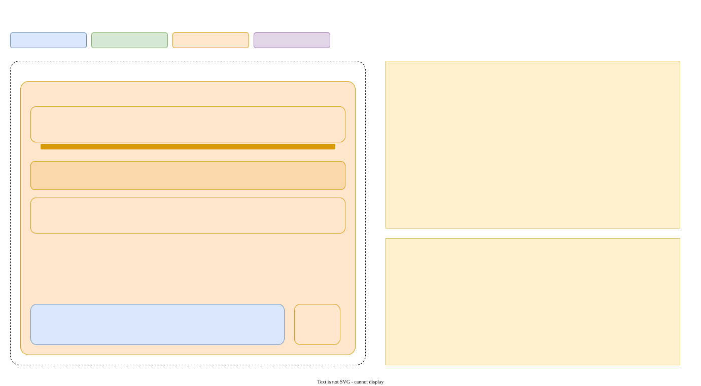

# expo-morph-menu

An expandable floating menu for **expo-router**, animated with **Reanimated 4**.

Tap the button and it morphs into a card menu. Pick a row and the card grows into a full-screen route. Close the route and it shrinks back into the card, and the menu stays open. The full screen is a real route, so you can push child screens inside it.


- **Real routes.** The full screen is an expo-router route: deep links, Android hardware back, and a native-stack inside it all work.
- **Seamless.** The sheet grows from the card's exact rect and lands back on it; the hand-off happens on the UI thread in a single frame, so there's no blank frame, ghosting or flicker (measured frame-by-frame, see `MorphTrace`).
- **Platform-aware.** iOS: swipe from the left edge or drag down to close. Android: close button or hardware back. Shadows, corners and gestures are configurable per platform.
- **Fast first paint.** `onHover` fires while the finger slides over a row (or the mouse hovers it on web) — 150–400 ms before release — the ideal moment to prefetch the screen's data.
- **Bring your own UI.** Every visible part is a slot (`Background`, `Item`, `Trigger`, `Separator`, `Scrim`, …): render it with Tamagui, NativeWind, Paper, gluestack or plain views. The package keeps the animation, geometry and gestures.
- **iOS, Android and web.**

## Documentation

| | English | Tiếng Việt |
| --- | --- | --- |
| Integration guide | [docs/en/INTEGRATION.md](docs/en/INTEGRATION.md) | [docs/vi/INTEGRATION.md](docs/vi/INTEGRATION.md) |
| Custom UI (slots) | [docs/en/CUSTOM-UI.md](docs/en/CUSTOM-UI.md) | [docs/vi/CUSTOM-UI.md](docs/vi/CUSTOM-UI.md) |
| Architecture | [docs/en/ARCHITECTURE.md](docs/en/ARCHITECTURE.md) | [docs/vi/ARCHITECTURE.md](docs/vi/ARCHITECTURE.md) |
| Diagrams (draw.io) | [expo-morph-menu.en.drawio](docs/diagrams/expo-morph-menu.en.drawio) | [expo-morph-menu.vi.drawio](docs/diagrams/expo-morph-menu.vi.drawio) |

## Install

```bash
npx expo install expo-morph-menu \
  expo-router react-native-reanimated react-native-worklets \
  react-native-gesture-handler react-native-safe-area-context react-native-screens
```

Optional (picked up automatically when installed):

| Package | Enables |
|---|---|
| `expo-haptics` | haptic ticks while sliding over rows and on select |
| `expo-glass-effect` | real Liquid Glass card on iOS 26+ |
| `expo-blur` | blurred card on iOS |

Requires Expo SDK 58+ (expo-router 58, Reanimated 4, Gesture Handler 3). Make sure your `babel.config.js` uses `babel-preset-expo` (it enables the worklets plugin).

## Usage

**1. Root layout** — wrap the app, declare the sheet group, and place `<MorphMenu />` *after* the root navigator:

```tsx
// app/_layout.tsx
import { Stack } from 'expo-router';
import { Ionicons } from '@expo/vector-icons';
import { MorphMenu, MorphProvider, morphSheetScreenOptions, type MorphItem } from 'expo-morph-menu';
import { GestureHandlerRootView } from 'react-native-gesture-handler';
import { SafeAreaProvider } from 'react-native-safe-area-context';

const items: MorphItem[] = [
  {
    key: 'camera',
    label: 'Camera',
    tint: '#3a3a3c',
    icon: <Ionicons name="camera" size={15} color="#fff" />,
    href: { pathname: '/(sheet)/[key]', params: { key: 'camera' } },
  },
  // …
];

export default function RootLayout() {
  return (
    <SafeAreaProvider>
      <GestureHandlerRootView style={{ flex: 1 }}>
        <MorphProvider items={items} onHover={(item) => prefetch(item.key)}>
          <Stack screenOptions={{ headerShown: false }}>
            <Stack.Screen name="index" />
            <Stack.Screen name="(sheet)" options={morphSheetScreenOptions} />
          </Stack>
          <MorphMenu />
        </MorphProvider>
      </GestureHandlerRootView>
    </SafeAreaProvider>
  );
}
```

**2. Sheet group layout** — every route in this group grows out of the menu card:

```tsx
// app/(sheet)/_layout.tsx
import { Stack } from 'expo-router';
import { MorphSheetLayout } from 'expo-morph-menu';

export default function SheetLayout() {
  return (
    <MorphSheetLayout>
      <Stack.Screen name="[key]" options={{ headerShown: false }} />
    </MorphSheetLayout>
  );
}
```

**3. Screens** — close with `<MorphCloseButton />` (or any `router.back()`); defer heavy content until the sheet has settled:

```tsx
// app/(sheet)/[key].tsx
import { MorphCloseButton, useMorphSettled } from 'expo-morph-menu';

export default function Screen() {
  const settled = useMorphSettled();
  return (
    <View style={{ flex: 1 }}>
      <MorphCloseButton />
      {settled ? <HeavyContent /> : <Placeholder />}
    </View>
  );
}
```

Every way out — your close button, Android back, `router.back()`, edge swipe, drag down — runs the reverse morph.

## Configuration

Everything is optional; pass only what you want to change.

```tsx
<MorphProvider
  items={items}
  config={{
    closeMenuOnDismiss: false,         // keep the menu open after closing the full screen
    anchor: 'bottom-right',            // or 'bottom-left'
    layout: { fabSize: 56, cardWidth: 236, rowHeight: 46, padding: 10, margin: 20, iconSize: 15 },
    radius: Platform.select({ ios: { card: 28 }, android: { card: 16 } }),
    shadow: { elevation: 8 },          // Android: elevation · iOS: color/opacity/radius/offsetY
    dismiss: { edgeSwipe: true, dragDown: false },
    spring: { duration: 460, dampingRatio: 0.85 },
    haptics: true,
    surface: 'auto',                   // 'glass' | 'blur' | 'solid'
    colorScheme: 'auto',               // 'light' | 'dark'
    backdropOpacity: 0.25,
    colors: { dark: { surface: '#202022' } },
  }}
/>
```

| Option | Default (iOS / Android) | |
|---|---|---|
| `closeMenuOnDismiss` | `false` | `true` collapses the card back into the button after the full screen closes |
| `anchor` | `'bottom-right'` | |
| `layout.*` | `56 / 236 / 46 / 10 / 20 / 15 / 1` | FAB size, card width, row height, list padding, screen margin (plus bottom safe area), row icon size, separator height |
| `radius.card` / `radius.sheet` / `radius.fab` | `28` / `0` / round | card corners; sheet corners once full screen; button corners (`null` = circle) |
| `shadow` | opacity `0.18`, radius `18`, offsetY `8` / elevation `10` | resting shadow (off while moving) |
| `dismiss.edgeSwipe` | `true` / `false` | swipe from the left edge; only on the sheet's root screen, so child screens keep the native back swipe |
| `dismiss.dragDown` | `true` / `false` | |
| `spring` | `460 ms`, `0.85` | ≈ SwiftUI `.snappy`; respects Reduce Motion |
| `haptics` | `true` | needs `expo-haptics` |
| `surface` | `'auto'` | Liquid Glass (iOS 26+) → blur (iOS) → solid |
| `colorScheme` | `'auto'` | follows the system |
| `colors.light` / `colors.dark` | see `LIGHT_COLORS` / `DARK_COLORS` | `surface`, `sheetBackground`, `text`, `scrim`, `backdrop`, `highlight`, `fabIcon`, `closeBackground`, `closeIcon`, `iconForeground` |

### Icons

Row icons (`item.icon`), the floating button (`fabIcon`) and the close button (`closeIcon` / `<MorphCloseButton icon>`) all accept a `MorphIcon`:

```tsx
import { Ionicons } from '@expo/vector-icons';
import CameraSvg from './camera.svg';                       // react-native-svg(-transformer)

icon: <Ionicons name="camera" size={15} color="#fff" />,   // element (icon font, SVG…)
icon: <CameraSvg width={15} height={15} />,                 // SVG component
icon: require('./camera.png'),                              // bundled image
icon: { uri: 'https://example.com/camera.png' },            // remote image
icon: ({ size, color }) => <Ionicons name="camera" size={size} color={color} />,
```

The function form receives the size and theme color for that spot (row icon: `layout.iconSize` / `colors.iconForeground`; button: `26` / `colors.fabIcon`; close: `size × 0.56` / `colors.closeIcon`), so icons follow light/dark mode. Single-color PNGs are tinted with that color; pass `iconTint: false` on an item (or `tintImage={false}` on the close button) for multi-color images.

```tsx
<MorphProvider
  items={items}
  fabIcon={({ size, color }) => <Ionicons name="add" size={size} color={color} />}
  closeIcon={require('./close.png')}                        // default for every MorphCloseButton
/>

<MorphCloseButton />                                          // uses closeIcon, or a built-in ×
<MorphCloseButton icon={<CloseSvg />} size={40} backgroundColor="transparent" />
```

`MorphCloseButton` props: `icon`, `size` (32), `iconSize`, `color`, `backgroundColor`, `tintImage`, `style`, plus any `Pressable` prop. It calls `router.back()` unless your `onPress` calls `e.preventDefault()`.

### Your UI kit: slots



The package owns the views that **move** (size, position, corners, clipping) and all the hand-off / gesture logic. Everything you **see** can be replaced through `components`:

```tsx
import { MorphProvider, renderIcon, type MorphComponents } from 'expo-morph-menu';

const components: MorphComponents = {
  Background: ({ variant }) => <Card elevation={0} style={StyleSheet.absoluteFill} />,
  Item: ({ item, index, hovered, colors }) => <ListItem title={item.label} subtitle={item.data?.subtitle} />,
  Trigger: ({ progress, size }) => <Icon name="plus" />,          // the button's face
  Separator: () => <Divider />,
  Scrim: () => <BlurView intensity={20} style={StyleSheet.absoluteFill} />,
  Backdrop: () => <View style={{ flex: 1, backgroundColor: '#000' }} />,
  Highlight: null,                                                  // your Item draws its own hover state
};

<MorphProvider
  items={items}
  components={components}
  itemHeight={(item) => (item.data?.subtitle ? 58 : 46)}           // rows of different heights
/>
```

| Slot | Props | Default |
|---|---|---|
| `Background` | `variant` ('menu' | 'sheet'), `progress`, `colors` | Liquid Glass / blur / solid `colors.surface` |
| `Item` | `item`, `index`, `variant`, `hovered` (SharedValue of the hovered index), `height`, `colors` | icon in a `tint` circle + label (`DefaultItem`) |
| `Trigger` | `progress`, `size`, `colors` | `fabIcon` or "+", fades and turns 45° as it opens |
| `Highlight` | `hovered`, `colors` — `null` disables it | rounded `colors.highlight` |
| `Separator` | `index`, `colors` (height: `layout.separatorHeight`) | none |
| `Scrim` / `Backdrop` | `progress`, `colors` (opacity is animated for you) | `colors.scrim` / `colors.backdrop` |

**The slot contract** — what keeps the morph seamless:

1. **Pure.** `Item` and `Background` are rendered *twice* — in the card and on the full-screen shell while it morphs. Same props must give the same pixels, or the two copies show up as a ghost at hand-off. Avoid internal state and enter/press animations of your own in them.
2. **Don't animate size or position** inside a slot; read `progress` / `hovered` (Reanimated shared values) to animate opacity, color, rotation…
3. **Known row heights:** `layout.rowHeight` or a pure `itemHeight(item, index)`. Rows are never measured — measuring is async and the first frame would be wrong.
4. **Opaque `Background`.** The shell and the card swap in a single frame when they line up; a see-through background would reveal the swap.

With NativeWind, Tamagui, Unistyles etc. just use their components or `className` inside the slots. For anything beyond slots, `useMorphProgress()` gives you the `menu` and `sheet` progress values to drive your own animations, and `renderIcon()` draws any `MorphIcon`.

### Callbacks

| Prop | When |
|---|---|
| `onHover(item)` | the finger slides onto a row (prefetch here) |
| `onSelect(item)` | a row is chosen, right before navigating |
| `onOpen()` / `onClose()` | the menu starts opening / closing |
| `onSheetDismissed(item)` | the full screen has finished closing |

## API

| Export | |
|---|---|
| `MorphProvider` | context; props: `items`, `config`, `components`, `itemHeight`, `fabIcon`, `closeIcon`, callbacks |
| `MorphMenu` | the floating button + card overlay; render after the root navigator |
| `MorphSheetLayout` | layout for the route group that morphs; children are `<Stack.Screen>`s, optional `screenOptions` |
| `morphSheetScreenOptions` | options for that group's `<Stack.Screen>` in the root navigator |
| `MorphCloseButton` | close button for sheet screens; customizable icon (see Icons) |
| `renderIcon(icon, { size, color })` | draws any `MorphIcon` — handy inside an `Item` slot |
| `DefaultItem` | the built-in row, to wrap or extend in your own `Item` |
| `useMorphProgress()` | `{ menu, sheet }` shared values (0 → 1), read-only |
| `useMorphSettled()` | `true` once the full screen has finished growing |
| `useMorph()` | low-level access to the shared values and resolved config |
| `MorphTrace` | debugging: logs every frame as `[morph] …` and flags `FLICKER` / `HOLE` / `GHOST` / `DROP` |
| `DEFAULT_CONFIG`, `LIGHT_COLORS`, `DARK_COLORS` | defaults |

Test IDs for E2E tools: `morph-fab`, `morph-scrim`, `morph-item-<key>`, `morph-close`.

## Web

Works with Expo web (React Native Web) using the same code:

- The menu and sheet morph exactly as on native; the inner stack and URLs are real (`/camera`).
- **Mouse hover** highlights rows and fires `onHover` (prefetch).
- **Esc** closes the full screen (on its root screen), then the menu.
- The **browser back button** runs the reverse morph too (it goes through `usePreventRemove`).
- **Press-and-drag** from the button to a row works with the mouse (the button captures the pointer while pressed); text isn't selected while dragging.
- Reloading or closing the tab while a full screen is open does **not** show a "Leave site?" prompt (React Navigation's `usePreventRemove` would add one; the package turns it off).
- No haptics, Liquid Glass or hardware back; blur uses CSS `backdrop-filter` via `expo-blur`.

## How it works

The menu card is an overlay (not a route). Selecting a row records the card's rect and pushes the item's route; the route's layout is a fixed-size `Stack` inside an animated shell that grows from that rect to full screen, so the inner navigator never re-lays out.


**Opening** — the shell's first frame is exactly the card, drawing the same rows, so the overlay can hide without a visible change; then the shell grows.


**Closing** — every way out goes through `usePreventRemove`; the shell shrinks back and, on the exact frame it matches the card, the two swap.


More — state machines, the shell's layers and timeline: [architecture](docs/en/ARCHITECTURE.md). Diagrams are generated from [`docs/diagrams/build.mjs`](docs/diagrams/build.mjs) (draw.io sources: [`expo-morph-menu.en.drawio`](docs/diagrams/expo-morph-menu.en.drawio)).

## Development

```bash
npm install
npm run example        # demo app (example/) in Expo Go
npm run typecheck
npm run build          # lib/
```

E2E with Maestro + frame trace: see [`example/README.md`](example/README.md).

## Status

Tested on Android (Pixel API 37 emulator, Android 17; MEmu, Android 9) via Maestro E2E with frame-level flicker checks, and on web (Chrome, desktop). **iOS is not yet verified on a device** (edge swipe, Liquid Glass, blur) — reports welcome.

## License

MIT
