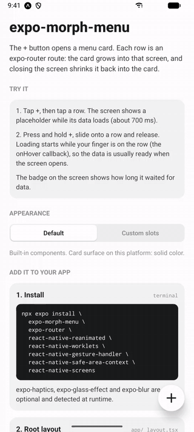
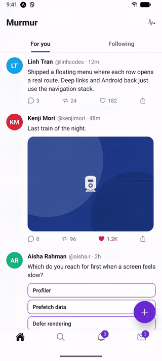
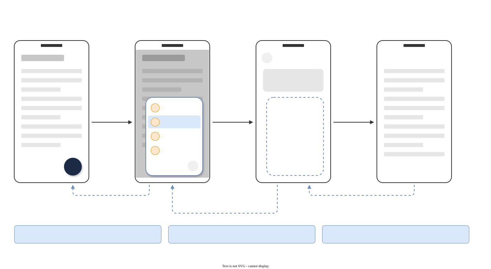
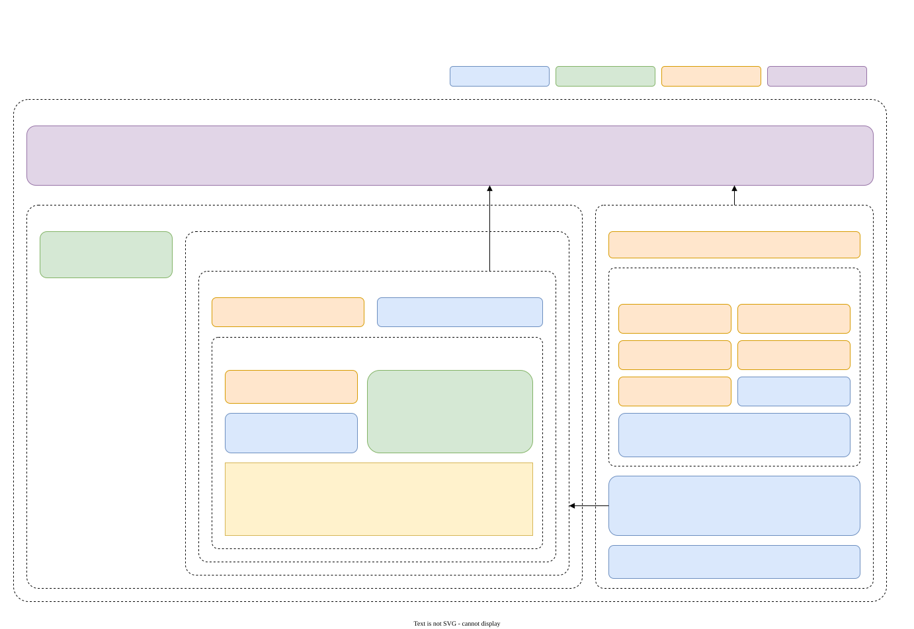
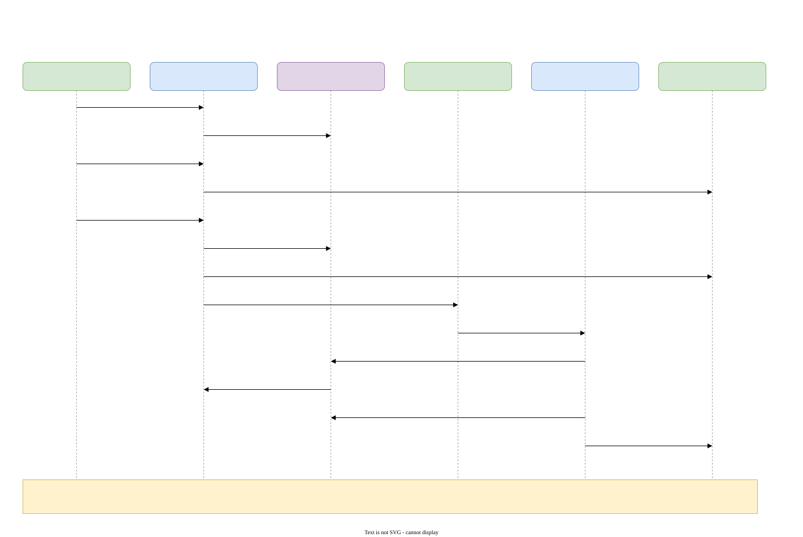
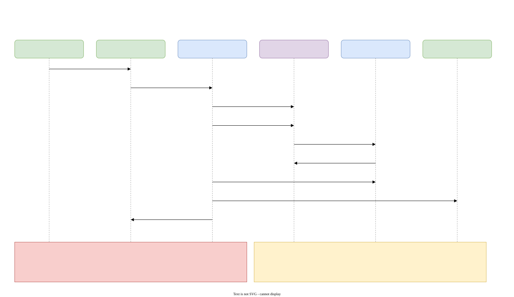

# expo-morph-menu

**English** | [Tiếng Việt](README.vi.md)

An expandable floating action menu for expo-router, animated with Reanimated 4.

The floating button expands into a card menu. Selecting a row expands the card into a full-screen route. When the route is dismissed, it collapses back into the card and the menu stays open. Because the full screen is a regular expo-router route, it supports deep links, back navigation and a nested native stack.

<table>
  <tr>
    <td align="center"></td>
    <td align="center"></td>
  </tr>
  <tr>
    <td align="center"><a href="example">Basic example</a>: tap a row, close, press and hold then slide</td>
    <td align="center"><a href="example-social">Social example</a>: post, poll and live screens from one menu</td>
  </tr>
</table>

Recorded on an Android emulator.



## Features

- The full screen is an expo-router route group. Deep links, Android hardware back, browser back and nested screens use the normal navigation stack.
- The full-screen container starts from the card's bounds and returns to them. The swap between the card and the container happens on the UI thread in a single frame.
- Dismiss gestures are configurable per platform: left-edge swipe and drag-down on iOS, close button and hardware back on Android, Esc and browser back on web.
- `onHover` fires while the pointer moves over a row, before the row is selected. Use it to prefetch the data for the destination screen.
- Every visible part of the menu is a replaceable component (slot), so the menu can be rendered with any UI kit.
- Supports iOS, Android and web (React Native Web).

## Documentation

| Topic | English | Tiếng Việt |
| --- | --- | --- |
| Integration guide | [docs/en/INTEGRATION.md](docs/en/INTEGRATION.md) | [docs/vi/INTEGRATION.md](docs/vi/INTEGRATION.md) |
| Custom UI (slots) | [docs/en/CUSTOM-UI.md](docs/en/CUSTOM-UI.md) | [docs/vi/CUSTOM-UI.md](docs/vi/CUSTOM-UI.md) |
| Architecture | [docs/en/ARCHITECTURE.md](docs/en/ARCHITECTURE.md) | [docs/vi/ARCHITECTURE.md](docs/vi/ARCHITECTURE.md) |
| Performance | [docs/en/PERFORMANCE.md](docs/en/PERFORMANCE.md) | [docs/vi/PERFORMANCE.md](docs/vi/PERFORMANCE.md) |
| Diagram sources | [docs/README.md](docs/README.md) | [docs/README.vi.md](docs/README.vi.md) |

## Installation

```bash
npx expo install expo-morph-menu \
  expo-router react-native-reanimated react-native-worklets \
  react-native-gesture-handler react-native-safe-area-context react-native-screens
```

Optional packages, detected at runtime:

| Package | Effect |
| --- | --- |
| `expo-haptics` | Haptic feedback when the pointer moves between rows and when a row is selected |
| `expo-glass-effect` | Liquid Glass card surface on iOS 26 and later |
| `expo-blur` | Blurred card surface on iOS |

Requirements: Expo SDK 58 or later (expo-router 58, Reanimated 4, Gesture Handler 3). `babel.config.js` must use `babel-preset-expo`, which enables the worklets Babel plugin.

## Usage

### 1. Root layout

Wrap the app in `MorphProvider`, register the sheet route group, and render `<MorphMenu />` after the root navigator.

```tsx
// app/_layout.tsx
import { Stack } from 'expo-router';
import { Ionicons } from '@expo/vector-icons';
import { MorphMenu, MorphProvider, morphSheetScreenOptions, type MorphItem } from 'expo-morph-menu';
import { GestureHandlerRootView } from 'react-native-gesture-handler';
import { SafeAreaProvider } from 'react-native-safe-area-context';

const items: MorphItem[] = [
  {
    key: 'camera',
    label: 'Camera',
    tint: '#3a3a3c',
    icon: <Ionicons name="camera" size={15} color="#fff" />,
    href: { pathname: '/(sheet)/[key]', params: { key: 'camera' } },
  },
  // ...
];

export default function RootLayout() {
  return (
    <SafeAreaProvider>
      <GestureHandlerRootView style={{ flex: 1 }}>
        <MorphProvider items={items} onHover={(item) => prefetch(item.key)}>
          <Stack screenOptions={{ headerShown: false }}>
            <Stack.Screen name="index" />
            <Stack.Screen name="(sheet)" options={morphSheetScreenOptions} />
          </Stack>
          <MorphMenu />
        </MorphProvider>
      </GestureHandlerRootView>
    </SafeAreaProvider>
  );
}
```

### 2. Sheet route group

Every route in this group expands from the menu card.

```tsx
// app/(sheet)/_layout.tsx
import { Stack } from 'expo-router';
import { MorphSheetLayout } from 'expo-morph-menu';

export default function SheetLayout() {
  return (
    <MorphSheetLayout>
      <Stack.Screen name="[key]" options={{ headerShown: false }} />
    </MorphSheetLayout>
  );
}
```

### 3. Screens

Dismiss with `<MorphCloseButton />` or any call to `router.back()`. Render expensive content after the expand animation has finished.

```tsx
// app/(sheet)/[key].tsx
import { MorphCloseButton, useMorphSettled } from 'expo-morph-menu';

export default function Screen() {
  const settled = useMorphSettled();
  return (
    <View style={{ flex: 1 }}>
      <MorphCloseButton />
      {settled ? <HeavyContent /> : <Placeholder />}
    </View>
  );
}
```

All dismiss paths run the collapse animation: the close button, `router.back()`, Android hardware back, browser back, Esc, and the iOS gestures.

## Configuration

All options are optional. Pass only the values you want to override.

```tsx
<MorphProvider
  items={items}
  config={{
    closeMenuOnDismiss: false,         // keep the menu open after the full screen is dismissed
    anchor: 'bottom-right',            // or 'bottom-left'
    layout: { fabSize: 56, cardWidth: 236, rowHeight: 46, padding: 10, margin: 20, iconSize: 15 },
    radius: Platform.select({ ios: { card: 28 }, android: { card: 16 } }),
    shadow: { elevation: 8 },          // Android: elevation. iOS and web: color, opacity, radius, offsetY
    dismiss: { edgeSwipe: true, dragDown: false },
    spring: { duration: 460, dampingRatio: 0.85 },
    haptics: true,
    surface: 'auto',                   // 'glass' | 'blur' | 'solid'
    colorScheme: 'auto',               // 'light' | 'dark'
    backdropOpacity: 0.25,
    colors: { dark: { surface: '#202022' } },
  }}
/>
```

| Option | Default (iOS / Android) | Description |
| --- | --- | --- |
| `closeMenuOnDismiss` | `false` | `true` collapses the card into the button after the full screen is dismissed |
| `anchor` | `'bottom-right'` | Screen corner of the button |
| `layout.*` | `56 / 236 / 46 / 10 / 20 / 15 / 1` | Button size, card width, row height, list padding, screen margin (added to the bottom safe area inset), row icon size, separator height |
| `radius.card` / `radius.sheet` / `radius.fab` | `28` / `0` / `null` | Corner radius of the card, of the full screen, and of the button (`null` renders a circle) |
| `shadow` | opacity `0.18`, radius `18`, offsetY `8` / elevation `10` | Shadow at rest. Disabled while the bounds are animating |
| `dismiss.edgeSwipe` | `true` / `false` | Left-edge swipe. Active only on the root screen of the sheet group, so nested screens keep the native back swipe |
| `dismiss.dragDown` | `true` / `false` | Drag down to dismiss |
| `spring` | `460` ms, `0.85` | Spring duration and damping ratio. Reduce Motion is respected |
| `haptics` | `true` | Requires `expo-haptics` |
| `surface` | `'auto'` | Resolution order: Liquid Glass (iOS 26+), blur (iOS), solid |
| `colorScheme` | `'auto'` | Follows the system setting |
| `colors.light` / `colors.dark` | `LIGHT_COLORS` / `DARK_COLORS` | `surface`, `sheetBackground`, `text`, `scrim`, `backdrop`, `highlight`, `fabIcon`, `closeBackground`, `closeIcon`, `iconForeground` |

### Icons

Row icons (`item.icon`), the button icon (`fabIcon`) and the close button icon (`closeIcon` or `<MorphCloseButton icon>`) accept a `MorphIcon`:

```tsx
icon: <Ionicons name="camera" size={15} color="#fff" />,   // React element (icon font, SVG)
icon: <CameraSvg width={15} height={15} />,                 // SVG component (react-native-svg)
icon: require('./camera.png'),                              // bundled image
icon: { uri: 'https://example.com/camera.png' },            // remote image
icon: ({ size, color }) => <Ionicons name="camera" size={size} color={color} />,
```

The function form receives the size and theme color for its position:

| Position | `size` | `color` |
| --- | --- | --- |
| Row icon | `layout.iconSize` | `colors.iconForeground` |
| Button | `26` | `colors.fabIcon` |
| Close button | `size * 0.56` | `colors.closeIcon` |

Single-color images are tinted with that color. For multi-color images, set `iconTint: false` on the item or `tintImage={false}` on the close button.

```tsx
<MorphProvider
  items={items}
  fabIcon={({ size, color }) => <Ionicons name="add" size={size} color={color} />}
  closeIcon={require('./close.png')}   // default icon for every MorphCloseButton
/>

<MorphCloseButton />
<MorphCloseButton icon={<CloseSvg />} size={40} backgroundColor="transparent" />
```

`MorphCloseButton` props: `icon`, `size` (default `32`), `iconSize`, `color`, `backgroundColor`, `tintImage`, `style`, and any `Pressable` prop. It calls `router.back()` unless `onPress` calls `e.preventDefault()`.

### Slots


The package owns the animated containers (size, position, corner radius, clipping) together with gestures and the hand-off logic. Each visible part can be replaced through `components`:

```tsx
import { MorphProvider, type MorphComponents } from 'expo-morph-menu';

const components: MorphComponents = {
  Background: () => <Card elevation={0} style={StyleSheet.absoluteFill} />,
  Item: ({ item }) => <ListItem title={item.label} subtitle={item.data?.subtitle} />,
  Trigger: () => <Icon name="plus" />,
  Separator: () => <Divider />,
  Scrim: () => <BlurView intensity={20} style={StyleSheet.absoluteFill} />,
  Backdrop: () => <View style={{ flex: 1, backgroundColor: '#000' }} />,
  Highlight: null,                     // Item renders its own hover state
};

<MorphProvider
  items={items}
  components={components}
  itemHeight={(item) => (item.data?.subtitle ? 58 : 46)}
/>
```

| Slot | Props | Default |
| --- | --- | --- |
| `Background` | `variant` (`'menu'` or `'sheet'`), `progress`, `colors` | Liquid Glass, blur or solid `colors.surface` |
| `Item` | `item`, `index`, `variant`, `hovered`, `height`, `colors` | `DefaultItem`: icon in a `tint` circle and a label |
| `Trigger` | `progress`, `size`, `colors` | `fabIcon` or "+", rotates 45 degrees and fades out while opening |
| `Highlight` | `hovered`, `colors`. Pass `null` to disable | Rounded rectangle in `colors.highlight` |
| `Separator` | `index`, `colors` | None |
| `Scrim` / `Backdrop` | `progress`, `colors`. Opacity is animated by the package | `colors.scrim` / `colors.backdrop` |

Slot components must follow four rules:

1. `Item` and `Background` are pure. They are rendered twice, in the card and in the full-screen container during the transition, and both copies must produce the same output.
2. Slots do not animate their own size or position. Use `progress` and `hovered` (Reanimated shared values) to animate opacity, color or rotation.
3. Row heights are known in advance: `layout.rowHeight` or a pure `itemHeight(item, index)`. Rows are not measured.
4. `Background` is opaque, because the card and the full-screen container swap in a single frame.

Details and examples for NativeWind, Tamagui, React Native Paper and Unistyles: [Custom UI](docs/en/CUSTOM-UI.md).

### Callbacks

| Prop | Called when |
| --- | --- |
| `onHover(item)` | The pointer moves onto a row. Use it to prefetch data |
| `onSelect(item)` | A row is selected, before navigation |
| `onOpen()` / `onClose()` | The menu starts opening or closing |
| `onSheetDismissed(item)` | The full screen has finished collapsing |

## API

| Export | Description |
| --- | --- |
| `MorphProvider` | Context provider. Props: `items`, `config`, `components`, `itemHeight`, `fabIcon`, `closeIcon`, callbacks |
| `MorphMenu` | Floating button and card overlay. Render it after the root navigator. Props: `hidden`, `bottomOffset`, `fabAccessibilityLabel` |
| `MorphSheetLayout` | Layout for the route group that expands from the card. Children are `<Stack.Screen>` elements. Optional `screenOptions` |
| `morphSheetScreenOptions` | Options for the group's `<Stack.Screen>` in the root navigator |
| `MorphCloseButton` | Close button for sheet screens |
| `renderIcon(icon, { size, color })` | Renders any `MorphIcon`. Useful inside a custom `Item` |
| `DefaultItem` | The built-in row component |
| `useMorphProgress()` | Read-only shared values `{ menu, sheet }`, from 0 to 1 |
| `useMorphSettled()` | `true` after the full screen has finished expanding |
| `useMorphDismiss()` | Returns `dismiss({ closeMenu? })`, which closes the whole sheet from any screen inside it |
| `useMorph()` | Low-level access to shared values and the resolved config |
| `MorphTrace` | Debug component. Logs each frame with the `[morph]` prefix and flags visual defects |
| `DEFAULT_CONFIG`, `LIGHT_COLORS`, `DARK_COLORS` | Default values |

Test IDs for end-to-end tests: `morph-fab`, `morph-scrim`, `morph-item-<key>`, `morph-close`.

## Web

The same code runs on Expo web through React Native Web.

- The URL reflects the route inside the full screen, for example `/camera`.
- Hovering a row with the mouse highlights it and fires `onHover`.
- Esc dismisses the full screen when its root screen is active, then closes the menu.
- The browser back button runs the collapse animation.
- Press-and-drag from the button to a row works with a mouse. Text selection is disabled during the drag.
- Reloading or closing the tab while the full screen is open does not show the "Leave site?" dialog.
- Haptics, Liquid Glass and hardware back are not available. Blur uses CSS `backdrop-filter` through `expo-blur`.

## How it works

The menu card is an overlay, not a route. When a row is selected, the package stores the card's bounds and pushes the item's route. The route group's layout renders a fixed-size `Stack` inside an animated container. The container expands from the stored bounds to the full screen, while the inner navigator keeps a constant size and is not laid out again.



Opening: the first frame of the container matches the card and renders the same rows, so the overlay can be hidden without a visible change. The container then expands.



Closing: every dismiss path is intercepted by `usePreventRemove`. The container collapses, and on the frame where its bounds match the card, the card becomes visible and the container is hidden.



State machines, container layers and the animation timeline are described in [Architecture](docs/en/ARCHITECTURE.md).

## Development

```bash
npm install
npm run example        # basic example (example/) in Expo Go
npm run example:social # social example with tabs (example-social/)
npm run typecheck      # package and both example apps
npm run test:api       # data layer of the examples: token refresh, retries, idempotency
npm run lint           # ESLint on the package and both examples
npm run format         # Prettier (code and config files; Markdown is not formatted)
npm run check          # typecheck, lint and format check together
npm run build          # compile to lib/
```

The ESLint config (`eslint.config.js`) extends `eslint-config-expo` and adds type-aware rules for errors that only show up at runtime:

| Rule | Catches |
| --- | --- |
| `@typescript-eslint/no-floating-promises` | A promise that is neither awaited nor caught, so its rejection is lost. Mark intentional fire-and-forget calls with `void` |
| `@typescript-eslint/no-misused-promises` | An async function passed where a callback must return nothing, such as `useEffect` |
| `@typescript-eslint/switch-exhaustiveness-check` | A `switch` over a union that misses a case added later |
| `react-hooks/rules-of-hooks`, `react-hooks/exhaustive-deps` | Hooks called conditionally, effects and callbacks that read stale values |
| `react-hooks/refs`, `react-hooks/purity` | Refs read or written during render, impure calls such as `Date.now()` during render |
| `import/no-cycle` | Import cycles, which can leave a module `undefined` when it is first read |

`react-hooks/immutability` is off: it reports every write to a Reanimated shared value (`sv.value = x`), which is how the Reanimated API works.

| Example | Shows |
| --- | --- |
| [example/](example/README.md) | The menu on a single screen with the integration steps, default and custom slots, prefetching on hover, Maestro end-to-end tests with the frame trace. No state management library |
| [example-social/](example-social/README.md) | A social app with tabs and sign-in: button above the tab bar, hidden on pushed screens, multi-step flows and a chat inside the sheet, `useMorphDismiss`, Redux Toolkit with optimistic updates |

The social example loads data from a mock REST API that runs in the app (JWT refresh, retries with backoff, fault injection): [example-social/docs/DATA-LAYER.md](example-social/docs/DATA-LAYER.md).

## Platform status

| Platform | Verified with |
| --- | --- |
| Android | Maestro end-to-end tests and frame traces on an Android 17 emulator (API 37). An earlier build was also tested on MEmu (Android 9) |
| Web | Manual and scripted tests in desktop Chrome, at desktop and phone viewport sizes |
| iOS | Not verified on a device yet. Edge swipe, Liquid Glass and blur are untested |

Issue reports for iOS are welcome.

## License

MIT
