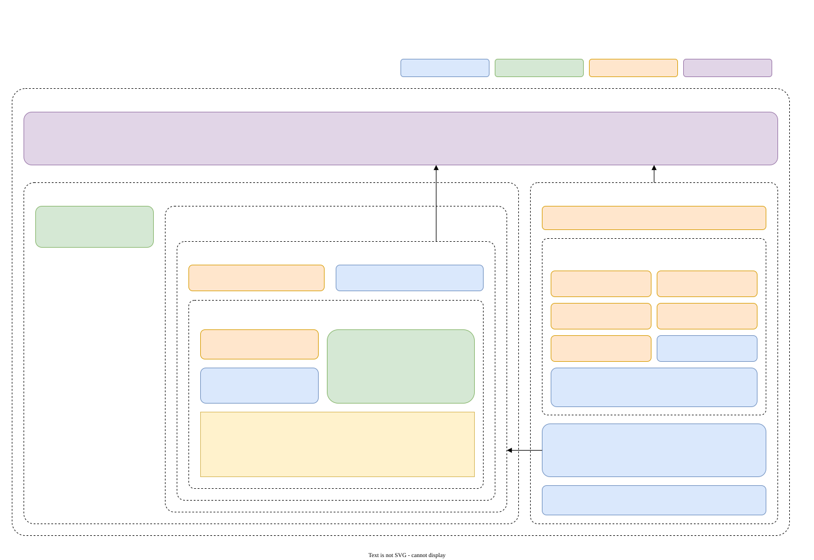

# expo-morph-menu

[English](README.md) | **Tiếng Việt**

Menu nổi có thể mở rộng dành cho expo-router, dùng animation của Reanimated 4.

Nút nổi mở rộng thành card menu. Khi chọn một dòng, card mở rộng thành một route full screen. Khi route được đóng, nó thu gọn về card và menu vẫn mở. Vì màn hình full screen là một route expo-router thông thường, nó hỗ trợ deep link, điều hướng back và native stack lồng nhau.


## Tính năng

- Màn hình full screen là một nhóm route expo-router. Deep link, nút back phần cứng trên Android, nút back của trình duyệt và các màn hình lồng nhau dùng navigation stack thông thường.
- Container toàn màn hình bắt đầu từ khung (bounds) của card và trở về khung đó. Việc hoán đổi giữa card và container diễn ra trên UI thread trong một frame.
- Cử chỉ đóng có thể cấu hình theo từng nền tảng: vuốt từ mép trái và kéo xuống trên iOS, nút đóng và nút back phần cứng trên Android, Esc và nút back của trình duyệt trên web.
- `onHover` được gọi khi con trỏ di chuyển trên một dòng, trước khi dòng được chọn. Dùng nó để prefetch dữ liệu cho màn hình đích.
- Mọi phần hiển thị của menu là một component có thể thay thế (slot), nên menu có thể được render bằng bất kỳ bộ UI nào.
- Hỗ trợ iOS, Android và web (React Native Web).

## Tài liệu

| Chủ đề | English | Tiếng Việt |
| --- | --- | --- |
| Hướng dẫn tích hợp | [docs/en/INTEGRATION.md](docs/en/INTEGRATION.md) | [docs/vi/INTEGRATION.md](docs/vi/INTEGRATION.md) |
| Giao diện tùy chỉnh (slot) | [docs/en/CUSTOM-UI.md](docs/en/CUSTOM-UI.md) | [docs/vi/CUSTOM-UI.md](docs/vi/CUSTOM-UI.md) |
| Kiến trúc | [docs/en/ARCHITECTURE.md](docs/en/ARCHITECTURE.md) | [docs/vi/ARCHITECTURE.md](docs/vi/ARCHITECTURE.md) |
| Hiệu năng | [docs/en/PERFORMANCE.md](docs/en/PERFORMANCE.md) | [docs/vi/PERFORMANCE.md](docs/vi/PERFORMANCE.md) |
| Mã nguồn sơ đồ | [docs/README.md](docs/README.md) | [docs/README.vi.md](docs/README.vi.md) |

## Cài đặt

```bash
npx expo install expo-morph-menu \
  expo-router react-native-reanimated react-native-worklets \
  react-native-gesture-handler react-native-safe-area-context react-native-screens
```

Các gói tùy chọn, được phát hiện khi chạy:

| Gói | Tác dụng |
| --- | --- |
| `expo-haptics` | Phản hồi rung khi con trỏ di chuyển giữa các dòng và khi một dòng được chọn |
| `expo-glass-effect` | Bề mặt card Liquid Glass trên iOS 26 trở lên |
| `expo-blur` | Bề mặt card làm mờ trên iOS |

Yêu cầu: Expo SDK 58 trở lên (expo-router 58, Reanimated 4, Gesture Handler 3). `babel.config.js` phải dùng `babel-preset-expo`, preset này bật Babel plugin cho worklets.

## Sử dụng

### 1. Root layout

Bọc ứng dụng trong `MorphProvider`, đăng ký nhóm route sheet và render `<MorphMenu />` sau root navigator.

```tsx
// app/_layout.tsx
import { Stack } from 'expo-router';
import { Ionicons } from '@expo/vector-icons';
import { MorphMenu, MorphProvider, morphSheetScreenOptions, type MorphItem } from 'expo-morph-menu';
import { GestureHandlerRootView } from 'react-native-gesture-handler';
import { SafeAreaProvider } from 'react-native-safe-area-context';

const items: MorphItem[] = [
  {
    key: 'camera',
    label: 'Camera',
    tint: '#3a3a3c',
    icon: <Ionicons name="camera" size={15} color="#fff" />,
    href: { pathname: '/(sheet)/[key]', params: { key: 'camera' } },
  },
  // ...
];

export default function RootLayout() {
  return (
    <SafeAreaProvider>
      <GestureHandlerRootView style={{ flex: 1 }}>
        <MorphProvider items={items} onHover={(item) => prefetch(item.key)}>
          <Stack screenOptions={{ headerShown: false }}>
            <Stack.Screen name="index" />
            <Stack.Screen name="(sheet)" options={morphSheetScreenOptions} />
          </Stack>
          <MorphMenu />
        </MorphProvider>
      </GestureHandlerRootView>
    </SafeAreaProvider>
  );
}
```

### 2. Nhóm route sheet

Mọi route trong nhóm này mở rộng từ card menu.

```tsx
// app/(sheet)/_layout.tsx
import { Stack } from 'expo-router';
import { MorphSheetLayout } from 'expo-morph-menu';

export default function SheetLayout() {
  return (
    <MorphSheetLayout>
      <Stack.Screen name="[key]" options={{ headerShown: false }} />
    </MorphSheetLayout>
  );
}
```

### 3. Màn hình

Đóng bằng `<MorphCloseButton />` hoặc bất kỳ lệnh gọi `router.back()` nào. Render nội dung nặng sau khi animation mở rộng đã kết thúc.

```tsx
// app/(sheet)/[key].tsx
import { MorphCloseButton, useMorphSettled } from 'expo-morph-menu';

export default function Screen() {
  const settled = useMorphSettled();
  return (
    <View style={{ flex: 1 }}>
      <MorphCloseButton />
      {settled ? <HeavyContent /> : <Placeholder />}
    </View>
  );
}
```

Mọi đường đóng đều chạy animation thu gọn: nút đóng, `router.back()`, nút back phần cứng trên Android, nút back của trình duyệt, Esc và các cử chỉ trên iOS.

## Cấu hình

Mọi tùy chọn đều không bắt buộc. Chỉ truyền những giá trị bạn muốn ghi đè.

```tsx
<MorphProvider
  items={items}
  config={{
    closeMenuOnDismiss: false,         // giữ menu mở sau khi đóng full screen
    anchor: 'bottom-right',            // hoặc 'bottom-left'
    layout: { fabSize: 56, cardWidth: 236, rowHeight: 46, padding: 10, margin: 20, iconSize: 15 },
    radius: Platform.select({ ios: { card: 28 }, android: { card: 16 } }),
    shadow: { elevation: 8 },          // Android: elevation. iOS và web: color, opacity, radius, offsetY
    dismiss: { edgeSwipe: true, dragDown: false },
    spring: { duration: 460, dampingRatio: 0.85 },
    haptics: true,
    surface: 'auto',                   // 'glass' | 'blur' | 'solid'
    colorScheme: 'auto',               // 'light' | 'dark'
    backdropOpacity: 0.25,
    colors: { dark: { surface: '#202022' } },
  }}
/>
```

| Tùy chọn | Mặc định (iOS / Android) | Mô tả |
| --- | --- | --- |
| `closeMenuOnDismiss` | `false` | `true` thu gọn card về nút sau khi full screen được đóng |
| `anchor` | `'bottom-right'` | Góc màn hình đặt nút |
| `layout.*` | `56 / 236 / 46 / 10 / 20 / 15 / 1` | Kích thước nút, chiều rộng card, chiều cao dòng, padding của danh sách, lề màn hình (cộng thêm vào inset safe area phía dưới), kích thước icon của dòng, chiều cao đường phân cách |
| `radius.card` / `radius.sheet` / `radius.fab` | `28` / `0` / `null` | Bán kính bo góc của card, của full screen và của nút (`null` render hình tròn) |
| `shadow` | opacity `0.18`, radius `18`, offsetY `8` / elevation `10` | Bóng đổ khi đứng yên. Bị tắt trong lúc khung đang chạy animation |
| `dismiss.edgeSwipe` | `true` / `false` | Vuốt từ mép trái. Chỉ hoạt động trên màn hình gốc của nhóm sheet, nên các màn hình lồng nhau giữ cử chỉ vuốt back native |
| `dismiss.dragDown` | `true` / `false` | Kéo xuống để đóng |
| `spring` | `460` ms, `0.85` | Thời lượng và hệ số damping của spring. Tôn trọng cài đặt Reduce Motion |
| `haptics` | `true` | Cần `expo-haptics` |
| `surface` | `'auto'` | Thứ tự chọn: Liquid Glass (iOS 26+), blur (iOS), solid |
| `colorScheme` | `'auto'` | Theo cài đặt hệ thống |
| `colors.light` / `colors.dark` | `LIGHT_COLORS` / `DARK_COLORS` | `surface`, `sheetBackground`, `text`, `scrim`, `backdrop`, `highlight`, `fabIcon`, `closeBackground`, `closeIcon`, `iconForeground` |

### Icon

Icon của dòng (`item.icon`), icon của nút (`fabIcon`) và icon của nút đóng (`closeIcon` hoặc `<MorphCloseButton icon>`) nhận một `MorphIcon`:

```tsx
icon: <Ionicons name="camera" size={15} color="#fff" />,   // React element (icon font, SVG)
icon: <CameraSvg width={15} height={15} />,                 // component SVG (react-native-svg)
icon: require('./camera.png'),                              // ảnh đóng gói cùng ứng dụng
icon: { uri: 'https://example.com/camera.png' },            // ảnh từ xa
icon: ({ size, color }) => <Ionicons name="camera" size={size} color={color} />,
```

Dạng hàm nhận kích thước và màu theme tương ứng với vị trí của nó:

| Vị trí | `size` | `color` |
| --- | --- | --- |
| Icon của dòng | `layout.iconSize` | `colors.iconForeground` |
| Nút | `26` | `colors.fabIcon` |
| Nút đóng | `size * 0.56` | `colors.closeIcon` |

Ảnh một màu được tô bằng màu đó. Với ảnh nhiều màu, đặt `iconTint: false` trên item hoặc `tintImage={false}` trên nút đóng.

```tsx
<MorphProvider
  items={items}
  fabIcon={({ size, color }) => <Ionicons name="add" size={size} color={color} />}
  closeIcon={require('./close.png')}   // icon mặc định cho mọi MorphCloseButton
/>

<MorphCloseButton />
<MorphCloseButton icon={<CloseSvg />} size={40} backgroundColor="transparent" />
```

Props của `MorphCloseButton`: `icon`, `size` (mặc định `32`), `iconSize`, `color`, `backgroundColor`, `tintImage`, `style` và mọi prop của `Pressable`. Nó gọi `router.back()` trừ khi `onPress` gọi `e.preventDefault()`.

### Slot


Package quản lý các container có animation (kích thước, vị trí, bán kính bo góc, cắt nội dung) cùng với cử chỉ và logic chuyển giao (hand-off). Mỗi phần hiển thị có thể được thay thế qua `components`:

```tsx
import { MorphProvider, type MorphComponents } from 'expo-morph-menu';

const components: MorphComponents = {
  Background: () => <Card elevation={0} style={StyleSheet.absoluteFill} />,
  Item: ({ item }) => <ListItem title={item.label} subtitle={item.data?.subtitle} />,
  Trigger: () => <Icon name="plus" />,
  Separator: () => <Divider />,
  Scrim: () => <BlurView intensity={20} style={StyleSheet.absoluteFill} />,
  Backdrop: () => <View style={{ flex: 1, backgroundColor: '#000' }} />,
  Highlight: null,                     // Item tự render trạng thái hover
};

<MorphProvider
  items={items}
  components={components}
  itemHeight={(item) => (item.data?.subtitle ? 58 : 46)}
/>
```

| Slot | Props | Mặc định |
| --- | --- | --- |
| `Background` | `variant` (`'menu'` hoặc `'sheet'`), `progress`, `colors` | Liquid Glass, blur hoặc màu đặc `colors.surface` |
| `Item` | `item`, `index`, `variant`, `hovered`, `height`, `colors` | `DefaultItem`: icon trong vòng tròn màu `tint` và một nhãn |
| `Trigger` | `progress`, `size`, `colors` | `fabIcon` hoặc "+", xoay 45 độ và mờ dần khi mở |
| `Highlight` | `hovered`, `colors`. Truyền `null` để tắt | Hình chữ nhật bo góc màu `colors.highlight` |
| `Separator` | `index`, `colors` | Không có |
| `Scrim` / `Backdrop` | `progress`, `colors`. Độ mờ (opacity) do package animate | `colors.scrim` / `colors.backdrop` |

Component slot phải tuân theo bốn quy tắc:

1. `Item` và `Background` là thuần (pure). Chúng được render hai lần, trong card và trong container toàn màn hình trong lúc chuyển cảnh, và hai bản phải cho ra cùng kết quả.
2. Slot không tự animate kích thước hay vị trí của mình. Dùng `progress` và `hovered` (shared value của Reanimated) để animate opacity, màu hoặc góc xoay.
3. Chiều cao dòng được biết trước: `layout.rowHeight` hoặc một hàm thuần `itemHeight(item, index)`. Các dòng không được đo.
4. `Background` phải đục (không trong suốt), vì card và container toàn màn hình hoán đổi trong một frame.

Chi tiết và ví dụ cho NativeWind, Tamagui, React Native Paper và Unistyles: [Giao diện tùy chỉnh](docs/vi/CUSTOM-UI.md).

### Callback

| Prop | Được gọi khi |
| --- | --- |
| `onHover(item)` | Con trỏ di chuyển vào một dòng. Dùng nó để prefetch dữ liệu |
| `onSelect(item)` | Một dòng được chọn, trước khi điều hướng |
| `onOpen()` / `onClose()` | Menu bắt đầu mở hoặc đóng |
| `onSheetDismissed(item)` | Full screen đã thu gọn xong |

## API

| Export | Mô tả |
| --- | --- |
| `MorphProvider` | Context provider. Props: `items`, `config`, `components`, `itemHeight`, `fabIcon`, `closeIcon`, các callback |
| `MorphMenu` | Overlay (lớp phủ) gồm nút nổi và card. Render sau root navigator. Props: `hidden`, `bottomOffset`, `fabAccessibilityLabel` |
| `MorphSheetLayout` | Layout cho nhóm route mở rộng từ card. Phần tử con là các `<Stack.Screen>`. `screenOptions` là tùy chọn |
| `morphSheetScreenOptions` | Tùy chọn cho `<Stack.Screen>` của nhóm trong root navigator |
| `MorphCloseButton` | Nút đóng cho các màn hình sheet |
| `renderIcon(icon, { size, color })` | Render bất kỳ `MorphIcon` nào. Hữu ích bên trong một `Item` tùy chỉnh |
| `DefaultItem` | Component dòng có sẵn |
| `useMorphProgress()` | Các shared value chỉ đọc `{ menu, sheet }`, từ 0 đến 1 |
| `useMorphSettled()` | `true` sau khi full screen đã mở rộng xong |
| `useMorphDismiss()` | Trả về `dismiss({ closeMenu? })`, dùng để đóng toàn bộ sheet từ bất kỳ màn hình nào bên trong |
| `useMorph()` | Truy cập mức thấp tới các shared value và cấu hình đã được xử lý |
| `MorphTrace` | Component gỡ lỗi. Ghi log từng frame với tiền tố `[morph]` và đánh dấu các lỗi hiển thị |
| `DEFAULT_CONFIG`, `LIGHT_COLORS`, `DARK_COLORS` | Giá trị mặc định |

Test ID cho kiểm thử end-to-end (E2E): `morph-fab`, `morph-scrim`, `morph-item-<key>`, `morph-close`.

## Web

Cùng một mã chạy trên Expo web thông qua React Native Web.

- URL phản ánh route bên trong full screen, ví dụ `/camera`.
- Hover chuột lên một dòng sẽ làm nổi bật dòng đó và gọi `onHover`.
- Esc đóng full screen khi màn hình gốc của nó đang hoạt động, sau đó đóng menu.
- Nút back của trình duyệt chạy animation thu gọn.
- Nhấn giữ và kéo từ nút tới một dòng hoạt động được với chuột. Việc chọn văn bản bị tắt trong lúc kéo.
- Tải lại hoặc đóng tab khi full screen đang mở không hiện hộp thoại "Leave site?".
- Không có haptics, Liquid Glass và nút back phần cứng. Blur dùng CSS `backdrop-filter` thông qua `expo-blur`.

## Cách hoạt động

Card menu là một overlay, không phải route. Khi một dòng được chọn, package lưu khung của card và push route của item. Layout của nhóm route render một `Stack` có kích thước cố định bên trong một container có animation. Container mở rộng từ khung đã lưu ra toàn màn hình, trong khi navigator bên trong giữ kích thước không đổi và không phải tính layout lại.



Mở: frame đầu tiên của container trùng với card và render cùng các dòng, nên overlay có thể được ẩn mà không có thay đổi nào nhìn thấy được. Sau đó container mở rộng.


Đóng: mọi đường đóng đều bị chặn bởi `usePreventRemove`. Container thu gọn, và tại frame mà khung của nó trùng với card, card được hiện ra và container bị ẩn.


Máy trạng thái, các lớp của container và dòng thời gian animation được mô tả trong [Kiến trúc](docs/vi/ARCHITECTURE.md).

## Phát triển

```bash
npm install
npm run example        # ví dụ cơ bản (example/) trong Expo Go
npm run example:social # ví dụ mạng xã hội có tab (example-social/)
npm run typecheck      # package và cả hai ứng dụng ví dụ
npm run test:api       # lớp dữ liệu của các ví dụ: refresh token, thử lại, idempotency
npm run build          # biên dịch ra lib/
```

| Ví dụ | Nội dung |
| --- | --- |
| [example/](example/README.vi.md) | Menu trên một màn hình, slot mặc định và tùy biến, prefetch bằng RTK Query, kiểm thử end-to-end bằng Maestro với trace theo frame |
| [example-social/](example-social/README.vi.md) | Ứng dụng mạng xã hội có tab và đăng nhập: nút nằm trên tab bar, ẩn ở các màn hình được push, luồng nhiều bước và chat bên trong sheet, `useMorphDismiss`, Redux Toolkit với optimistic update |

Cả hai ví dụ tải dữ liệu từ một REST API giả lập chạy trong ứng dụng (refresh JWT, thử lại theo backoff, giả lập lỗi): [example-shared/README.vi.md](example-shared/README.vi.md).

## Trạng thái nền tảng

| Nền tảng | Đã kiểm tra bằng |
| --- | --- |
| Android | Kiểm thử end-to-end bằng Maestro và trace theo frame trên emulator Android 17 (API 37). Một bản build trước đó cũng đã được kiểm thử trên MEmu (Android 9) |
| Web | Kiểm thử thủ công và bằng script trên Chrome desktop, với kích thước viewport desktop và điện thoại |
| iOS | Chưa kiểm tra trên thiết bị. Vuốt từ mép trái, Liquid Glass và blur chưa được kiểm thử |

Hoan nghênh các báo cáo lỗi trên iOS.

## Giấy phép

MIT
