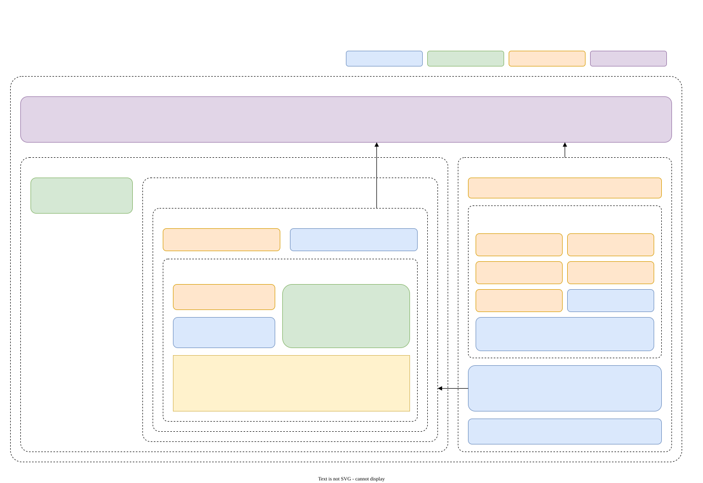
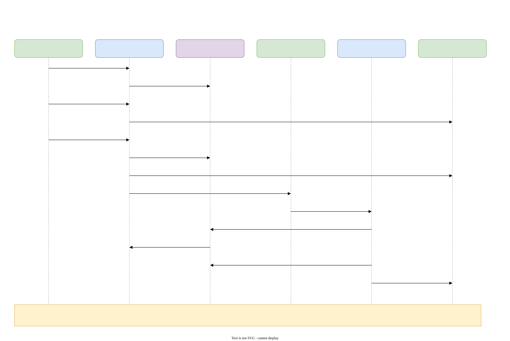
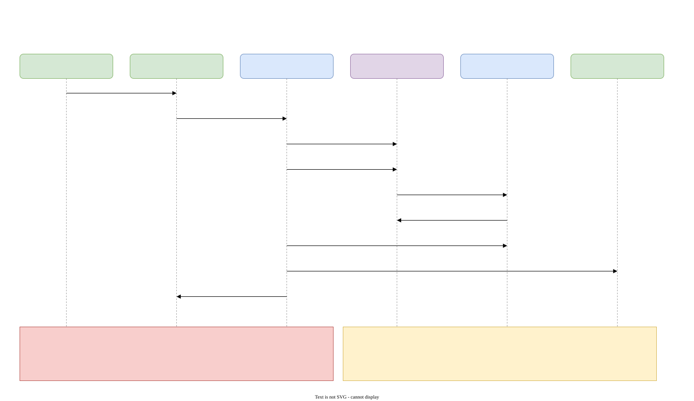
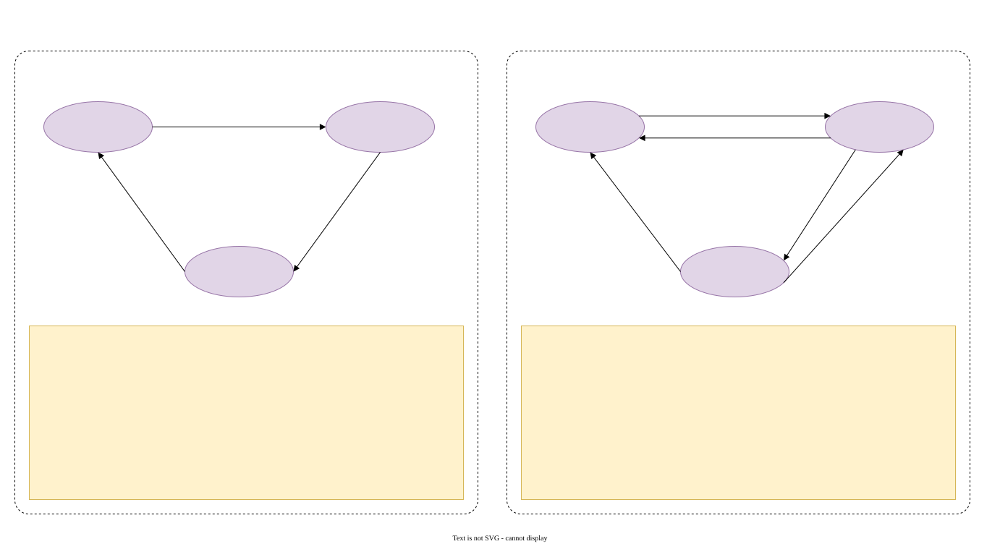
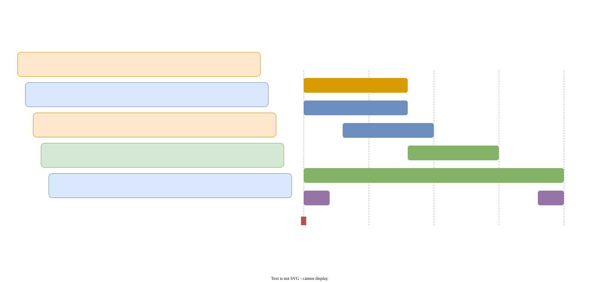

# Architecture

> Diagrams: [`../diagrams/expo-morph-menu.en.drawio`](../diagrams/expo-morph-menu.en.drawio) (7 pages: the overview is the last one). Open with [app.diagrams.net](https://app.diagrams.net), draw.io desktop or the VS Code "Draw.io Integration" extension. Page numbers below refer to that file.
>
> Tiếng Việt: [`../vi/ARCHITECTURE.md`](../vi/ARCHITECTURE.md)

`expo-morph-menu` turns a floating button into a menu card, and a menu row into a full-screen **expo-router route** — then shrinks that screen back into the card when it closes. This document explains how it is built and why.

## 1. The boundary: what is a route and what is not

The easiest way to build this interaction is one big `Animated.View` that morphs from button to card to full screen. It looks right, but the "screen" doesn't exist for navigation: no child screens, no Android back, no URL, no deep link, no state restoration.

The package draws the line differently:

| Part | Route? | Why |
| --- | --- | --- |
| Button → menu card | **No** — an overlay (`MorphMenu`) | A transient affordance, like a context menu. Nobody deep-links into an open menu. It must still consume Android back / Esc. |
| Card → full screen | **Yes** — a real route group (`MorphSheetLayout`) | A destination: needs a URL, child screens, back navigation, restoration. |

Everything else follows from this boundary. The overlay and the route never import each other; they meet only in `MorphProvider` (page 1).



## 2. Building blocks

| Module | Role |
| --- | --- |
| `MorphProvider` | Context: shared values, resolved config, colors (light/dark), items, row layout, slots, callbacks. |
| `MorphMenu` | The overlay: button hit area + Pan gesture, the animated card, scrim, rows. Rendered **after** the root navigator. |
| `MorphSheetLayout` | Layout for the route group that morphs: animated shell, fixed-size inner `Stack`, dismiss gestures, `usePreventRemove`. |
| `morphSheetScreenOptions` | Options for that group in the root stack: `transparentModal`, `animation: 'none'`, no native gesture, transparent background. |
| `MenuFace` / `DefaultItem` | The menu rows — drawn in the card **and** on the shell while it morphs. |
| `MorphCloseButton` | Close button for sheet screens (`router.back()`), customizable icon. |
| `useMorphSettled()` | `true` once the full screen finished growing — defer heavy content until then. |
| `useMorphProgress()` | Read-only `{ menu, sheet }` shared values for your own animations. |
| `MorphTrace` | Debugging: logs every frame and flags hand-off defects. |

Source files live in `src/`: `config.ts` (defaults, colors), `geometry.ts` (rects, row offsets), `visibility.ts` (who is visible), `constants.ts`, `shadow.ts`, `Surface.tsx` + `optional.ts` (glass/blur/haptics, all optional), `web.ts`.

## 3. Shared state

Four Reanimated shared values connect the two halves:

| Value | Owner | Meaning |
| --- | --- | --- |
| `menu` | overlay | 0 → 1: button grows into the card |
| `sheet` | route | 0 → 1: card grows into the full screen |
| `origin` | overlay writes, route reads | the card's rect at the moment of selection |
| `handoff` | both | who currently shows the card: `MENU`, `ROUTE` or `RETURNING` |

`origin` is what keeps the halves independent: a deep link straight into a sheet route has no origin, so the shell grows from a centered fallback rect instead.

`handoff` decides perceived quality. Routes mount asynchronously; if the overlay faded out by progress alone there would occasionally be an empty frame. It disappears only when the route is really on screen.

## 4. Opening (page 2)



1. Press on the button → `menu` springs to 1, mode `open`. The hit area stays active while the press is down (see §8).
2. Sliding over rows (mouse hover on web) highlights them and calls `onHover(item)` — 150–400 ms before release, the ideal moment to prefetch.
3. Release on a row, or tap one. If the card hasn't finished growing (`menu < 0.995`), the selection waits for it — pushing early would grow the shell from a rect the card hasn't reached yet.
4. `origin = card rect`, `handoff = MENU`, `onSelect(item)`, `router.push(item.href)`.
5. The route mounts with no animation. Its first frame is the shell at exactly the card's rect, already showing the menu rows (`MenuFace`) — identical pixels.
6. `handoff = ROUTE` (native: the shell's `onLayout`; web: `useLayoutEffect`) → the overlay card hides. Nothing visibly changes.
7. `sheet` springs to 1: the shell grows, content fades in, the menu face fades out.
8. Spring finished → `useMorphSettled()` becomes `true`.

All visual steps run on the UI thread. JS only pushes the route and reports callbacks.

## 5. Closing (page 3)



Every dismiss path — your close button / `router.back()`, Android hardware back, browser back, Esc on web, iOS edge swipe or drag down — becomes a navigation "remove", which `usePreventRemove` blocks. The reverse morph therefore lives in exactly one place:

1. `handoff = RETURNING`, `sheet` springs to 0 (from wherever a gesture left it — no jump).
2. The shell shrinks; content fades out; the menu face fades in.
3. On the frame where `sheet ≤ 0.005` (`ARRIVED`), the shell is within 1 dp of the card: **cut** — shell opacity 0, card opacity 1, same UI frame.
4. `closeMenuOnDismiss = false` (default): the scrim fades back, the menu stays open. `true`: the card collapses to the button.
5. Spring finished → `sheetDismissed()` syncs the overlay's JS state, `onSheetDismissed(item)`, then `repeat()` lets the original navigation action continue.

`handoff` deliberately stays `RETURNING` after unmount: Android removes native views asynchronously, and resetting it would show the old shell for one more frame. The next selection resets it.

## 6. Why the hand-off is a cut, not a crossfade (page 4)



An earlier version crossfaded shell and card over the last 12 % of progress. A mid-close screenshot showed two half-transparent copies of the menu a few dp apart — doubled, blurred text, read by the eye as a flicker. A single-frame cut at a point where both layers are pixel-identical is invisible, and because both layers read the same `sheet` value in the same UI frame, dropped frames cannot separate them.

**Layering differs per platform:**

- **iOS:** a `transparentModal` is presented above the root view, so the route covers the overlay. The card never needs to hide — and must not: Liquid Glass / blur views (`UIVisualEffectView`) render incorrectly at alpha < 1.
- **Android & web:** screens live in the same view tree and the overlay is declared after the navigator, so it is on top and must hide while the route owns the screen.

## 7. The shell: fixed-size content (page 5)



```tsx
<Animated.View style={shell}>                       // x, y, width, height, radius change every frame
  <Animated.View style={{ width: W, height: H }}>   // FIXED, absolutely positioned
    <Stack />                                        // never re-laid out
  </Animated.View>
</Animated.View>
```

If the inner `Stack` resized with the shell, every frame would trigger a layout pass over the whole screen tree. With a fixed-size interior clipped by `overflow: hidden`, only one node is re-measured. This is also why child screens inside the sheet are a **real native stack** (native push animation, native back swipe, Android back).

Layers inside the shell, and when they change (progress 0 = card, 1 = full screen):

| Layer | Range | Change |
| --- | --- | --- |
| `Background` slot (variant `sheet`) | 0 → 0.4 | opacity 1 → 0 |
| shell background color | 0 → 0.4 | card color → `colors.sheetBackground` |
| `MenuFace` (rows, anchored to the card corner) | 0.15 → 0.5 | opacity 1 → 0 |
| your content | 0.4 → 0.75 | opacity 0 → 1 |
| your content | 0 → 1 | translateY −`insets.top` → 0 |
| shadow | 0 → 0.1 and 0.9 → 1 | ramps; off in mid-flight |

The content is anchored to the shell's top-left; at card size the visible part would be the empty status-bar strip, so it is shifted up by `insets.top` while small.

Sizes come from `useSafeAreaFrame()`, not `useWindowDimensions()`: on Android edge-to-edge the "window" excludes the navigation bar and the shell would stop short of the bottom edge.

## 8. Input and gestures

| | iOS | Android | Web |
| --- | --- | --- | --- |
| Open menu | tap / press | tap / press | click / press |
| Select | tap row, or press-and-drag from the button | same | click row, or press-and-drag |
| Prefetch (`onHover`) | while dragging | while dragging | while dragging or hovering |
| Close menu | tap scrim | tap scrim, hardware back | click scrim, Esc |
| Close full screen | close button, edge swipe¹, drag down¹ | close button, hardware back | close button, Esc², browser back |

¹ `config.dismiss` — defaults: on for iOS, off for Android. Edge swipe is enabled only on the sheet's root screen; on child screens the left edge belongs to the native back swipe.
² Only on the sheet's root screen.

A tap that is released in place never selects a row: the button sits inside the card's last row, and a slightly long press would otherwise open it.

**Touch ownership** (page 4, right): in mode `route` the overlay takes no touches and does not listen to back — otherwise, where the overlay is on top, its scrim would swallow your close button.

## 9. Web specifics

Each of these was found by testing in Chrome and is handled by the package:

- **Pointer capture.** Gesture Handler skips `setPointerCapture` when the gesture view has `role="button"`. Without capture, a press-and-drag that leaves the button never delivers `pointerup` to it and the gesture stays stuck. On web the role sits on an inner element instead.
- **Hit area during a press.** An element switched to `pointer-events: none` mid-press never receives `pointerup`; the button's hit area stays active until the press ends.
- **Hand-off timing.** `onLayout` (ResizeObserver) arrives frames late on web; the route hands off in `useLayoutEffect` instead.
- **No "Leave site?" prompt.** `usePreventRemove` would block page unload while the full screen is open. The package calls the hook's `disablePrevention()` on `beforeunload`, from a listener registered before React Navigation's.
- **Shadows.** React Native Web only builds a correct `box-shadow` when all `shadow*` props are in one style; with an animated `shadowOpacity` they aren't, so the package writes `box-shadow` itself on web.
- Esc closes, mouse hover drives `onHover`, text isn't selected while dragging.

## 10. Geometry

All rects are **computed, never measured** (`geometry.ts`): measuring is asynchronous and the first frame would be wrong. Row heights come from `layout.rowHeight` or `itemHeight(item, index)`; `listLayout()` turns them into row offsets used by the card, the shell's menu face, drag hit-testing (`rowAt`) and the highlight. `anchor` mirrors everything for `bottom-left`.

## 11. Performance principles

- Nothing visual waits for JS: spring callbacks and `useAnimatedReaction` drive the hand-off on the UI thread. The menu reacts the frame the shell arrives instead of waiting for the spring to settle (it wobbles ~7 frames around 0).
- Heavy screen content mounts after `useMorphSettled()`; content is never unmounted at the start of the close animation.
- Shadows are off while bounds change every frame.
- `MorphProvider` memoizes config by content, so an inline `config={{…}}` doesn't re-render consumers.

Measurements and the history of each fix: [`../PERFORMANCE.md`](../PERFORMANCE.md) (Vietnamese).

## 12. Observability

`<MorphTrace enabled />` logs one line per changed frame:

```
[morph] f=56 m=1.000 s=0.002 h=2 ov=1.00 sh=0.00 handoff
```

`m`/`s` = progress, `h` = hand-off state, `ov`/`sh` = actual opacity of card/shell (computed with the same functions the styles use). Flags: `handoff` (intended swap), `FLICKER` (any other jump > 0.5 in one frame), `HOLE` (nothing visible while the route is up), `GHOST` (both partially visible while misaligned), `OVERLAP` (card still covering a moving shell), `DROP(n)` (frame took n ms). The example app's E2E runner fails on any defect flag — see [`INTEGRATION.md`](INTEGRATION.md#testing).

## 13. Alternatives considered

- **A shared-element / zoom transition library** (e.g. `react-native-screen-transitions`): less code, but adds a dependency and typically a JS-driven stack. Worth it if the whole app needs custom transitions.
- **Reanimated shared element transitions:** the leanest in code and keeps the native stack, but interacts with `usePreventRemove`-blocked back gestures — the very mechanism this package relies on. Check the current status of your Reanimated version before choosing it.
- **One overlay for everything:** rejected — see §1.

What native platforms do is the same idea: hide source and destination, animate a third view between the two bounds, swap back. SwiftUI's `matchedTransitionSource` + `.navigationTransition(.zoom)` is Apple's answer to "morph, but still a route"; Compose's `SharedTransitionLayout` keeps both ends in one tree, like this package does.

## 14. Known limitations

- **iOS is not yet verified on a device** (edge swipe, Liquid Glass, blur). Android and web are covered by E2E and frame traces.
- **Rotation while open:** `origin` is absolute; rotating with the sheet open makes it stale. Lock orientation for the group, or store `W/H` with the rect and convert.
- **One menu per app:** `origin` is a single rect. Several menus would need a small map keyed by route.
- **Accessibility:** rows have `menuitem` roles and every drag action has a tap alternative; open/close announcements for screen readers are not implemented yet.
- **Deeper nesting:** if the inner stack contains tabs or its own modals, re-check where `usePreventRemove` fires (only when the inner stack is at its root).
