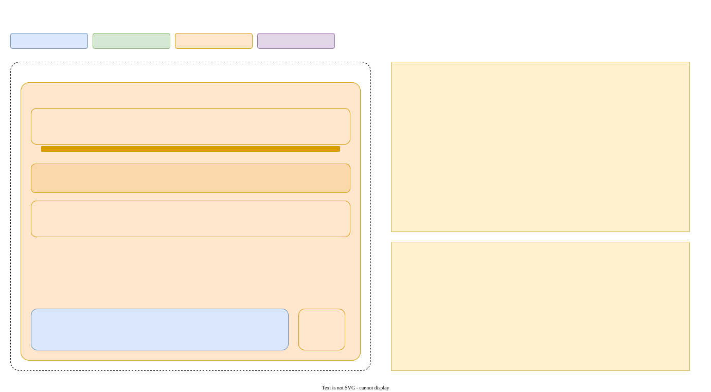

# Custom UI: slots

> Tiếng Việt: [`../vi/CUSTOM-UI.md`](../vi/CUSTOM-UI.md) · Diagram: page 6 of [`../diagrams/expo-morph-menu.en.drawio`](../diagrams/expo-morph-menu.en.drawio) · Integration: [`INTEGRATION.md`](INTEGRATION.md)

Every project has its own UI kit. `expo-morph-menu` doesn't ask you to adopt its look: **the package moves things, you draw them.**

- **The package owns** the views that move — size, position, corners, clipping, shadow — plus the geometry, gestures and the hand-off between menu and full screen.
- **You own** what is seen, through *slots*: plain React components that receive props and shared values.

Use your design system's components inside the slots — Tamagui, NativeWind, React Native Paper, Unistyles, gluestack, or plain views.

## Slots



```tsx
<MorphProvider items={items} components={{ Background, Item, Trigger, Highlight, Separator, Scrim, Backdrop }} itemHeight={…} />
```

| Slot | Props | Drawn | Default |
| --- | --- | --- | --- |
| `Background` | `variant: 'menu' \| 'sheet'`, `progress`, `colors` | fills the card; again on the full-screen shell while it morphs | Liquid Glass / blur / solid `colors.surface` |
| `Item` | `item`, `index`, `variant`, `hovered`, `height`, `colors` | each row, in the card and on the shell | `DefaultItem`: icon in a `tint` circle + label |
| `Trigger` | `progress`, `size`, `colors` | the button's face (inside the card's corner) | `fabIcon` or "+", fades and turns 45° |
| `Highlight` | `hovered`, `colors` — or `null` | behind the hovered row; positioned and sized by the package | rounded `colors.highlight` |
| `Separator` | `index`, `colors` | between rows, `layout.separatorHeight` tall | none |
| `Scrim` | `progress`, `colors` | behind the open menu; tap closes it | `colors.scrim` |
| `Backdrop` | `progress`, `colors` | behind the full screen | `colors.backdrop` × `backdropOpacity` |

- `progress` / `hovered` are Reanimated `SharedValue`s — read them inside `useAnimatedStyle`.
- `variant` tells `Item`/`Background` whether they're in the interactive card (`'menu'`) or the static copy on the shell (`'sheet'`). Usually you ignore it; it's there for analytics or debug borders.
- `Scrim` and `Backdrop` get their opacity animated by the package; draw them static.
- Row heights: `layout.rowHeight` for all rows, or `itemHeight={(item, index) => number}`.

## The contract

These four rules are what keep the morph seamless. Each one comes from a defect that was measured and fixed.

1. **Slots are pure.** `Item` and `Background` are rendered **twice**: in the card, and on the full-screen shell while it morphs. At the hand-off the two copies swap in one frame, so they must be pixel-identical. Same props → same output. No internal state, no mount/enter animations, no press ripple of their own (rows are already wrapped in a `Pressable` by the package).
2. **Don't animate size or position.** The package animates the container; animating inside it fights the morph. Animate opacity, color, rotation, scale of an icon… from `progress` and `hovered`.
3. **Row heights are known up front.** Never measured: `rowHeight` or a pure `itemHeight`. Heights drive drag-to-select hit testing and the highlight.
4. **`Background` is opaque.** A see-through background would reveal the frame where shell and card swap. Want a translucent look? Use `surface: 'blur' | 'glass'` and no `Background` slot.

**How to check:** render `<MorphTrace enabled />` and look for `GHOST` / `FLICKER` / `OVERLAP` in the logs while opening and closing. On web, `example/public/phone.html` shows the app in a phone-sized frame.

## Walkthrough: a dark card with subtitles

This is the "Custom (slots)" variant of the example app (`example/components/CustomSlots.tsx`), tested on Android and web.

```tsx
import { Ionicons } from '@expo/vector-icons';
import { BlurView } from 'expo-blur';
import {
  renderIcon,
  type MorphComponents,
  type MorphConfigInput,
  type MorphItem,
  type MorphItemProps,
  type MorphTriggerProps,
} from 'expo-morph-menu';
import { StyleSheet, Text, View } from 'react-native';
import Animated, { Extrapolation, interpolate, useAnimatedStyle } from 'react-native-reanimated';

// 1. Opaque background — your card color, border, gradient image…
function Background() {
  return <View style={[StyleSheet.absoluteFill, { backgroundColor: '#1f2a44' }]} />;
}

// 2. A row with a subtitle and its own hover state.
function Item({ item, index, hovered, colors }: MorphItemProps) {
  const subtitle = item.data?.subtitle as string | undefined;
  const hover = useAnimatedStyle(() => ({
    backgroundColor: hovered.value === index ? 'rgba(255,255,255,0.12)' : 'transparent',
  }));
  return (
    <Animated.View style={[styles.item, hover]}>
      <View style={[styles.badge, { backgroundColor: item.tint ?? '#334' }]}>
        {renderIcon(item.icon, { size: 16, color: colors.iconForeground })}
      </View>
      <View style={{ flex: 1 }}>
        <Text style={styles.title}>{item.label}</Text>
        {subtitle ? <Text style={styles.subtitle}>{subtitle}</Text> : null}
      </View>
    </Animated.View>
  );
}

// 3. The button face: animate rotation/opacity from progress, not size.
function Trigger({ progress }: MorphTriggerProps) {
  const style = useAnimatedStyle(() => ({
    opacity: interpolate(progress.value, [0, 0.35], [1, 0], Extrapolation.CLAMP),
    transform: [{ rotate: `${interpolate(progress.value, [0, 0.35], [0, 90], Extrapolation.CLAMP)}deg` }],
  }));
  return (
    <Animated.View style={style}>
      <Ionicons name="apps" size={22} color="#fff" />
    </Animated.View>
  );
}

export const components: MorphComponents = {
  Background,
  Item,
  Trigger,
  Separator: () => <View style={{ flex: 1, marginHorizontal: 18, backgroundColor: 'rgba(255,255,255,0.15)' }} />,
  Scrim: () => <BlurView intensity={20} tint="dark" style={StyleSheet.absoluteFill} />,
  Highlight: null, // Item draws its own hover state
};

export const config: MorphConfigInput = {
  radius: { card: 18, fab: 18 },                       // rounded-square button
  layout: { cardWidth: 260, separatorHeight: StyleSheet.hairlineWidth },
  colors: { light: { iconForeground: '#fff' }, dark: { iconForeground: '#fff' } },
};

export const itemHeight = (item: MorphItem) => (item.data?.subtitle ? 58 : 46);
```

```tsx
<MorphProvider items={items} components={components} config={config} itemHeight={itemHeight}>
```

Notes:

- Each `Item` is placed in a row box of its height; fill it with `flex: 1`.
- `Separator` fills a box the package sizes to `separatorHeight`; draw it with `flex: 1`.
- The `Highlight` slot (when used) is positioned and sized to the hovered row by the package — draw it to fill (`flex: 1`).
- Define slot components **at module level** (or memoize them). A new component identity on every render remounts every row.
- `item.data` carries anything your `Item` needs (subtitle, badge count, disabled flag).

## Colors and the shell

While the full screen grows, the shell shows your `Background` fading out over `colors.sheetBackground`, and your screens fading in. Keep them coherent:

- `colors.sheetBackground` should match your screens' background (it also becomes the inner Stack's `contentStyle`).
- With a dark `Background` and a white sheet, the shell passes through a blend of both for a few frames — that's expected. For a calmer morph, use a `Background` close to `sheetBackground`.
- Dark mode: pass both palettes (`colors.light`, `colors.dark`) and read `colors` from slot props instead of hard-coding.

## Icons and the close button

Every icon accepts a `MorphIcon` — an element, an image source, or a function:

```tsx
fabIcon={({ size, color }) => <Icon name="plus" size={size} color={color} />}
closeIcon={require('./close.png')}                // default for every MorphCloseButton
items={[{ …, icon: <CameraSvg width={15} height={15} /> }]}
```

The function form gets the size and theme color for that spot. Single-color PNGs are tinted; pass `iconTint: false` (item) or `tintImage={false}` (close button) for multi-color images. Inside your own `Item`, use `renderIcon(item.icon, { size, color })`.

`<MorphCloseButton icon={…} size={40} backgroundColor="transparent" />` — or don't use it at all: any button calling `router.back()` runs the same reverse morph.

## UI kit recipes

The pattern is the same everywhere: **static, pure components inside the slots; motion from shared values.** The snippets below show the shape — check prop names against your kit's version.

**NativeWind**

```tsx
const components: MorphComponents = {
  Background: () => <View className="absolute inset-0 bg-zinc-900" />,
  Item: ({ item }) => (
    <View className="flex-1 flex-row items-center px-4 gap-3">
      <Text className="text-white font-semibold">{item.label}</Text>
    </View>
  ),
};
```

Hover/pressed states must come from `hovered` via `useAnimatedStyle`, not from `active:`/`hover:` classes (those react to the row's own touches, which the package's `Pressable` handles, and wouldn't appear on the shell copy).

**Tamagui**

```tsx
const components: MorphComponents = {
  Background: () => <YStack position="absolute" fullscreen backgroundColor="$background" />,
  Item: ({ item }) => (
    <XStack flex={1} alignItems="center" paddingHorizontal="$4" gap="$3">
      <Text fontWeight="600">{item.label}</Text>
    </XStack>
  ),
};
```

Don't use Tamagui `animation`/`enterStyle` props or pressable `Button`/`ListItem` inside slots — they animate on mount and would differ between the two copies.

**React Native Paper**

```tsx
const components: MorphComponents = {
  Background: () => <Surface elevation={0} style={StyleSheet.absoluteFill} />,
  Item: ({ item }) => <List.Item title={item.label} style={{ flex: 1, justifyContent: 'center' }} />, // no onPress
};
```

Keep Paper's elevation at 0 inside the card — the package draws the card's shadow (`config.shadow`). A `List.Item` without `onPress` has no ripple, which keeps it pure.

**Unistyles / StyleSheet-based themes**

Call your style hook inside the slot (`const { styles } = useStyles(sheet)`); theme switches re-render both copies the same way, so purity holds.

## Going further

- **`useMorphProgress()`** returns `{ menu, sheet }` for animating things outside the menu — dim a tab bar, blur a header, scale the page behind.
- **Wrap the default row:** `Item: (p) => <View style={{ opacity: p.item.data?.disabled ? 0.4 : 1, flex: 1 }}><DefaultItem {...p} /></View>`.
- **Different looks per platform:** build `components` with `Platform.select`.
- **Disable a part:** `Highlight: null`; omit `Separator`; pass `surface: 'solid'` to skip glass/blur.

## Checklist

- [ ] Slot components defined at module level (or memoized).
- [ ] No internal state, mount animations or press effects inside `Item` / `Background`.
- [ ] Hover/pressed visuals read `hovered`; button animation reads `progress`.
- [ ] Row heights from `rowHeight` / pure `itemHeight`.
- [ ] `Background` opaque; `colors.sheetBackground` matches your screens.
- [ ] Light and dark palettes provided if the app supports both.
- [ ] Open/close checked with `<MorphTrace enabled />`: no `GHOST`, `FLICKER`, `OVERLAP`, `HOLE`.
