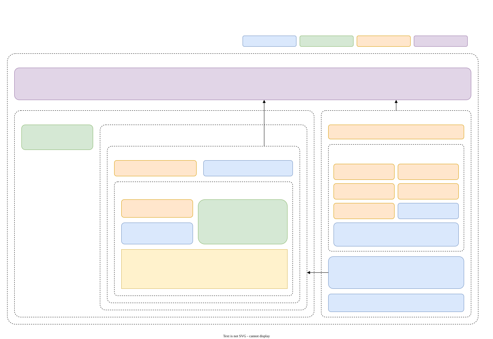

# Integration guide

> Tiếng Việt: [`../vi/INTEGRATION.md`](../vi/INTEGRATION.md) · Architecture: [`ARCHITECTURE.md`](ARCHITECTURE.md) · Custom UI: [`CUSTOM-UI.md`](CUSTOM-UI.md)

This guide takes an existing expo-router app to a working morph menu in three files, then covers configuration, platform behavior, testing and troubleshooting.

## Requirements

| | Version |
| --- | --- |
| Expo SDK | 58+ |
| expo-router | 58+ |
| react-native-reanimated | 4+ (with `react-native-worklets`) |
| react-native-gesture-handler | 3+ |
| react-native-safe-area-context | 5+ |
| react-native-screens | 4+ |

Optional, picked up automatically when installed: `expo-haptics` (haptic ticks), `expo-glass-effect` (Liquid Glass on iOS 26+), `expo-blur` (blurred card on iOS). Nothing breaks if they're missing.

Tested on Android (emulators, Android 9 and 17) and web (Chrome). iOS has not yet been verified on a device.

## Install

```bash
npx expo install expo-morph-menu \
  expo-router react-native-reanimated react-native-worklets \
  react-native-gesture-handler react-native-safe-area-context react-native-screens

# optional
npx expo install expo-haptics expo-blur expo-glass-effect
```

`babel.config.js` must use `babel-preset-expo` (default in Expo projects). It enables the worklets plugin that Reanimated needs. The package ships TypeScript source for Metro (`react-native` export condition), so your Babel config compiles its worklets too.



## Step 1 — root layout

```tsx
// app/_layout.tsx
import { Ionicons } from '@expo/vector-icons';
import { Stack } from 'expo-router';
import { MorphMenu, MorphProvider, morphSheetScreenOptions, type MorphItem } from 'expo-morph-menu';
import { GestureHandlerRootView } from 'react-native-gesture-handler';
import { SafeAreaProvider } from 'react-native-safe-area-context';

const items: MorphItem[] = [
  {
    key: 'camera',
    label: 'Camera',
    tint: '#3a3a3c',
    icon: ({ size, color }) => <Ionicons name="camera" size={size} color={color} />,
    href: { pathname: '/(sheet)/[key]', params: { key: 'camera' } },
  },
  {
    key: 'audio',
    label: 'Audio',
    tint: '#ff453a',
    icon: ({ size, color }) => <Ionicons name="mic" size={size} color={color} />,
    href: { pathname: '/(sheet)/[key]', params: { key: 'audio' } },
  },
];

export default function RootLayout() {
  return (
    <SafeAreaProvider>
      <GestureHandlerRootView style={{ flex: 1 }}>
        <MorphProvider items={items}>
          <Stack screenOptions={{ headerShown: false }}>
            <Stack.Screen name="index" />
            <Stack.Screen name="(sheet)" options={morphSheetScreenOptions} />
          </Stack>
          <MorphMenu />
        </MorphProvider>
      </GestureHandlerRootView>
    </SafeAreaProvider>
  );
}
```

Order matters:

- `SafeAreaProvider` and `GestureHandlerRootView` **outside** `MorphProvider`.
- `<MorphMenu />` **after** the root `Stack`, inside `MorphProvider` — it is an overlay that must draw above your screens.
- The sheet group gets `morphSheetScreenOptions` (`transparentModal`, `animation: 'none'`, `gestureEnabled: false`, transparent background). The package drives the animation; a native transition on top would fight it.

## Step 2 — the sheet route group

Every route inside this group grows out of the menu card and shrinks back into it.

```tsx
// app/(sheet)/_layout.tsx
import { Stack } from 'expo-router';
import { MorphSheetLayout } from 'expo-morph-menu';

export default function SheetLayout() {
  return (
    <MorphSheetLayout>
      <Stack.Screen name="[key]" options={{ headerShown: false }} />
      {/* more screens are pushed natively inside the sheet */}
      <Stack.Screen name="details" options={{ title: 'Details' }} />
    </MorphSheetLayout>
  );
}
```

`MorphSheetLayout` props:

| Prop | |
| --- | --- |
| `children` | `<Stack.Screen>` declarations for the group |
| `screenOptions` | merged into the inner Stack's defaults (background = `colors.sheetBackground`, minimal back button) |

You can name the group anything; the items' `href`s just need to point into it.

## Step 3 — screens

```tsx
// app/(sheet)/[key].tsx
import { useLocalSearchParams } from 'expo-router';
import { MorphCloseButton, useMorphSettled } from 'expo-morph-menu';
import { useSafeAreaInsets } from 'react-native-safe-area-context';

export default function SheetScreen() {
  const { key } = useLocalSearchParams<{ key: string }>();
  const settled = useMorphSettled();
  const insets = useSafeAreaInsets();

  return (
    <View style={{ flex: 1 }}>
      <View style={{ paddingTop: insets.top + 6, paddingHorizontal: 16 }}>
        <MorphCloseButton />
      </View>
      {settled ? <HeavyContent id={key} /> : <Skeleton />}
    </View>
  );
}
```

- **Closing:** `MorphCloseButton` calls `router.back()`. Any other way out works too — `router.back()` from your own button, Android back, browser back, Esc on web, and on iOS edge swipe / drag down. All run the reverse morph.
- **`useMorphSettled()`** is `true` once the shell finished growing. Mounting a heavy list mid-animation is the most common source of jank.
- **Safe area:** the shell covers the whole screen including system bars; pad your header with `insets.top` and scroll content with `insets.bottom`.

`MorphCloseButton` props: `icon`, `size` (32), `iconSize`, `color`, `backgroundColor`, `tintImage`, `style`, any `Pressable` prop. Call `e.preventDefault()` in `onPress` to stop the default `router.back()`.

## Items

```ts
type MorphItem = {
  key: string;                 // unique; also the testID suffix
  label: string;
  href: Href;                  // a route inside the sheet group
  icon?: MorphIcon;            // element, image source, or ({ size, color }) => node
  iconTint?: boolean;          // tint single-color PNGs (default true)
  tint?: string;               // circle behind the icon; omit for no circle
  accessibilityLabel?: string;
  data?: Record<string, unknown>; // anything your custom Item slot needs
};
```

Keep `items` stable (module constant or `useMemo`). Icons:

```tsx
icon: <Ionicons name="camera" size={15} color="#fff" />          // element
icon: require('./camera.png')                                     // bundled image (tinted)
icon: { uri: 'https://example.com/camera.png' }                   // remote image
icon: ({ size, color }) => <CameraSvg width={size} color={color} />  // follows theme
```

## Configuration

Pass only what you change; everything else uses platform defaults.

```tsx
<MorphProvider
  items={items}
  config={{
    closeMenuOnDismiss: false,
    anchor: 'bottom-right',
    layout: { fabSize: 56, cardWidth: 236, rowHeight: 46 },
    radius: Platform.select({ ios: { card: 28 }, android: { card: 20 } }),
    dismiss: { dragDown: false },
    colorScheme: 'auto',
  }}
/>
```

| Key | Default (iOS / Android / web) | Notes |
| --- | --- | --- |
| `closeMenuOnDismiss` | `false` | `false`: after the full screen closes, the menu stays open. `true`: collapses to the button. |
| `anchor` | `'bottom-right'` | or `'bottom-left'` |
| `layout.fabSize` | `56` | |
| `layout.cardWidth` | `236` | |
| `layout.rowHeight` | `46` | default row height (see `itemHeight`) |
| `layout.padding` | `10` | top/bottom padding of the list |
| `layout.margin` | `20` | distance from the screen edges (+ bottom safe area) |
| `layout.iconSize` | `15` | row icon size; the tint circle is `iconSize + 11` |
| `layout.separatorHeight` | `1` | used only with a `Separator` slot |
| `radius.card` / `radius.sheet` / `radius.fab` | `28` / `0` / circle | `fab: null` = round |
| `shadow` | opacity 0.18, radius 18, offsetY 8 / elevation 10 | iOS & web use color/opacity/radius/offsetY; Android uses elevation |
| `dismiss.edgeSwipe` | `true` / `false` / `false` | left-edge swipe, sheet root screen only |
| `dismiss.dragDown` | `true` / `false` / `false` | |
| `spring` | `{ duration: 460, dampingRatio: 0.85 }` | respects Reduce Motion |
| `haptics` | `true` | needs `expo-haptics` |
| `surface` | `'auto'` | `'glass'`, `'blur'`, `'solid'` — auto: Liquid Glass (iOS 26+) → blur (iOS) → solid |
| `colorScheme` | `'auto'` | `'light'`, `'dark'` |
| `backdropOpacity` | `0.25` | darkness behind the full screen |
| `colors.light` / `colors.dark` | `LIGHT_COLORS` / `DARK_COLORS` | `surface`, `sheetBackground`, `text`, `scrim`, `backdrop`, `highlight`, `fabIcon`, `closeBackground`, `closeIcon`, `iconForeground` |

If your screens are light-only, set `colorScheme: 'light'` — otherwise a dark OS/browser gives the close button a light icon on your white screen.

Other `MorphProvider` props: `components` and `itemHeight` (see [Custom UI](CUSTOM-UI.md)), `fabIcon`, `closeIcon`.

## Callbacks

| Prop | When |
| --- | --- |
| `onHover(item)` | finger slides onto a row (or mouse hovers it on web) |
| `onSelect(item)` | a row is chosen, right before `router.push` |
| `onOpen()` / `onClose()` | the menu starts opening / closing |
| `onSheetDismissed(item)` | the full screen has finished closing |

Prefetch in `onHover` — the user is still deciding, the data is on its way:

```tsx
const queryClient = useQueryClient();
<MorphProvider
  items={items}
  onHover={(item) => queryClient.prefetchQuery({ queryKey: ['sheet', item.key], queryFn: () => fetchSheet(item.key) })}
/>
```

## Platform behavior

| | iOS | Android | Web |
| --- | --- | --- | --- |
| Card surface (auto) | Liquid Glass (26+) or blur | solid | solid |
| Close full screen | close button, edge swipe, drag down | close button, hardware back | close button, Esc, browser back |
| Close menu | scrim | scrim, hardware back | scrim, Esc |
| `onHover` | drag | drag | drag, mouse hover |
| Haptics | ✓ | ✓ | — |

Web notes: reloading or closing the tab while a full screen is open does not prompt "Leave site?"; press-and-drag works with a mouse; text isn't selected while dragging.

## Deep links

Sheet routes are ordinary routes, so `myapp://camera` (or `/camera` on web) opens them directly. With no card to grow from, the shell grows from a centered rect. Closing returns to whatever is underneath.

## Testing

Stable test IDs:

| ID | Element |
| --- | --- |
| `morph-fab` | the button hit area |
| `morph-scrim` | scrim behind the open menu |
| `morph-item-<key>` | a row |
| `morph-close` | `MorphCloseButton` (default) |

Maestro example:

```yaml
- tapOn: { id: "morph-fab" }
- tapOn: { id: "morph-item-camera" }
- tapOn: { id: "morph-close" }
- assertVisible: { id: "morph-item-camera" }   # menu stays open (closeMenuOnDismiss: false)
```

To catch visual defects (flicker, ghosting, empty frames), render `<MorphTrace enabled={__DEV__ && myFlag} />` inside `MorphProvider` and scan the `[morph]` log lines for `FLICKER`, `HOLE`, `GHOST`, `OVERLAP`. The repository's example app has a complete Maestro + logcat runner (`example/scripts/e2e.mjs`).

## Troubleshooting

| Symptom | Cause / fix |
| --- | --- |
| The menu draws behind screens / doesn't show | `<MorphMenu />` must be after the root `Stack`, inside `MorphProvider`. |
| "useMorph() must be used inside &lt;MorphProvider&gt;" | `MorphSheetLayout`, `MorphCloseButton` or a hook is outside the provider. |
| The full screen slides in with a native animation | The group is missing `options={morphSheetScreenOptions}`. |
| Gap at the bottom of the full screen (Android) | Don't wrap the app in a container with its own size; the package uses `useSafeAreaFrame()`, which needs `SafeAreaProvider` at the root. |
| Content jumps or janks while opening | Mount heavy content after `useMorphSettled()`. |
| A ghost of the menu during close | A custom `Item`/`Background` isn't pure or isn't opaque — see [Custom UI › contract](CUSTOM-UI.md#the-contract). |
| Close button invisible in dark mode | Your screens are light-only: set `colorScheme: 'light'`, or theme your screens. |
| "Two copies of React" / hooks errors in a monorepo | Make sure Metro resolves a single `react`, `react-native-reanimated` and `expo-router`. |
| Worklet errors ("… is not a worklet") | `babel.config.js` must use `babel-preset-expo`; clear the Metro cache (`expo start -c`). |
