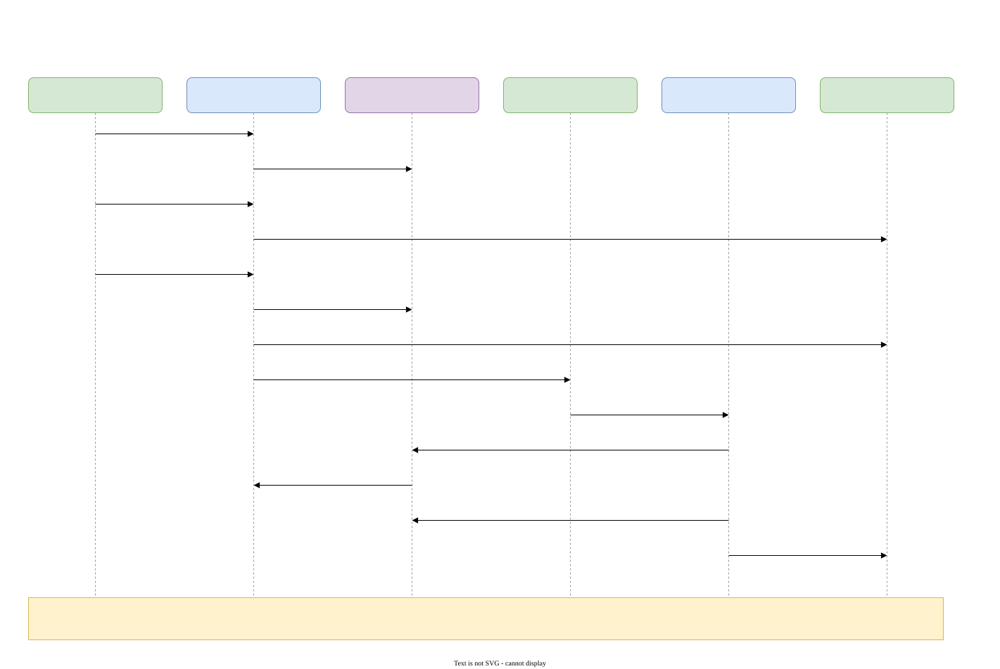
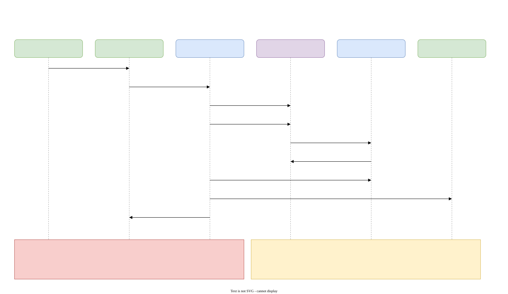
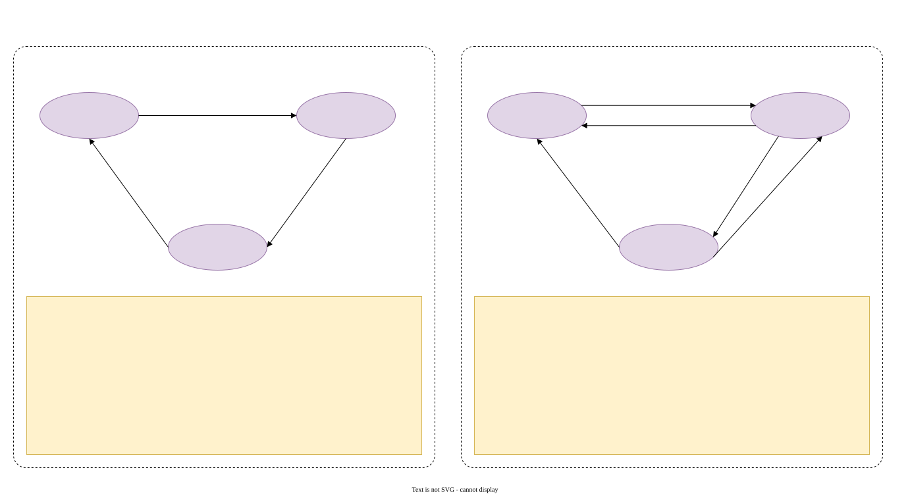
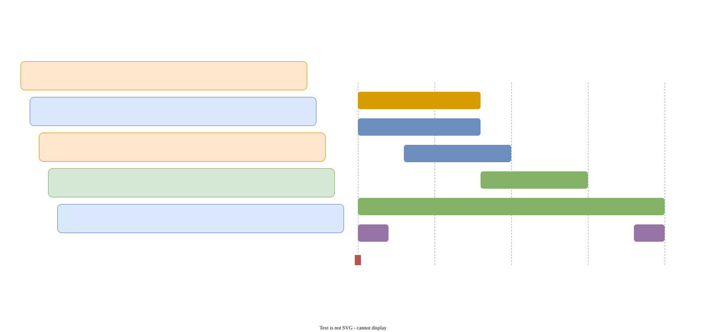

# Kiến trúc

> Sơ đồ: [`../diagrams/expo-morph-menu.vi.drawio`](../diagrams/expo-morph-menu.vi.drawio) (7 trang, trang tổng quan nằm cuối). Mở bằng [app.diagrams.net](https://app.diagrams.net), draw.io desktop hoặc extension "Draw.io Integration" của VS Code. Số trang nhắc tới bên dưới là của file này.
>
> English: [`../en/ARCHITECTURE.md`](../en/ARCHITECTURE.md)

`expo-morph-menu` biến một nút nổi thành card menu, rồi biến một dòng menu thành một **route full screen của expo-router** — và khi đóng thì thu màn đó về lại card. Tài liệu này giải thích package được dựng thế nào và vì sao.

## 1. Ranh giới: cái gì là route, cái gì không

Cách dễ nhất để dựng interaction này là một `Animated.View` lớn morph từ nút sang card rồi sang full screen. Nhìn thì đúng, nhưng "màn hình" đó không tồn tại với hệ thống điều hướng: không có màn con, không có back cứng Android, không URL, không deep link, không khôi phục trạng thái.

Package vạch ranh giới khác đi:

| Thành phần | Là route? | Lý do |
| --- | --- | --- |
| Nút → card menu | **Không** — overlay (`MorphMenu`) | Affordance tạm thời, như context menu. Không ai deep link vào một menu đang mở. Nhưng nó vẫn phải nuốt back cứng Android / phím Esc. |
| Card → full screen | **Có** — một nhóm route thật (`MorphSheetLayout`) | Là điểm đến: cần URL, màn con, điều hướng lùi, khôi phục trạng thái. |

Mọi thứ khác là hệ quả của ranh giới này. Overlay và route không import nhau; chúng chỉ gặp nhau ở `MorphProvider` (trang 1).


## 2. Các khối

| Module | Vai trò |
| --- | --- |
| `MorphProvider` | Context: shared value, cấu hình đã resolve, màu (sáng/tối), item, bố cục dòng, slot, callback. |
| `MorphMenu` | Overlay: vùng bấm của nút + cử chỉ Pan, card animate, scrim, các dòng. Đặt **sau** navigator gốc. |
| `MorphSheetLayout` | Layout cho nhóm route morph: vỏ animate, `Stack` lồng có kích thước cố định, cử chỉ đóng, `usePreventRemove`. |
| `morphSheetScreenOptions` | Options của nhóm đó ở stack gốc: `transparentModal`, `animation: 'none'`, tắt cử chỉ native, nền trong suốt. |
| `MenuFace` / `DefaultItem` | Các dòng menu — vẽ trong card **và** trên vỏ lúc đang morph. |
| `MorphCloseButton` | Nút đóng cho các màn trong sheet (`router.back()`), icon tuỳ biến được. |
| `useMorphSettled()` | `true` khi full screen đã nở xong — hoãn phần nặng tới lúc đó. |
| `useMorphProgress()` | `{ menu, sheet }` chỉ đọc, để animate UI của riêng bạn. |
| `MorphTrace` | Gỡ lỗi: ghi từng frame và đánh dấu lỗi giao ca. |

Mã nguồn nằm trong `src/`: `config.ts` (mặc định, màu), `geometry.ts` (rect, vị trí dòng), `visibility.ts` (ai đang hiện), `constants.ts`, `shadow.ts`, `Surface.tsx` + `optional.ts` (kính/blur/haptics, đều tuỳ chọn), `web.ts`.

## 3. Trạng thái chung

Bốn shared value của Reanimated nối hai nửa:

| Giá trị | Ai sở hữu | Ý nghĩa |
| --- | --- | --- |
| `menu` | overlay | 0 → 1: nút nở thành card |
| `sheet` | route | 0 → 1: card nở thành full screen |
| `origin` | overlay ghi, route đọc | rect của card lúc chọn dòng |
| `handoff` | cả hai | ai đang hiện card: `MENU`, `ROUTE` hoặc `RETURNING` |

`origin` giữ cho hai nửa độc lập: deep link thẳng vào một route sheet thì không có origin, vỏ nở từ một rect dự phòng ở giữa màn.

`handoff` quyết định chất lượng cảm nhận. Route mount bất đồng bộ; nếu overlay mờ đi chỉ theo tiến trình thì thỉnh thoảng sẽ lọt một frame trống. Overlay chỉ biến mất khi route đã thật sự có mặt trên màn.

## 4. Luồng mở (trang 2)



1. Nhấn nút → `menu` spring về 1, mode `open`. Vùng bấm giữ hoạt động trong lúc còn nhấn (xem §8).
2. Rê qua các dòng (hover chuột trên web) → dòng được tô sáng, gọi `onHover(item)` — sớm hơn lúc nhả tay 150–400 ms, thời điểm lý tưởng để prefetch.
3. Nhả tay trên một dòng, hoặc chạm một dòng. Nếu card chưa nở xong (`menu < 0.995`), lệnh chọn chờ — push sớm thì vỏ sẽ nở từ một rect mà card chưa tới.
4. `origin = rect card`, `handoff = MENU`, `onSelect(item)`, `router.push(item.href)`.
5. Route mount, không animation. Frame đầu của nó là vỏ đúng bằng rect của card, đã vẽ sẵn các dòng menu (`MenuFace`) — pixel giống hệt.
6. `handoff = ROUTE` (native: `onLayout` của vỏ; web: `useLayoutEffect`) → card overlay ẩn đi. Mắt không thấy gì thay đổi.
7. `sheet` spring về 1: vỏ lớn dần, nội dung hiện lên, mặt menu mờ đi.
8. Spring xong → `useMorphSettled()` thành `true`.

Mọi bước hình ảnh chạy trên UI thread. JS chỉ push route và gọi callback.

## 5. Luồng đóng (trang 3)



Mọi đường đóng — nút đóng / `router.back()`, back cứng Android, back của trình duyệt, Esc trên web, vuốt cạnh trái hay kéo xuống trên iOS — đều thành một hành động "gỡ route", và `usePreventRemove` chặn nó. Vì vậy morph ngược nằm ở đúng một chỗ:

1. `handoff = RETURNING`, `sheet` spring về 0 (từ chỗ cử chỉ để lại — không giật).
2. Vỏ thu nhỏ; nội dung mờ đi; mặt menu hiện dần.
3. Ở frame có `sheet ≤ 0.005` (`ARRIVED`), vỏ lệch card dưới 1 dp: **cắt** — vỏ opacity 0, card opacity 1, trong cùng một frame UI.
4. `closeMenuOnDismiss = false` (mặc định): scrim hiện lại, menu vẫn mở. `true`: card thu tiếp về nút.
5. Spring xong → `sheetDismissed()` đồng bộ state JS của overlay, `onSheetDismissed(item)`, rồi `repeat()` cho hành động điều hướng gốc chạy tiếp.

`handoff` cố ý giữ `RETURNING` kể cả sau unmount: Android gỡ view native bất đồng bộ, đặt lại nó sẽ làm vỏ cũ hiện thêm một frame. Lần chọn kế tiếp mới đặt lại.

## 6. Vì sao giao ca là một cú cắt, không phải crossfade (trang 4)



Một phiên bản trước crossfade vỏ và card trong 12 % cuối của tiến trình. Ảnh chụp giữa lúc đóng cho thấy hai bản menu nửa trong suốt lệch nhau vài dp — chữ in đúp, nhoè, mắt đọc thành một cú nháy. Cắt trong một frame ở thời điểm hai lớp trùng nhau tới từng pixel thì không thấy gì; và vì cả hai lớp đọc cùng một giá trị `sheet` trong cùng frame UI, rớt frame cũng không tách được chúng.

**Thứ tự lớp khác nhau theo platform:**

- **iOS:** `transparentModal` được present đè lên root view, nên route che overlay. Card không cần ẩn — và không được ẩn bằng opacity: view Liquid Glass / blur (`UIVisualEffectView`) vẽ sai khi alpha < 1.
- **Android & web:** các màn nằm chung cây view và overlay khai báo sau navigator, nên nó ở trên và phải ẩn khi route chiếm màn.

## 7. Vỏ: nội dung kích thước cố định (trang 5)



```tsx
<Animated.View style={shell}>                       // x, y, width, height, bo góc đổi mỗi frame
  <Animated.View style={{ width: W, height: H }}>   // CỐ ĐỊNH, absolute
    <Stack />                                        // không bao giờ bị đo lại
  </Animated.View>
</Animated.View>
```

Nếu `Stack` lồng co giãn theo vỏ, mỗi frame kéo theo một lần layout cả cây màn hình. Ruột kích thước cố định, bị `overflow: hidden` cắt bớt, thì chỉ còn một node phải đo lại. Đây cũng là lý do các màn con trong sheet là **native stack thật** (animation push native, vuốt back native, back cứng Android).

Các lớp trong vỏ và lúc chúng thay đổi (tiến trình 0 = card, 1 = full screen):

| Lớp | Khoảng | Thay đổi |
| --- | --- | --- |
| slot `Background` (variant `sheet`) | 0 → 0.4 | opacity 1 → 0 |
| màu nền vỏ | 0 → 0.4 | màu card → `colors.sheetBackground` |
| `MenuFace` (các dòng, neo góc card) | 0.15 → 0.5 | opacity 1 → 0 |
| nội dung của bạn | 0.4 → 0.75 | opacity 0 → 1 |
| nội dung của bạn | 0 → 1 | translateY −`insets.top` → 0 |
| bóng | 0 → 0.1 và 0.9 → 1 | tăng/giảm dần; tắt khi đang bay |

Nội dung neo góc trên-trái của vỏ; ở cỡ card, phần lộ ra sẽ là dải status bar trống, nên lúc còn nhỏ nó được đẩy lên `insets.top`.

Kích thước lấy từ `useSafeAreaFrame()`, không phải `useWindowDimensions()`: trên Android edge-to-edge, "window" không tính thanh điều hướng và vỏ sẽ dừng trước mép đáy.

## 8. Thao tác và cử chỉ

| | iOS | Android | Web |
| --- | --- | --- | --- |
| Mở menu | chạm / nhấn | chạm / nhấn | click / nhấn |
| Chọn | chạm dòng, hoặc giữ nút rồi rê | như iOS | click dòng, hoặc giữ rồi rê |
| Prefetch (`onHover`) | khi rê | khi rê | khi rê hoặc hover |
| Đóng menu | chạm scrim | chạm scrim, back cứng | click scrim, Esc |
| Đóng full screen | nút đóng, vuốt cạnh¹, kéo xuống¹ | nút đóng, back cứng | nút đóng, Esc², back trình duyệt |

¹ `config.dismiss` — mặc định bật trên iOS, tắt trên Android. Vuốt cạnh chỉ bật ở màn gốc của sheet; ở màn con, cạnh trái thuộc về vuốt back native.
² Chỉ ở màn gốc của sheet.

Chạm rồi nhả tại chỗ không bao giờ chọn dòng: nút nằm trong dòng cuối của card, giữ tay hơi lâu là sẽ mở nhầm dòng đó.

**Ai nhận chạm** (trang 4, bên phải): ở mode `route`, overlay không nhận chạm và không nghe back — nếu không, ở nơi overlay nằm trên, scrim của nó sẽ nuốt nút đóng của bạn.

## 9. Riêng cho web

Mỗi điểm dưới đây đều tìm ra khi test trên Chrome, và package đã xử lý:

- **Giữ pointer.** Gesture Handler bỏ qua `setPointerCapture` khi view của gesture có `role="button"`. Không giữ pointer thì cú giữ-và-rê rời khỏi nút sẽ không bao giờ đưa `pointerup` về nút, gesture kẹt luôn. Trên web, role được chuyển xuống một phần tử con.
- **Vùng bấm trong lúc nhấn.** Phần tử bị đổi sang `pointer-events: none` giữa chừng không nhận `pointerup`; vùng bấm của nút giữ hoạt động tới khi nhả.
- **Thời điểm giao ca.** `onLayout` (ResizeObserver) về trễ vài frame trên web; route giao ca trong `useLayoutEffect`.
- **Không hỏi "Leave site?".** `usePreventRemove` sẽ chặn cả việc rời trang suốt lúc full screen mở. Package gọi `disablePrevention()` của hook khi có `beforeunload`, từ một listener đăng ký trước listener của React Navigation.
- **Bóng.** React Native Web chỉ dựng đúng `box-shadow` khi mọi thuộc tính `shadow*` nằm chung một style; với `shadowOpacity` animate riêng thì không, nên trên web package tự viết `box-shadow`.
- Esc để đóng, hover chuột gọi `onHover`, không bôi đen chữ khi kéo.

## 10. Hình học

Mọi rect đều **tính trước, không đo** (`geometry.ts`): đo là bất đồng bộ, frame đầu sẽ sai. Chiều cao dòng lấy từ `layout.rowHeight` hoặc `itemHeight(item, index)`; `listLayout()` đổi chúng thành vị trí từng dòng, dùng cho card, mặt menu trên vỏ, dò dòng khi rê (`rowAt`) và highlight. `anchor` lật toàn bộ cho `bottom-left`.

## 11. Nguyên tắc hiệu năng

- Không gì về hình ảnh phải chờ JS: callback của spring và `useAnimatedReaction` lái giao ca trên UI thread. Menu phản ứng đúng frame vỏ tới nơi thay vì chờ spring dừng hẳn (nó lắc ~7 frame quanh 0).
- Phần nặng của màn mount sau `useMorphSettled()`; nội dung không bao giờ bị gỡ lúc bắt đầu animation đóng.
- Bóng tắt khi bounds đổi mỗi frame.
- `MorphProvider` memo cấu hình theo nội dung, nên `config={{…}}` viết inline không làm consumer render lại.

Số đo và lịch sử từng lần sửa: [`../PERFORMANCE.md`](../PERFORMANCE.md).

## 12. Quan sát

`<MorphTrace enabled />` ghi một dòng mỗi frame có thay đổi:

```
[morph] f=56 m=1.000 s=0.002 h=2 ov=1.00 sh=0.00 handoff
```

`m`/`s` = tiến trình, `h` = trạng thái giao ca, `ov`/`sh` = opacity thực của card/vỏ (tính bằng đúng các hàm mà style dùng). Nhãn: `handoff` (đổi chỗ có chủ đích), `FLICKER` (mọi cú nhảy khác > 0.5 trong một frame), `HOLE` (không gì hiện khi route còn trên màn), `GHOST` (hai lớp cùng hiện một phần khi chưa trùng nhau), `OVERLAP` (card còn đè lên vỏ đang chuyển động), `DROP(n)` (frame mất n ms). Bộ chạy E2E của app ví dụ trượt khi có bất kỳ nhãn lỗi nào — xem [`INTEGRATION.md`](INTEGRATION.md#kiểm-thử).

## 13. Các hướng đã cân nhắc

- **Thư viện shared element / zoom transition** (ví dụ `react-native-screen-transitions`): ít code hơn, nhưng thêm dependency và thường là stack chạy bằng JS. Đáng chọn nếu cả app cần nhiều transition tuỳ biến.
- **Shared element transition của Reanimated:** gọn nhất về code và giữ native stack, nhưng tương tác với cử chỉ back bị `usePreventRemove` chặn — đúng cơ chế package này dựa vào. Kiểm tra tình trạng của bản Reanimated bạn dùng trước khi chọn.
- **Một overlay cho mọi thứ:** loại — xem §1.

Các nền tảng native làm cùng một ý: ẩn nguồn và đích, animate một view thứ ba giữa hai bounds, rồi tráo lại. `matchedTransitionSource` + `.navigationTransition(.zoom)` của SwiftUI là câu trả lời của Apple cho "morph nhưng vẫn là route"; `SharedTransitionLayout` của Compose giữ cả hai đầu trong một cây, như package này.

## 14. Giới hạn đã biết

- **Chưa kiểm trên thiết bị iOS** (vuốt cạnh, Liquid Glass, blur). Android và web có E2E và trace từng frame.
- **Xoay màn hình khi đang mở:** `origin` là toạ độ tuyệt đối; xoay lúc sheet mở thì rect cũ sai. Khoá xoay cho nhóm route, hoặc lưu kèm `W/H` rồi quy đổi.
- **Một menu cho cả app:** `origin` là một rect đơn. Nhiều menu cần một map nhỏ theo route.
- **Trợ năng:** các dòng có role `menuitem`, mọi thao tác rê đều có cách thay thế bằng chạm; chưa có thông báo mở/đóng cho trình đọc màn hình.
- **Lồng sâu hơn:** nếu stack lồng có tab hoặc modal riêng, xem lại chỗ `usePreventRemove` bắn (chỉ khi stack lồng ở màn gốc).
