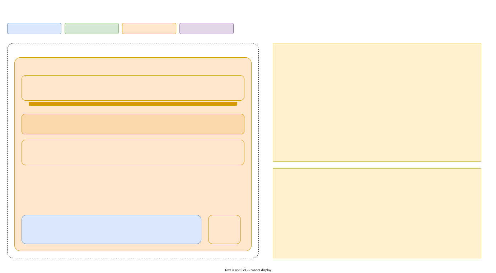

# Tuỳ biến UI: slot

> English: [`../en/CUSTOM-UI.md`](../en/CUSTOM-UI.md) · Sơ đồ: trang 6 của [`../diagrams/expo-morph-menu.vi.drawio`](../diagrams/expo-morph-menu.vi.drawio) · Tích hợp: [`INTEGRATION.md`](INTEGRATION.md)

Mỗi dự án có một bộ UI riêng. `expo-morph-menu` không bắt bạn dùng giao diện của nó: **package lái chuyển động, bạn vẽ phần nhìn thấy.**

- **Package giữ** các view chuyển động — kích thước, vị trí, bo góc, cắt nội dung, bóng — cùng hình học, cử chỉ và việc giao ca giữa menu và full screen.
- **Bạn giữ** những gì nhìn thấy, qua các *slot*: component React bình thường, nhận props và shared value.

Dùng component của design system bạn đang có bên trong slot — Tamagui, NativeWind, React Native Paper, Unistyles, gluestack, hay view thường.

## Các slot



```tsx
<MorphProvider items={items} components={{ Background, Item, Trigger, Highlight, Separator, Scrim, Backdrop }} itemHeight={…} />
```

| Slot | Props | Vẽ ở đâu | Mặc định |
| --- | --- | --- | --- |
| `Background` | `variant: 'menu' \| 'sheet'`, `progress`, `colors` | lấp đầy card; vẽ lại trên vỏ full screen lúc đang morph | Liquid Glass / blur / nền đặc `colors.surface` |
| `Item` | `item`, `index`, `variant`, `hovered`, `height`, `colors` | từng dòng, trong card và trên vỏ | `DefaultItem`: icon trong vòng tròn `tint` + nhãn |
| `Trigger` | `progress`, `size`, `colors` | mặt nút + (trong góc card) | `fabIcon` hoặc "+", mờ và xoay 45° |
| `Highlight` | `hovered`, `colors` — hoặc `null` | sau dòng đang hover; package đặt vị trí và kích thước | `colors.highlight` bo góc |
| `Separator` | `index`, `colors` | giữa các dòng, cao `layout.separatorHeight` | không có |
| `Scrim` | `progress`, `colors` | sau menu đang mở; chạm để đóng | `colors.scrim` |
| `Backdrop` | `progress`, `colors` | sau full screen | `colors.backdrop` × `backdropOpacity` |

- `progress` / `hovered` là `SharedValue` của Reanimated — đọc trong `useAnimatedStyle`.
- `variant` cho `Item`/`Background` biết chúng đang ở card tương tác (`'menu'`) hay bản tĩnh trên vỏ (`'sheet'`). Thường bạn bỏ qua; nó có để phục vụ analytics hoặc viền debug.
- `Scrim` và `Backdrop` được package animate opacity; bạn vẽ chúng tĩnh.
- Chiều cao dòng: `layout.rowHeight` cho mọi dòng, hoặc `itemHeight={(item, index) => number}`.

## Hợp đồng

Bốn quy tắc dưới đây giữ cho morph liền mạch. Mỗi quy tắc xuất phát từ một lỗi đã đo được và đã sửa.

1. **Slot phải thuần.** `Item` và `Background` được vẽ **hai lần**: trong card, và trên vỏ full screen lúc đang morph. Lúc giao ca, hai bản đổi chỗ trong một frame, nên phải giống nhau tới từng pixel. Cùng props → cùng kết quả. Không state riêng, không animation lúc mount/xuất hiện, không hiệu ứng nhấn riêng (các dòng đã được package bọc trong `Pressable`).
2. **Không tự animate kích thước hay vị trí.** Package animate container; animate bên trong sẽ giành với morph. Hãy animate opacity, màu, xoay, scale của icon… từ `progress` và `hovered`.
3. **Chiều cao dòng biết trước.** Không bao giờ đo: dùng `rowHeight` hoặc `itemHeight` thuần. Chiều cao quyết định việc dò dòng khi rê-để-chọn và vị trí highlight.
4. **`Background` phải đục.** Nền trong suốt sẽ làm lộ frame mà vỏ và card đổi chỗ. Muốn trông trong mờ? Dùng `surface: 'blur' | 'glass'` và không dùng slot `Background`.

**Cách kiểm:** render `<MorphTrace enabled />` rồi tìm `GHOST` / `FLICKER` / `OVERLAP` trong log khi mở và đóng. Trên web, `example/public/phone.html` hiện app trong khung cỡ điện thoại.

## Làm từng bước: card tối có subtitle

Đây là bản "Tuỳ biến (slot)" của app ví dụ (`example/components/CustomSlots.tsx`), đã kiểm trên Android và web.

```tsx
import { Ionicons } from '@expo/vector-icons';
import { BlurView } from 'expo-blur';
import {
  renderIcon,
  type MorphComponents,
  type MorphConfigInput,
  type MorphItem,
  type MorphItemProps,
  type MorphTriggerProps,
} from 'expo-morph-menu';
import { StyleSheet, Text, View } from 'react-native';
import Animated, { Extrapolation, interpolate, useAnimatedStyle } from 'react-native-reanimated';

// 1. Nền đục — màu card, viền, ảnh gradient của bạn…
function Background() {
  return <View style={[StyleSheet.absoluteFill, { backgroundColor: '#1f2a44' }]} />;
}

// 2. Một dòng có subtitle và tự vẽ trạng thái hover.
function Item({ item, index, hovered, colors }: MorphItemProps) {
  const subtitle = item.data?.subtitle as string | undefined;
  const hover = useAnimatedStyle(() => ({
    backgroundColor: hovered.value === index ? 'rgba(255,255,255,0.12)' : 'transparent',
  }));
  return (
    <Animated.View style={[styles.item, hover]}>
      <View style={[styles.badge, { backgroundColor: item.tint ?? '#334' }]}>
        {renderIcon(item.icon, { size: 16, color: colors.iconForeground })}
      </View>
      <View style={{ flex: 1 }}>
        <Text style={styles.title}>{item.label}</Text>
        {subtitle ? <Text style={styles.subtitle}>{subtitle}</Text> : null}
      </View>
    </Animated.View>
  );
}

// 3. Mặt nút: animate xoay/opacity theo progress, không animate kích thước.
function Trigger({ progress }: MorphTriggerProps) {
  const style = useAnimatedStyle(() => ({
    opacity: interpolate(progress.value, [0, 0.35], [1, 0], Extrapolation.CLAMP),
    transform: [{ rotate: `${interpolate(progress.value, [0, 0.35], [0, 90], Extrapolation.CLAMP)}deg` }],
  }));
  return (
    <Animated.View style={style}>
      <Ionicons name="apps" size={22} color="#fff" />
    </Animated.View>
  );
}

export const components: MorphComponents = {
  Background,
  Item,
  Trigger,
  Separator: () => <View style={{ flex: 1, marginHorizontal: 18, backgroundColor: 'rgba(255,255,255,0.15)' }} />,
  Scrim: () => <BlurView intensity={20} tint="dark" style={StyleSheet.absoluteFill} />,
  Highlight: null, // Item tự vẽ trạng thái hover
};

export const config: MorphConfigInput = {
  radius: { card: 18, fab: 18 },                       // nút vuông bo góc
  layout: { cardWidth: 260, separatorHeight: StyleSheet.hairlineWidth },
  colors: { light: { iconForeground: '#fff' }, dark: { iconForeground: '#fff' } },
};

export const itemHeight = (item: MorphItem) => (item.data?.subtitle ? 58 : 46);
```

```tsx
<MorphProvider items={items} components={components} config={config} itemHeight={itemHeight}>
```

Ghi chú:

- Mỗi `Item` nằm trong một ô dòng cao đúng chiều cao của nó; lấp đầy ô bằng `flex: 1`.
- `Separator` lấp đầy một ô package đặt cao `separatorHeight`; vẽ bằng `flex: 1`.
- Slot `Highlight` (khi dùng) được package đặt vị trí và kích thước theo dòng đang hover — vẽ lấp đầy (`flex: 1`).
- Khai báo component slot **ở cấp module** (hoặc memo). Một component mới mỗi lần render sẽ làm mọi dòng mount lại.
- `item.data` chứa bất cứ gì `Item` của bạn cần (subtitle, số badge, cờ disabled).

## Màu và vỏ

Khi full screen nở ra, vỏ hiện `Background` của bạn mờ dần trên nền `colors.sheetBackground`, còn các màn của bạn hiện dần lên. Giữ chúng hài hoà:

- `colors.sheetBackground` nên trùng màu nền các màn của bạn (nó cũng thành `contentStyle` của Stack lồng).
- `Background` tối với sheet trắng thì vỏ sẽ đi qua màu pha giữa hai bên trong vài frame — chuyện bình thường. Muốn morph êm hơn, dùng `Background` gần với `sheetBackground`.
- Chế độ tối: truyền cả hai bảng màu (`colors.light`, `colors.dark`) và đọc `colors` từ props của slot thay vì viết cứng.

## Icon và nút đóng

Mọi icon đều nhận `MorphIcon` — element, ảnh, hoặc hàm:

```tsx
fabIcon={({ size, color }) => <Icon name="plus" size={size} color={color} />}
closeIcon={require('./close.png')}                // mặc định cho mọi MorphCloseButton
items={[{ …, icon: <CameraSvg width={15} height={15} /> }]}
```

Dạng hàm nhận cỡ và màu theme của vị trí đó. Ảnh PNG đơn sắc được tô màu; truyền `iconTint: false` (item) hoặc `tintImage={false}` (nút đóng) cho ảnh nhiều màu. Trong `Item` của bạn, dùng `renderIcon(item.icon, { size, color })`.

`<MorphCloseButton icon={…} size={40} backgroundColor="transparent" />` — hoặc không dùng nó: bất kỳ nút nào gọi `router.back()` cũng chạy đúng morph ngược.

## Công thức cho các bộ UI

Cách làm giống nhau ở mọi nơi: **component tĩnh, thuần trong slot; chuyển động lấy từ shared value.** Các đoạn dưới đây chỉ minh hoạ hình dạng — hãy đối chiếu tên prop với phiên bản bộ UI của bạn.

**NativeWind**

```tsx
const components: MorphComponents = {
  Background: () => <View className="absolute inset-0 bg-zinc-900" />,
  Item: ({ item }) => (
    <View className="flex-1 flex-row items-center px-4 gap-3">
      <Text className="text-white font-semibold">{item.label}</Text>
    </View>
  ),
};
```

Trạng thái hover/nhấn phải lấy từ `hovered` qua `useAnimatedStyle`, không dùng class `active:`/`hover:` (chúng phản ứng với chạm của chính dòng, vốn do `Pressable` của package xử lý, và sẽ không xuất hiện trên bản sao trên vỏ).

**Tamagui**

```tsx
const components: MorphComponents = {
  Background: () => <YStack position="absolute" fullscreen backgroundColor="$background" />,
  Item: ({ item }) => (
    <XStack flex={1} alignItems="center" paddingHorizontal="$4" gap="$3">
      <Text fontWeight="600">{item.label}</Text>
    </XStack>
  ),
};
```

Đừng dùng prop `animation`/`enterStyle` của Tamagui hay `Button`/`ListItem` bấm được bên trong slot — chúng animate lúc mount và hai bản sao sẽ lệch nhau.

**React Native Paper**

```tsx
const components: MorphComponents = {
  Background: () => <Surface elevation={0} style={StyleSheet.absoluteFill} />,
  Item: ({ item }) => <List.Item title={item.label} style={{ flex: 1, justifyContent: 'center' }} />, // không onPress
};
```

Giữ elevation của Paper bằng 0 trong card — package tự vẽ bóng card (`config.shadow`). `List.Item` không có `onPress` thì không có hiệu ứng ripple, nên giữ được tính thuần.

**Unistyles / theme dựa trên StyleSheet**

Gọi style hook ngay trong slot (`const { styles } = useStyles(sheet)`); đổi theme sẽ render lại cả hai bản sao như nhau, nên vẫn thuần.

## Đi xa hơn

- **`useMorphProgress()`** trả `{ menu, sheet }` để animate những thứ bên ngoài menu — làm tối tab bar, blur header, thu nhỏ trang phía sau.
- **Bọc dòng mặc định:** `Item: (p) => <View style={{ opacity: p.item.data?.disabled ? 0.4 : 1, flex: 1 }}><DefaultItem {...p} /></View>`.
- **Mỗi platform một kiểu:** dựng `components` bằng `Platform.select`.
- **Tắt một phần:** `Highlight: null`; bỏ `Separator`; truyền `surface: 'solid'` để bỏ kính/blur.

## Checklist

- [ ] Component slot khai báo ở cấp module (hoặc memo).
- [ ] Không state riêng, animation lúc mount hay hiệu ứng nhấn trong `Item` / `Background`.
- [ ] Hình ảnh hover/nhấn đọc `hovered`; animation của nút đọc `progress`.
- [ ] Chiều cao dòng từ `rowHeight` / `itemHeight` thuần.
- [ ] `Background` đục; `colors.sheetBackground` trùng màu nền các màn.
- [ ] Có đủ bảng màu sáng và tối nếu app hỗ trợ cả hai.
- [ ] Đã kiểm mở/đóng với `<MorphTrace enabled />`: không có `GHOST`, `FLICKER`, `OVERLAP`, `HOLE`.
