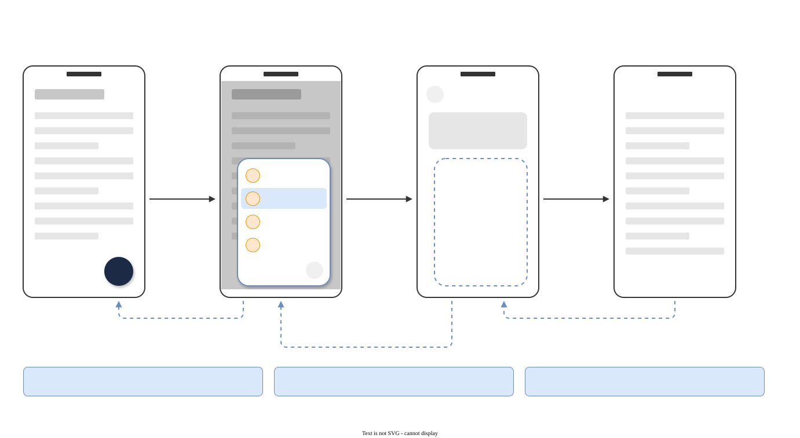

# expo-morph-menu example app

**English** | [Tiếng Việt](README.vi.md)

Demo app for the `expo-morph-menu` package. The app imports the package source from `../src`. Package usage is documented in the [root README](../README.md).

The app implements an expandable floating menu where the full screen is an expo-router route: it supports nested screens, Android hardware back and deep links.



## Running the app

Run all commands from the repository root. `example/` uses the root `node_modules` and resolves the package from `../src` (see `metro.config.js`). Do not run `npm install` inside `example/`.

```bash
npm install          # in the repository root
npm run example      # expo start in example/
```

The app runs in Expo Go (tested on Android). Liquid Glass and blur on iOS require a development build: `cd example && npx expo run:ios`.

Web: open `http://localhost:8081`, or press `w` in the Metro terminal. For a phone-sized viewport, open `http://localhost:8081/phone.html`, which renders the app in a 390 x 844 iframe. Mouse hover over a row acts as a drag, Esc dismisses the full screen and then the menu, and the browser back button runs the collapse animation.

The home screen describes the integration steps, with the file in this app where each step is done. It also has a switch between two variants: Default and Custom (slots). The custom variant (`components/CustomSlots.tsx`) replaces every slot: card background, rows with subtitles and different heights, separators, a rounded square button and a blurred scrim.

Type checking without a device:

```bash
npm run typecheck    # package and example app
```

## End-to-end tests (Android, Maestro)

`.maestro/` contains 6 flows:

| Flow | Scenario |
| --- | --- |
| `01-menu-open-close` | Open and close the menu (scrim, hardware back) |
| `02-sheet-close-button` | Open the full screen, dismiss with the close button |
| `03-sheet-hardware-back` | Dismiss with hardware back |
| `04-sheet-drag-down` | Drag down (on Android the full screen stays open) |
| `05-sheet-child-then-close` | Push a child screen, go back, dismiss |
| `06-ios-edge-swipe` | Left-edge swipe (iOS only, not run yet) |

Each flow that dismisses the full screen asserts that the menu is still open afterwards (`closeMenuOnDismiss: false`).

Maestro checks behavior only. Single-frame defects are not visible in screenshots, so they are detected with the frame trace (`src/MorphTrace.tsx`), written to logcat and scanned by `example/scripts/e2e.mjs`.

```bash
npm run example:trace                                  # terminal 1: Metro with EXPO_PUBLIC_MORPH_TRACE=1
npm run e2e                                            # terminal 2: Maestro and trace scan
npm run e2e -- .maestro/02-sheet-close-button.yaml     # a single flow
```

The run fails if a flow fails or if the trace contains `FLICKER`, `HOLE`, `GHOST` or `OVERLAP`. The full trace, including dropped frames (`DROP`), is written to `e2e-trace.log`.

Requirements: a device listed by `adb devices` with Expo Go installed, Maestro (`~/.maestro/maestro/bin`), and Java 17 or later (`JAVA_HOME`; the script falls back to the Android Studio JBR). The script uses the LAN IP address for the `exp://` URL.

| Variable | Use |
| --- | --- |
| `ANDROID_SERIAL` | Select a device when several are connected, for example `emulator-5554` |
| `METRO_PORT` | Metro is not on port 8081, for example `npm run example:trace -- --port 8082` |
| `METRO_URL` | Set the Expo Go URL explicitly |

Measure frame timing with a production bundle. Dropped frames in a development bundle are not representative:

```bash
npm run example:trace -- --port 8083 --no-dev --minify
ANDROID_SERIAL=emulator-5554 METRO_PORT=8083 npm run e2e
```

Expo Go caches production bundles. If the trace shows outdated code, clear the Expo Go data (`adb shell pm clear host.exp.exponent`) and run again.

## Configuration

Defaults are defined per platform in `src/config.ts` and overridden through `MorphProvider` in `example/app/_layout.tsx`:

```tsx
<MorphProvider
  config={{
    closeMenuOnDismiss: true,          // default false: the menu stays open after the full screen is dismissed
    radius: Platform.select({ ios: { card: 28 }, android: { card: 16 } }),
    shadow: { elevation: 6 },          // Android: elevation. iOS: color, opacity, radius, offsetY
    dismiss: { dragDown: false },      // iOS default: edgeSwipe and dragDown. Android: no gestures
  }}
>
```

| Option | iOS | Android |
| --- | --- | --- |
| `closeMenuOnDismiss` | `false` | `false` |
| `radius.card` / `radius.sheet` | 28 / 0 | 28 / 0 |
| `shadow` | opacity 0.18, radius 18, offsetY 8 | elevation 10 |
| `dismiss.edgeSwipe` | Enabled, on the root screen of the group only | Disabled (the left edge is the system back gesture) |
| `dismiss.dragDown` | Enabled | Disabled |
| Close button and hardware back | Close button | Close button, hardware back |

Deep link to a detail route:

```bash
npx uri-scheme open morphmenu://sheet/audio --ios
```

## Comparing the two selection methods

1. Press and hold "+", drag to a row, and release. Data loading starts while the pointer moves over the row, so the screen usually opens with content already loaded. The badge shows the wait time, typically 0 ms.
2. Tap "+", then tap a row quickly. There is no hover phase to start loading early, so the screen shows a placeholder first, and the badge shows the actual wait time.

The comparison shows that the perceived delay comes mostly from loading and rendering the content, not from the animation.

## Prefetching

`data/sheetData.ts` is a fake data source with 700 ms of latency and an in-memory cache, kept small on purpose. The menu's `onHover` calls `prefetchSheet(key)`, and the sheet screen reads the same cache entry with `useSheetData(key)`. In your app, call your data library's prefetch function from `onHover` instead (for example TanStack Query `prefetchQuery` or RTK Query `util.prefetch`).

For a full data layer with Redux Toolkit, RTK Query and JWT refresh, see the [social example](../example-social/README.md).

## Documentation

| Document | Contents |
| --- | --- |
| [Architecture](../docs/en/ARCHITECTURE.md) | Route boundary, opening and closing sequences, hand-off, web specifics |
| [Integration guide](../docs/en/INTEGRATION.md) | Installation, configuration, testing, troubleshooting |
| [Custom UI](../docs/en/CUSTOM-UI.md) | Slots, slot contract, examples for UI kits |
| [Performance](../docs/en/PERFORMANCE.md) | Optimizations, measurement methods, test results |
| [Diagrams](../docs/README.md) | 7 draw.io pages, English and Vietnamese |

## Project structure

```
src/                       expo-morph-menu package
  index.ts                 public API
  MorphProvider.tsx        shared values, config, items, callbacks
  MorphMenu.tsx            overlay: button, card, hit testing, onHover
  MorphSheetLayout.tsx     animated container and nested Stack (layout of the route group)
  MenuFace.tsx             menu rows shared by the overlay and the container
  Surface.tsx, optional.ts Liquid Glass, blur or solid surface; optional haptics
  config.ts                platform defaults, light and dark colors
  geometry.ts, visibility.ts, constants.ts
  MorphTrace.tsx           per-frame trace for debugging and end-to-end tests
example/                   this app
  app/_layout.tsx          MorphProvider, root Stack, MorphMenu after the navigator
  app/(sheet)/_layout.tsx  MorphSheetLayout with Stack.Screen declarations
  app/(sheet)/[key].tsx    root screen of the group
  app/(sheet)/child.tsx    nested screen, closes the sheet with useMorphDismiss()
  data/items.tsx           menu items
  data/sheetData.ts        fake data source with prefetching
  .maestro/, scripts/      end-to-end tests
```

## Versions

Expo SDK 58, React Native 0.88, React 19.3, Reanimated 4.7, Gesture Handler 3.3, react-native-screens 4.30.

After changing the SDK version, run `cd example && npx expo install --fix` to align native module versions with the SDK.

## Verification status

- `npm run typecheck` passes for the package and the example app.
- Maestro end-to-end tests on an Android 17 emulator (API 37): 6 of 6 flows pass (the iOS flow is skipped), and the trace contains no `FLICKER`, `HOLE` or `GHOST` flags. MEmu (Android 9) was tested only with the build before the package was extracted. Numbers: [Performance](../docs/en/PERFORMANCE.md#6-test-results).
- Not run on iOS yet (requires a Mac): left-edge swipe, Liquid Glass, blur.
