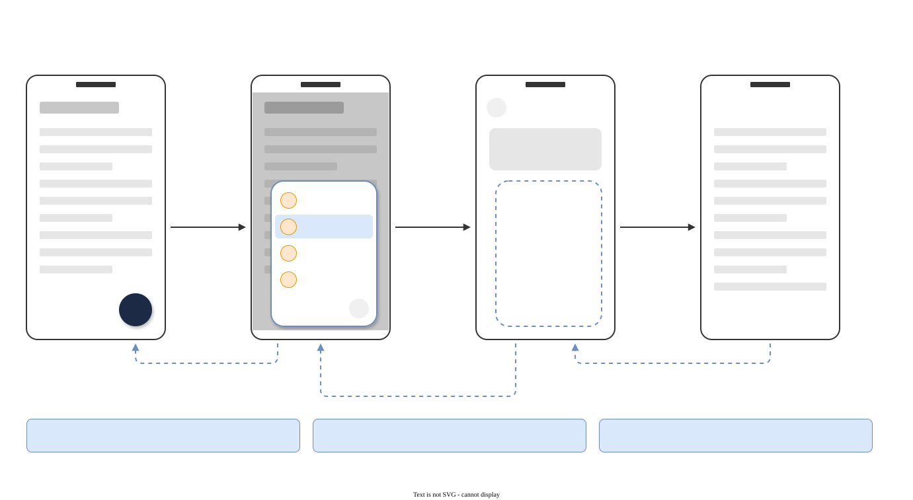

# expo-morph-menu — app ví dụ

App demo của package `expo-morph-menu` (mã nguồn ở `../src`). Hướng dẫn
dùng package: xem [README ở thư mục gốc](../README.md).

Dựng lại interaction "Expandable Floating Menu" của SwiftUI bằng Expo, nhưng
với điều hướng thật: màn full-screen là một route, bên trong push được màn con,
back cứng Android và deep link đều chạy.



## Chạy

Mọi lệnh chạy từ **thư mục gốc** của repo. `example/` dùng chung
`node_modules` của thư mục gốc và đọc package thẳng từ `../src` (xem
`metro.config.js`) — **đừng** `npm install` riêng trong `example/`.

```bash
npm install          # ở thư mục gốc
npm run example      # expo start trong example/
```

Chạy được bằng Expo Go (đã thử trên Android). Muốn Liquid Glass / blur thật
trên iOS thì dùng development build: `cd example && npx expo run:ios`.

Web: mở `http://localhost:8081` (hoặc nhấn `w` trong terminal Metro). Khổ
điện thoại: `http://localhost:8081/phone.html` (app trong iframe 390×844, không
cần thu nhỏ cửa sổ). Hover
chuột lên dòng = rê tay; Esc đóng full screen rồi đóng menu; nút back của trình
duyệt cũng chạy morph ngược.

Màn Home có nút chuyển **Giao diện: Mặc định / Tuỳ biến (slot)**. Bản tuỳ biến
(`components/CustomSlots.tsx`) thay mọi slot: nền card, dòng có subtitle cao
khác nhau, vạch ngăn, nút + vuông, scrim blur.

Kiểm tra nhanh mà không cần chạy máy:

```bash
npm run typecheck    # package + app ví dụ
```

### E2E + kiểm tra flicker (Android, Maestro)

`.maestro/` có 6 flow: mở/đóng menu (scrim, back cứng); mở full screen rồi
đóng bằng nút ×, back cứng, kéo xuống (Android: không đóng), qua màn con; và
vuốt cạnh trái (chỉ iOS, chưa chạy thử). Mọi flow đóng full screen đều kiểm
menu **vẫn mở** sau đó (`closeMenuOnDismiss = false`). Maestro chỉ kiểm hành
vi; flicker nằm dưới tầm screenshot nên được bắt bằng trace từng frame
(`src/MorphTrace.tsx`), in ra logcat rồi `example/scripts/e2e.mjs` quét.

```bash
npm run example:trace  # Metro với EXPO_PUBLIC_MORPH_TRACE=1 (terminal 1)
npm run e2e            # Maestro + quét trace          (terminal 2)
npm run e2e -- .maestro/02-sheet-close-button.yaml   # một flow
```

Trượt khi một flow trượt HOẶC trace có `FLICKER` / `HOLE` / `GHOST` / `OVERLAP`; trace đầy
đủ ở `e2e-trace.log`, kèm số frame rớt (`DROP`). Cần: thiết bị trong `adb
devices` có Expo Go, Maestro (`~/.maestro/maestro/bin`), Java 17+ (`JAVA_HOME`,
mặc định thử JBR của Android Studio). Script tự dùng IP LAN cho `exp://…`.

| Biến | Dùng khi |
|---|---|
| `ANDROID_SERIAL` | có nhiều thiết bị, ví dụ `emulator-5554` |
| `METRO_PORT` | Metro không ở 8081, ví dụ chạy song song `npm run example:trace -- --port 8082` |
| `METRO_URL` | đặt hẳn URL Expo Go |

Đo độ mượt thật thì dùng bundle production — rớt frame ở bản dev gần như vô nghĩa:

```bash
npm run example:trace -- --port 8083 --no-dev --minify
ANDROID_SERIAL=emulator-5554 METRO_PORT=8083 npm run e2e
```

Expo Go cache bundle production: nếu trace cho thấy code cũ, xoá dữ liệu Expo
Go (`adb shell pm clear host.exp.exponent`) rồi chạy lại.

### Cấu hình

`src/config.ts` — mặc định theo platform, ghi đè qua `MorphProvider`
(`example/app/_layout.tsx`):

```tsx
<MorphProvider
  config={{
    closeMenuOnDismiss: true,          // mặc định false: đóng full screen xong menu vẫn mở
    radius: Platform.select({ ios: { card: 28 }, android: { card: 16 } }),
    shadow: { elevation: 6 },          // Android: elevation; iOS: color/opacity/radius/offsetY
    dismiss: { dragDown: false },      // iOS mặc định: edgeSwipe + dragDown; Android: không cử chỉ
  }}
>
```

| | iOS | Android |
|---|---|---|
| `closeMenuOnDismiss` | `false` | `false` |
| `radius.card` / `radius.sheet` | 28 / 0 | 28 / 0 |
| `shadow` | opacity 0.18, radius 18, offsetY 8 | elevation 10 |
| `dismiss.edgeSwipe` | ✓ (chỉ ở màn gốc của sheet) | — (cạnh trái là back của hệ thống) |
| `dismiss.dragDown` | ✓ | — |
| Nút × / back cứng | nút × | nút × + back cứng |

Deep link vào thẳng route detail:

```bash
npx uri-scheme open morphmenu://sheet/audio --ios
```

## Hai cách thử để thấy khác biệt

1. **Giữ "+" rồi rê xuống một dòng và nhả.** Dữ liệu được nạp từ lúc ngón tay
   rê qua, nên màn mở ra đã có sẵn nội dung — badge sẽ ghi "chờ 0ms".
2. **Chạm "+" rồi chạm nhanh một dòng.** Không có pha rê để tranh thủ, bạn sẽ
   thấy skeleton và badge ghi thời gian chờ thật.

Đó là minh hoạ sống của luận điểm chính: nút thắt không nằm ở animation mà ở
chi phí dựng nội dung.

## Tài liệu


| File | Nội dung |
| --- | --- |
| [`docs/vi/ARCHITECTURE.md`](../docs/vi/ARCHITECTURE.md) ([EN](../docs/en/ARCHITECTURE.md)) | Ranh giới route, luồng mở/đóng, giao ca, vỏ-ruột, riêng cho web |
| [`docs/vi/INTEGRATION.md`](../docs/vi/INTEGRATION.md) ([EN](../docs/en/INTEGRATION.md)) | Cài đặt, cấu hình, kiểm thử, xử lý sự cố |
| [`docs/vi/CUSTOM-UI.md`](../docs/vi/CUSTOM-UI.md) ([EN](../docs/en/CUSTOM-UI.md)) | Slot, hợp đồng của slot, công thức cho các bộ UI |
| [`docs/PERFORMANCE.md`](../docs/PERFORMANCE.md) | Các điểm tối ưu, cách đo, số liệu |
| [`docs/diagrams/`](../docs/diagrams/) | 7 trang sơ đồ draw.io, bản EN và VI |

Mở file `.drawio` bằng app.diagrams.net hoặc extension Draw.io Integration
trong VS Code.

## Cấu trúc

```
src/                       ← package expo-morph-menu
  index.ts                 API public
  MorphProvider.tsx        shared value + config + items + callback
  MorphMenu.tsx            overlay FAB → card, hit-test, onHover
  MorphSheetLayout.tsx     vỏ morph + Stack lồng (dùng làm _layout của nhóm route)
  MenuFace.tsx             mặt menu dùng chung cho overlay và vỏ
  Surface.tsx, optional.ts Liquid Glass → blur → nền đặc; haptics tuỳ chọn
  config.ts                mặc định theo platform + màu sáng/tối
  geometry.ts, visibility.ts, constants.ts
  MorphTrace.tsx           trace từng frame (gỡ lỗi / e2e)
example/                   ← app này
  app/_layout.tsx          MorphProvider + Stack gốc + MorphMenu NGOÀI navigator
  app/(sheet)/_layout.tsx  <MorphSheetLayout> + Stack.Screen
  app/(sheet)/[key].tsx    màn gốc của sheet; child.tsx: màn con
  data/                    danh sách menu, dữ liệu giả có prefetch
  .maestro/, scripts/      e2e
```

## Phiên bản

Expo SDK 58 · React Native 0.88 · React 19.3 · Reanimated 4.7 ·
Gesture Handler 3.3 · react-native-screens 4.30.

Nếu bạn nâng hoặc hạ SDK, chạy `cd example && npx expo install --fix` để Expo
tự chỉnh các native module về đúng phiên bản của SDK đó.

## Đã kiểm chứng tới đâu

- `npm run typecheck` sạch (package + app ví dụ).
- E2E Maestro trên Android, AVD Pixel API 37 (Android 17): 6/6 flow pass
  (flow iOS tự bỏ qua), trace không có FLICKER / HOLE / GHOST. MEmu (Android 9)
  chỉ mới chạy ở bản trước khi tách package. Số liệu ở `docs/PERFORMANCE.md`.
- **Chưa chạy trên iOS** (cần máy Mac): vuốt cạnh trái, Liquid Glass, blur.
