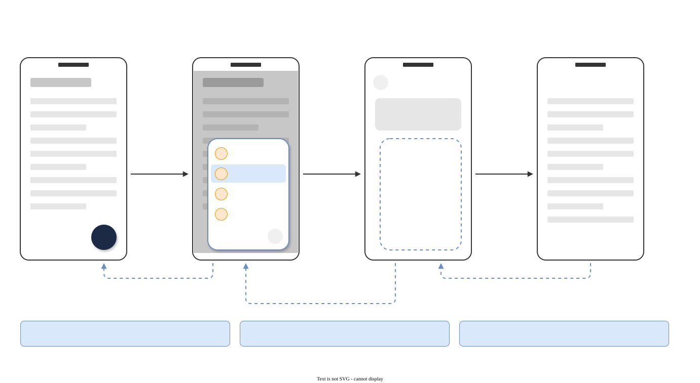

# Ứng dụng ví dụ expo-morph-menu

[English](README.md) | **Tiếng Việt**

Ứng dụng demo cho package `expo-morph-menu`. Ứng dụng import mã nguồn của package từ `../src`. Cách dùng package được mô tả trong [README gốc](../README.vi.md).

Ứng dụng hiện thực một menu nổi có thể mở rộng, trong đó màn hình full screen là một route expo-router: nó hỗ trợ màn hình lồng nhau, nút back phần cứng trên Android và deep link.



## Chạy ứng dụng

Chạy mọi lệnh từ thư mục gốc của repository. `example/` dùng `node_modules` ở thư mục gốc và resolve package từ `../src` (xem `metro.config.js`). Không chạy `npm install` bên trong `example/`.

```bash
npm install          # ở thư mục gốc của repository
npm run example      # expo start trong example/
```

Ứng dụng chạy trong Expo Go (đã kiểm thử trên Android). Liquid Glass và blur trên iOS cần development build: `cd example && npx expo run:ios`.

Web: mở `http://localhost:8081`, hoặc nhấn `w` trong terminal Metro. Để có viewport cỡ điện thoại, mở `http://localhost:8081/phone.html`, trang này render ứng dụng trong một iframe 390 x 844. Hover chuột lên một dòng có tác dụng như kéo, Esc đóng full screen rồi đến menu, và nút back của trình duyệt chạy animation thu gọn.

Màn hình chính mô tả các bước tích hợp, kèm file trong ứng dụng này nơi mỗi bước được thực hiện. Màn hình này cũng có công tắc chuyển giữa hai biến thể: Default và Custom (slot). Biến thể tùy chỉnh (`components/CustomSlots.tsx`) thay thế mọi slot: nền card, các dòng có phụ đề và chiều cao khác nhau, đường phân cách, nút hình vuông bo góc và scrim làm mờ.

Kiểm tra kiểu khi không có thiết bị:

```bash
npm run typecheck    # package và ứng dụng ví dụ
```

## Kiểm thử end-to-end (Android, Maestro)

`.maestro/` chứa 6 flow:

| Flow | Kịch bản |
| --- | --- |
| `01-menu-open-close` | Mở và đóng menu (scrim, nút back phần cứng) |
| `02-sheet-close-button` | Mở full screen, đóng bằng nút đóng |
| `03-sheet-hardware-back` | Đóng bằng nút back phần cứng |
| `04-sheet-drag-down` | Kéo xuống (trên Android full screen vẫn mở) |
| `05-sheet-child-then-close` | Push một màn hình con, quay lại, đóng |
| `06-ios-edge-swipe` | Vuốt từ mép trái (chỉ iOS, chưa chạy) |

Mỗi flow đóng full screen đều kiểm tra rằng menu vẫn mở sau đó (`closeMenuOnDismiss: false`).

Maestro chỉ kiểm tra hành vi. Lỗi chỉ kéo dài một frame không thấy được trong ảnh chụp màn hình, nên chúng được phát hiện bằng trace theo frame (`src/MorphTrace.tsx`), ghi vào logcat và được `example/scripts/e2e.mjs` quét.

```bash
npm run example:trace                                  # terminal 1: Metro với EXPO_PUBLIC_MORPH_TRACE=1
npm run e2e                                            # terminal 2: Maestro và quét trace
npm run e2e -- .maestro/02-sheet-close-button.yaml     # một flow
```

Lần chạy thất bại nếu một flow thất bại hoặc nếu trace chứa `FLICKER`, `HOLE`, `GHOST` hoặc `OVERLAP`. Toàn bộ trace, bao gồm các frame bị rớt (dropped frame, `DROP`), được ghi vào `e2e-trace.log`.

Yêu cầu: một thiết bị có trong danh sách `adb devices` và đã cài Expo Go, Maestro (`~/.maestro/maestro/bin`), và Java 17 trở lên (`JAVA_HOME`; nếu không có, script dùng JBR của Android Studio). Script dùng địa chỉ IP LAN cho URL `exp://`.

| Biến | Công dụng |
| --- | --- |
| `ANDROID_SERIAL` | Chọn thiết bị khi có nhiều thiết bị kết nối, ví dụ `emulator-5554` |
| `METRO_PORT` | Metro không chạy ở cổng 8081, ví dụ `npm run example:trace -- --port 8082` |
| `METRO_URL` | Đặt URL Expo Go một cách tường minh |

Đo thời gian frame bằng bundle production. Số frame bị rớt trong bundle development không mang tính đại diện:

```bash
npm run example:trace -- --port 8083 --no-dev --minify
ANDROID_SERIAL=emulator-5554 METRO_PORT=8083 npm run e2e
```

Expo Go lưu cache các bundle production. Nếu trace hiển thị mã cũ, xóa dữ liệu Expo Go (`adb shell pm clear host.exp.exponent`) và chạy lại.

## Cấu hình

Giá trị mặc định được định nghĩa theo từng nền tảng trong `src/config.ts` và được ghi đè qua `MorphProvider` trong `example/app/_layout.tsx`:

```tsx
<MorphProvider
  config={{
    closeMenuOnDismiss: true,          // mặc định false: menu vẫn mở sau khi full screen được đóng
    radius: Platform.select({ ios: { card: 28 }, android: { card: 16 } }),
    shadow: { elevation: 6 },          // Android: elevation. iOS: color, opacity, radius, offsetY
    dismiss: { dragDown: false },      // mặc định trên iOS: edgeSwipe và dragDown. Android: không có cử chỉ
  }}
>
```

| Tùy chọn | iOS | Android |
| --- | --- | --- |
| `closeMenuOnDismiss` | `false` | `false` |
| `radius.card` / `radius.sheet` | 28 / 0 | 28 / 0 |
| `shadow` | opacity 0.18, radius 18, offsetY 8 | elevation 10 |
| `dismiss.edgeSwipe` | Bật, chỉ trên màn hình gốc của nhóm | Tắt (mép trái là cử chỉ back của hệ thống) |
| `dismiss.dragDown` | Bật | Tắt |
| Nút đóng và nút back phần cứng | Nút đóng | Nút đóng, nút back phần cứng |

Deep link tới một route chi tiết:

```bash
npx uri-scheme open morphmenu://sheet/audio --ios
```

## So sánh hai cách chọn

1. Nhấn giữ "+", kéo tới một dòng và thả ra. Việc tải dữ liệu bắt đầu khi con trỏ di chuyển trên dòng, nên màn hình thường mở ra với nội dung đã được tải. Badge hiển thị thời gian chờ, thường là 0 ms.
2. Chạm "+", rồi chạm nhanh vào một dòng. Không có giai đoạn hover để bắt đầu tải sớm, nên màn hình hiển thị placeholder trước, và badge hiển thị thời gian chờ thực tế.

Phép so sánh cho thấy độ trễ cảm nhận được chủ yếu đến từ việc tải và render nội dung, không phải từ animation.

## Prefetch

`data/sheetData.ts` là một nguồn dữ liệu giả với độ trễ 700 ms và cache trong bộ nhớ, được giữ đơn giản có chủ đích. `onHover` của menu gọi `prefetchSheet(key)`, và màn sheet đọc cùng mục cache đó bằng `useSheetData(key)`. Trong ứng dụng của bạn, gọi hàm prefetch của thư viện dữ liệu từ `onHover` (ví dụ `prefetchQuery` của TanStack Query hoặc `util.prefetch` của RTK Query).

Lớp dữ liệu đầy đủ với Redux Toolkit, RTK Query và refresh JWT có ở [ví dụ mạng xã hội](../example-social/README.vi.md).

## Tài liệu

| Tài liệu | Nội dung |
| --- | --- |
| [Kiến trúc](../docs/vi/ARCHITECTURE.md) | Ranh giới route, trình tự mở và đóng, chuyển giao (hand-off), đặc thù trên web |
| [Hướng dẫn tích hợp](../docs/vi/INTEGRATION.md) | Cài đặt, cấu hình, kiểm thử, xử lý sự cố |
| [Giao diện tùy chỉnh](../docs/vi/CUSTOM-UI.md) | Slot, quy ước của slot, ví dụ cho các bộ UI |
| [Hiệu năng](../docs/vi/PERFORMANCE.md) | Các tối ưu, phương pháp đo, kết quả kiểm thử |
| [Sơ đồ](../docs/README.vi.md) | 7 trang draw.io, tiếng Anh và tiếng Việt |

## Cấu trúc dự án

```
src/                       package expo-morph-menu
  index.ts                 API công khai
  MorphProvider.tsx        shared value, cấu hình, item, callback
  MorphMenu.tsx            overlay: nút, card, hit testing, onHover
  MorphSheetLayout.tsx     container có animation và Stack lồng nhau (layout của nhóm route)
  MenuFace.tsx             các dòng menu dùng chung cho overlay và container
  Surface.tsx, optional.ts bề mặt Liquid Glass, blur hoặc màu đặc; haptics tùy chọn
  config.ts                mặc định theo nền tảng, màu sáng và tối
  geometry.ts, visibility.ts, constants.ts
  MorphTrace.tsx           trace theo frame để gỡ lỗi và kiểm thử end-to-end
example/                   ứng dụng này
  app/_layout.tsx          MorphProvider, Stack gốc, MorphMenu sau navigator
  app/(sheet)/_layout.tsx  MorphSheetLayout với các khai báo Stack.Screen
  app/(sheet)/[key].tsx    màn hình gốc của nhóm
  app/(sheet)/child.tsx    màn hình lồng nhau, đóng sheet bằng useMorphDismiss()
  data/items.tsx           item của menu
  data/sheetData.ts        nguồn dữ liệu giả có prefetch
  .maestro/, scripts/      kiểm thử end-to-end
```

## Phiên bản

Expo SDK 58, React Native 0.88, React 19.3, Reanimated 4.7, Gesture Handler 3.3, react-native-screens 4.30.

Sau khi đổi phiên bản SDK, chạy `cd example && npx expo install --fix` để căn chỉnh phiên bản các native module theo SDK.

## Trạng thái kiểm tra

- `npm run typecheck` chạy thành công cho package và ứng dụng ví dụ.
- Kiểm thử end-to-end bằng Maestro trên emulator Android 17 (API 37): 6 trên 6 flow đạt (flow iOS được bỏ qua), và trace không chứa cờ `FLICKER`, `HOLE` hay `GHOST`. MEmu (Android 9) chỉ được kiểm thử với bản build trước khi package được tách ra. Số liệu: [Hiệu năng](../docs/vi/PERFORMANCE.md#6-kết-quả-kiểm-thử).
- Chưa chạy trên iOS (cần máy Mac): vuốt từ mép trái, Liquid Glass, blur.
