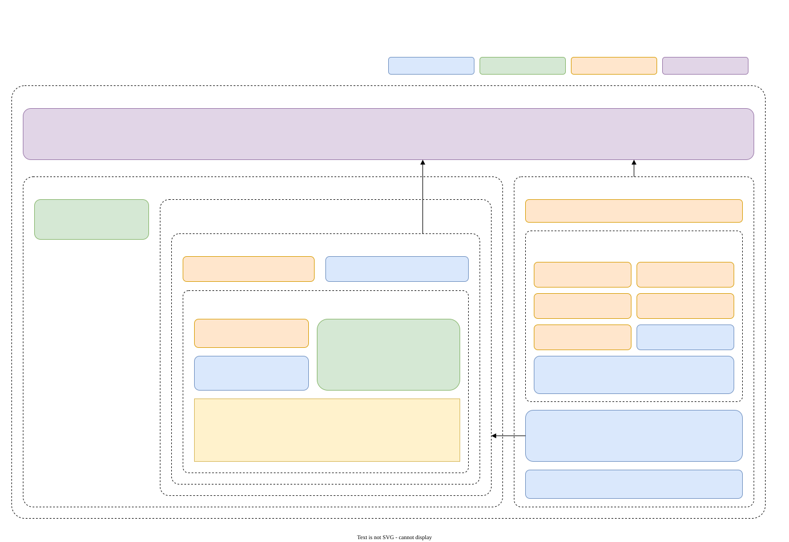
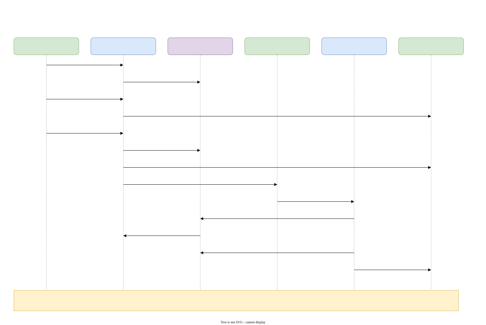
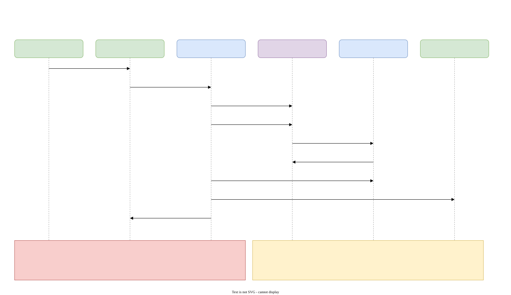
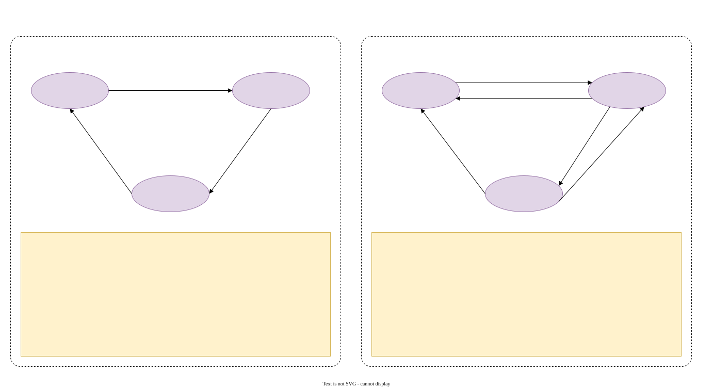
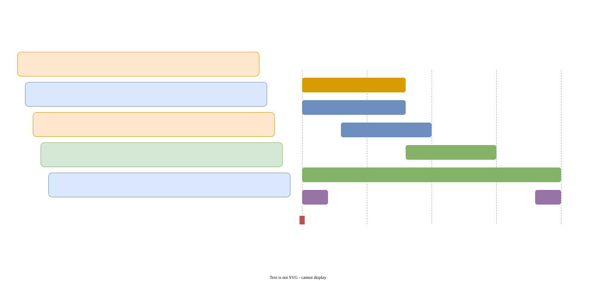
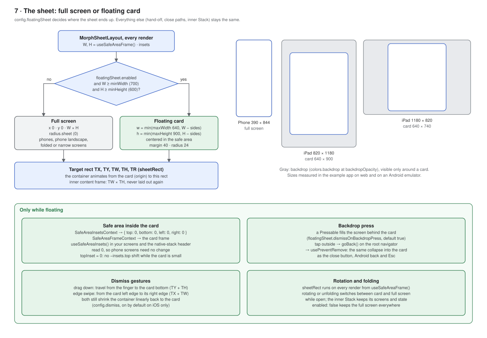

{/* Generated from docs/en/ARCHITECTURE.md by website/scripts/sections.mjs: edit that file, then run npm run sections. */}

Related: [Integration guide](/expo-morph-menu/guides/integration/), [Custom UI](/expo-morph-menu/guides/custom-ui/), [Performance](/expo-morph-menu/guides/performance/)

Diagram source: [`expo-morph-menu.en.drawio`](https://github.com/anhtuank7c/expo-morph-menu/blob/main/docs/diagrams/expo-morph-menu.en.drawio), 7 pages (0 to 6). Page numbers in this document refer to that file. Page 7 is generated by [`floating-sheet.mjs`](https://github.com/anhtuank7c/expo-morph-menu/blob/main/docs/diagrams/floating-sheet.mjs) straight to SVG, with the draw.io model embedded, so draw.io opens it too.

`expo-morph-menu` expands a floating button into a menu card, and expands a menu row into a full-screen expo-router route. When the route is dismissed, it collapses back into the card. This document describes the structure of the package and the reasons behind the main design decisions.

## 1. Route boundary

A simple implementation uses one `Animated.View` that animates from button to card to full screen. That view is not a navigation destination: it has no child screens, no Android back handling, no URL, no deep link and no state restoration.

The package splits the interaction into two parts:

| Part | Implemented as | Reason |
| --- | --- | --- |
| Button to menu card | Overlay (`MorphMenu`), not a route | A short-lived UI element, similar to a context menu. It has no URL. It still handles Android back and Esc |
| Card to full screen | Route group (`MorphSheetLayout`) | A navigation destination that needs a URL, child screens, back navigation and state restoration |

The overlay and the route group do not import each other. They communicate only through `MorphProvider` (page 1).



## 2. Modules

| Module | Responsibility |
| --- | --- |
| `MorphProvider` | Context: shared values, resolved config, light and dark colors, items, row layout, slots, callbacks |
| `MorphMenu` | Overlay: button hit area with a Pan gesture, animated card, scrim, rows. Rendered after the root navigator |
| `MorphSheetLayout` | Layout of the route group: animated container, fixed-size inner `Stack`, dismiss gestures, `usePreventRemove` |
| `morphSheetScreenOptions` | Options for the group in the root stack: `transparentModal`, `animation: 'none'`, no root header, native gesture disabled, transparent background |
| `MenuFace` / `DefaultItem` | Menu rows, rendered in the card and in the container during the transition |
| `MorphCloseButton` | Close button for sheet screens. Calls `router.back()` |
| `useMorphSettled()` | Returns `true` after the full screen has finished expanding |
| `useMorphDismiss()` | Closes the whole sheet from any screen in the group. `MorphSheetLayout` registers its root-navigator `goBack` in the provider, and an optional `closeMenu` value overrides `closeMenuOnDismiss` for that one dismissal |
| `useMorphProgress()` | Read-only shared values `{ menu, sheet }` |
| `MorphTrace` | Debug component that logs every frame and flags hand-off defects |

Source files in `src/`:

| File | Contents |
| --- | --- |
| `config.ts` | Default config and color palettes |
| `geometry.ts` | Rectangles, row offsets, hit testing |
| `visibility.ts` | Opacity of the card and the container, shared by styles and `MorphTrace` |
| `constants.ts` | Hand-off states and progress thresholds |
| `shadow.ts` | Platform-specific shadow styles |
| `Surface.tsx`, `optional.ts` | Liquid Glass, blur and haptics, loaded only when installed |
| `web.ts` | Keyboard handling on web |

## 3. Shared state

Four Reanimated shared values connect the overlay and the route group:

| Value | Written by | Meaning |
| --- | --- | --- |
| `menu` | Overlay | 0 to 1: the button expands into the card |
| `sheet` | Route group | 0 to 1: the card expands into the full screen |
| `origin` | Overlay (read by the route group) | Bounds of the card at the moment of selection |
| `handoff` | Both | Which side currently renders the card: `MENU`, `ROUTE` or `RETURNING` |

`origin` keeps the two parts independent. A deep link into a sheet route has no origin, so the container expands from a centered fallback rectangle.

`handoff` controls visibility during the transition. Routes mount asynchronously. If the overlay were hidden based on progress alone, a frame could occasionally render neither the card nor the route. The overlay is hidden only after the route has rendered its first frame.

## 4. Opening sequence

Page 2.



1. A press on the button animates `menu` to 1 and sets the mode to `open`. The hit area stays active until the press ends (see [section 8](#8-input-and-gestures)).
2. Moving the pointer over rows (mouse hover on web) highlights them and calls `onHover(item)`.
3. The user releases the pointer on a row, or taps a row. If the card has not finished expanding (`menu < 0.995`), the selection is deferred until it has. Otherwise the container would start from bounds the card has not reached.
4. The overlay sets `origin` to the card bounds and `handoff` to `MENU`, calls `onSelect(item)`, then calls `router.push(item.href)`.
5. The route mounts without a native transition. Its first frame is the container at the card bounds, rendering the same menu rows (`MenuFace`).
6. The route sets `handoff` to `ROUTE` (native: in the container's `onLayout`; web: in `useLayoutEffect`), and the overlay card is hidden. The pixels on screen do not change.
7. `sheet` animates to 1. The container expands, the screen content fades in and the menu rows fade out.
8. When the spring finishes, `useMorphSettled()` returns `true`.

All visual updates run on the UI thread. JavaScript only pushes the route and calls the callbacks.

## 5. Closing sequence

Page 3.



Every dismiss path becomes a navigation remove action, which `usePreventRemove` intercepts: the close button or `router.back()`, Android hardware back, browser back, Esc on web, and the left-edge swipe or drag-down gesture on iOS. The collapse animation is therefore implemented in one place:

1. `handoff` is set to `RETURNING` and `sheet` animates to 0, starting from its current value, so a gesture that already moved the container does not cause a jump.
2. The container collapses, the screen content fades out and the menu rows fade in.
3. On the first frame where `sheet <= 0.005` (`ARRIVED`), the container bounds are within 1 dp of the card. In that frame, the container opacity becomes 0 and the card opacity becomes 1.
4. With `closeMenuOnDismiss: false` (default), the scrim fades back in and the menu stays open. With `true`, the card collapses into the button.
5. When the spring finishes, `sheetDismissed()` updates the overlay's React state, `onSheetDismissed(item)` is called, and the original navigation action continues.

`handoff` keeps the value `RETURNING` after the route unmounts. Android removes native views asynchronously, and resetting the value earlier would show the container for one more frame. The next selection resets it.

## 6. Hand-off: single-frame swap

Page 4.



An earlier version crossfaded the container and the card over the last 12% of progress. A screenshot taken mid-close showed two semi-transparent copies of the menu a few dp apart, with doubled text. The current version swaps the two layers in a single frame, at the point where their bounds match. Both layers read the same `sheet` value in the same UI frame, so a dropped frame cannot desynchronize them.

Layer order depends on the platform:

- iOS: a `transparentModal` is presented above the root view, so the route covers the overlay. The card is not hidden. Hiding it is also avoided because `UIVisualEffectView` (used by Liquid Glass and blur) does not render correctly with opacity below 1.
- Android and web: screens and the overlay share one view tree, and the overlay is declared after the navigator, so it is on top. It must be hidden while the route is visible.

## 7. Full-screen container

Page 5.



```tsx
<Animated.View style={shell}>                       // x, y, width, height and radius change every frame
  <Animated.View style={{ width: W, height: H }}>   // fixed size, absolutely positioned
    <Stack />                                        // not laid out again during the animation
  </Animated.View>
</Animated.View>
```

If the inner `Stack` were resized with the container, each frame would trigger a layout pass over the whole screen tree. With a fixed-size inner view clipped by `overflow: hidden`, only the container node is laid out again. Because the inner navigator is a regular native stack, child screens use the native push animation, the native back swipe and Android back.

Layers inside the container and their animation ranges (progress 0 is the card, 1 is the full screen):

| Layer | Progress range | Change |
| --- | --- | --- |
| `Background` slot (variant `sheet`) | 0 to 0.4 | Opacity 1 to 0 |
| Container background color | 0 to 0.4 | Card color to `colors.sheetBackground` |
| `MenuFace` (rows anchored to the card corner) | 0.15 to 0.5 | Opacity 1 to 0 |
| Screen content | 0.4 to 0.75 | Opacity 0 to 1 |
| Screen content | 0 to 1 | translateY from `-insets.top` to 0 |
| Shadow | 0 to 0.1 and 0.9 to 1 | Fades in and out. Disabled in between |

The content is anchored to the top-left corner of the container. At card size, the visible part would be the empty status bar area, so the content is shifted up by `insets.top` while the container is small.

Dimensions come from `useSafeAreaFrame()`, not `useWindowDimensions()`. With Android edge-to-edge, the window dimensions exclude the navigation bar, and the container would not reach the bottom edge.

### Floating card on wide screens

Page 7.



The container does not always end at full screen. On every render, `sheetRect()` in `geometry.ts` computes the target rectangle from the screen frame, the safe area insets and `config.floatingSheet`:

- When `floatingSheet.enabled` is true and the screen is at least `minWidth` (700) wide and `minHeight` (600) tall, the target is a card centered in the safe area: at most `maxWidth` × `maxHeight` (640 × 900), at least `margin` (40) from the edges, with the corner radius `floatingSheet.radius` (24). On an iPad in portrait this is 640 × 900, in landscape 640 × 740.
- Otherwise it is the full screen with `radius.sheet`. Phones, phones in landscape and folded phones stay full screen.

The container animates from the card to the target, and the inner content frame has the target's size. Everything else is the same in both modes: the hand-off, the close paths and the fixed-size inner `Stack`. A floating card differs in four ways:

| Area | Behavior |
| --- | --- |
| Safe area | The screens inside get `SafeAreaInsetsContext` with all insets at 0 and `SafeAreaFrameContext` with the card's frame. `useSafeAreaInsets()` and the native-stack header therefore read 0, and phone screens work without changes. The `-insets.top` content shift is 0 as well |
| Backdrop | `colors.backdrop` at `backdropOpacity` stays visible around the card. With `dismissOnBackdropPress` (default), a `Pressable` behind the card calls `goBack()`, which goes through `usePreventRemove` like every other close path |
| Gestures | Drag-down travels from the finger to the bottom of the card (`TY + TH`), the edge swipe to its right edge (`TX + TW`) |
| Resizing | Rotating or unfolding while the sheet is open switches between card and full screen. The safe area providers are always rendered, with the screen's values in full screen, so the tree keeps its shape and the inner `Stack` keeps its screens and state |

## 8. Input and gestures

| Action | iOS | Android | Web |
| --- | --- | --- | --- |
| Open the menu | Tap or press | Tap or press | Click or press |
| Select a row | Tap a row, or press and drag from the button | Same as iOS | Click a row, or press and drag |
| `onHover` | During a drag | During a drag | During a drag or mouse hover |
| Close the menu | Tap the scrim | Tap the scrim, hardware back | Click the scrim, Esc |
| Dismiss the full screen | Close button, left-edge swipe (1), drag down (1) | Close button, hardware back | Close button, Esc (2), browser back |

(1) Controlled by `config.dismiss`. Enabled by default on iOS and disabled on Android. The left-edge swipe is active only on the root screen of the group. On child screens, the left edge is used by the native back swipe.
(2) Only on the root screen of the group.

A tap released in place never selects a row. The button is located inside the area of the card's last row, and a slightly long tap would otherwise select that row.

Touch handling (page 4, right side): in mode `route`, the overlay does not receive touches and does not handle back events. On platforms where the overlay is on top, its scrim would otherwise intercept taps on the close button.

## 9. Web specifics

The following issues were found during testing in Chrome. The package handles each of them:

- Pointer capture: Gesture Handler does not call `setPointerCapture` when the gesture view has `role="button"`. Without pointer capture, a drag that leaves the button never delivers `pointerup` to it, and the gesture does not end. On web, the role is set on an inner element.
- Hit area during a press: an element that switches to `pointer-events: none` during a press does not receive `pointerup`. The button keeps its hit area until the press ends.
- Hand-off timing: `onLayout` is implemented with `ResizeObserver` on web and arrives several frames late. The route sets `handoff` in `useLayoutEffect` instead.
- "Leave site?" dialog: `usePreventRemove` blocks page unload while the full screen is open. The package calls `disablePrevention()`, returned by the hook, in a `beforeunload` listener that is registered before the React Navigation listener.
- Shadows: React Native Web generates a correct `box-shadow` only when all `shadow*` properties are in the same style object. With an animated `shadowOpacity` they are not, so the package sets `boxShadow` directly on web.
- Esc dismisses, mouse hover triggers `onHover`, and text selection is disabled during a drag.

## 10. Geometry

All rectangles are computed, not measured (`geometry.ts`). Measurement is asynchronous, so the first frame would use incorrect values. Row heights come from `layout.rowHeight` or `itemHeight(item, index)`. `listLayout()` converts them to row offsets, which are used by the card, by the menu rows inside the container, by drag hit testing (`rowAt`) and by the highlight. With `anchor: 'bottom-left'`, all positions are mirrored horizontally.

## 11. Performance principles

- Visual updates do not wait for JavaScript. Spring callbacks and `useAnimatedReaction` run the hand-off on the UI thread. The menu reacts in the frame where the container reaches the card, instead of waiting for the spring to settle, which takes about 7 more frames of oscillation around 0.
- Expensive screen content is mounted after `useMorphSettled()` returns `true`. Content is not unmounted when the collapse animation starts.
- Shadows are disabled while the bounds change every frame.
- `MorphProvider` memoizes the config by value, so an inline `config={{...}}` object does not re-render consumers.

Measurements and the history of each fix: [Performance](/expo-morph-menu/guides/performance/).

## 12. Frame trace

`<MorphTrace enabled />` logs one line for each frame in which a value changed:

```
[morph] f=56 m=1.000 s=0.002 h=2 ov=1.00 sh=0.00 handoff
```

| Field | Meaning |
| --- | --- |
| `f` | Frame number |
| `m`, `s` | `menu` and `sheet` progress |
| `h` | `handoff` state |
| `ov`, `sh` | Rendered opacity of the card and the container, computed by the same functions as the styles |

| Flag | Condition |
| --- | --- |
| `handoff` | The expected swap between card and container |
| `FLICKER` | Any other opacity change greater than 0.5 within one frame |
| `HOLE` | Neither layer is visible while the route is shown |
| `GHOST` | Both layers are partially visible while their bounds differ |
| `OVERLAP` | The card still covers a moving container |
| `DROP(n)` | The frame took `n` ms |

The end-to-end runner of the example app fails on any defect flag. See [Integration guide: Testing](/expo-morph-menu/guides/integration/#testing).

## 13. Alternatives considered

- Shared element or zoom transition library, for example `react-native-screen-transitions`: less code, but adds a dependency and usually a JavaScript-based stack. Suitable when the whole app needs custom transitions.
- Reanimated shared element transitions: little code, and the native stack is kept. They interact with back gestures blocked by `usePreventRemove`, which this package depends on. Check the status of the feature in your Reanimated version before using it.
- A single overlay for the whole interaction: rejected for the reasons in [section 1](#1-route-boundary).

Native platforms use a similar approach: hide the source and the destination, animate an intermediate view between the two bounds, then show the destination. On iOS, SwiftUI provides `matchedTransitionSource` with `.navigationTransition(.zoom)` for transitions between a view and a navigation destination. In Jetpack Compose, `SharedTransitionLayout` keeps both ends in one tree, as this package does.

## 14. Known limitations

- iOS has not been verified on a device. Edge swipe, Liquid Glass and blur are untested. Android and web are covered by end-to-end tests and frame traces.
- Rotation while the full screen is open: `origin` stores absolute coordinates and becomes invalid after rotation. Lock the orientation for the group, or store the screen dimensions with the rectangle and convert it.
- One menu per app: `origin` is a single rectangle. Multiple menus would require a map keyed by route.
- Accessibility: rows use the `menuitem` role and every drag action has a tap alternative. Screen reader announcements for opening and closing are not implemented.
- Deeper nesting: if the inner stack contains tabs or its own modals, verify when `usePreventRemove` fires. It fires only when the inner stack is at its root screen.
