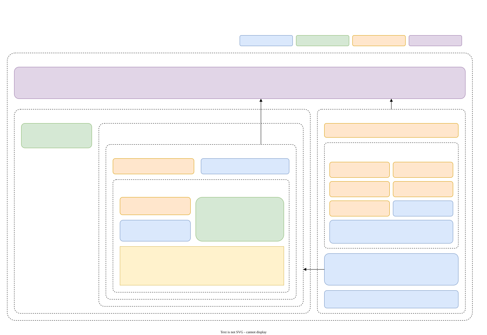
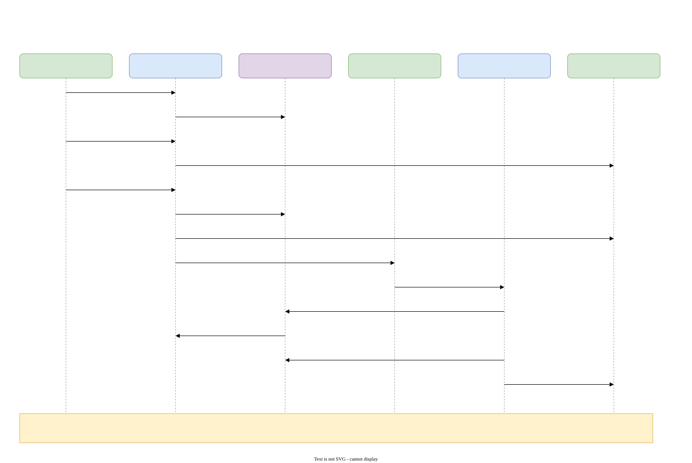
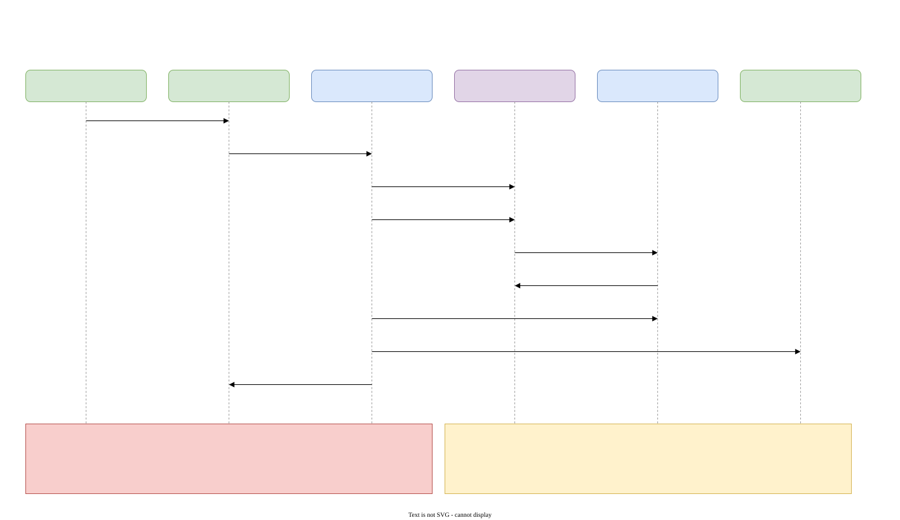

{/* Generated from README.md by website/scripts/sections.mjs: edit that file, then run npm run sections. */}

The menu card is an overlay, not a route. When a row is selected, the package stores the card's bounds and pushes the item's route. The route group's layout renders a fixed-size `Stack` inside an animated container. The container expands from the stored bounds to the full screen, while the inner navigator keeps a constant size and is not laid out again.

Opening: the first frame of the container matches the card and renders the same rows, so the overlay can be hidden without a visible change. The container then expands.

Closing: every dismiss path is intercepted by `usePreventRemove`. The container collapses, and on the frame where its bounds match the card, the card becomes visible and the container is hidden.

State machines, container layers and the animation timeline are described in [Architecture](/expo-morph-menu/guides/architecture/).
