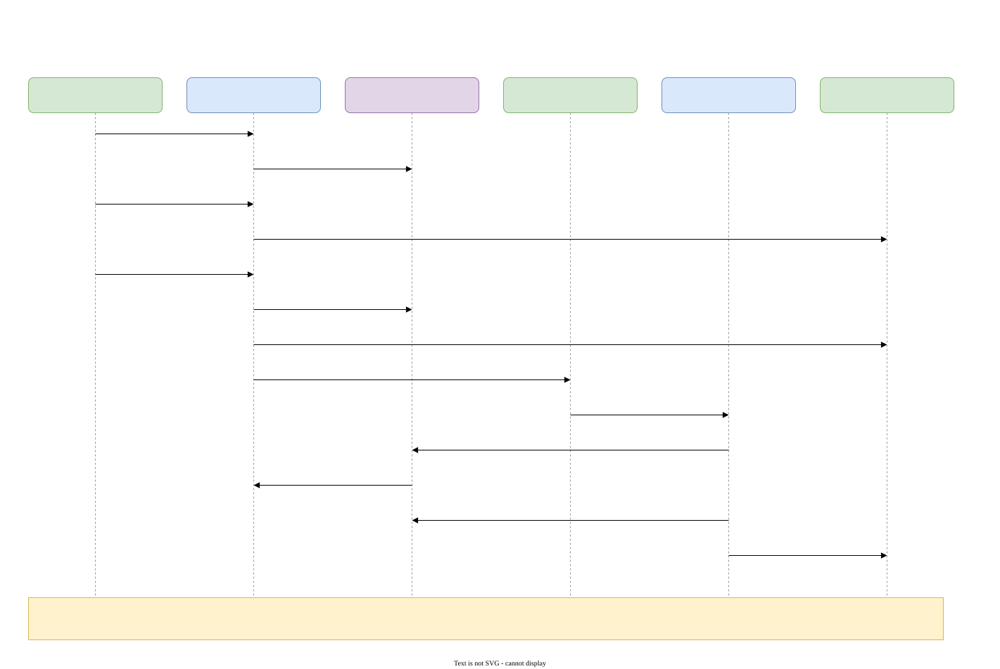
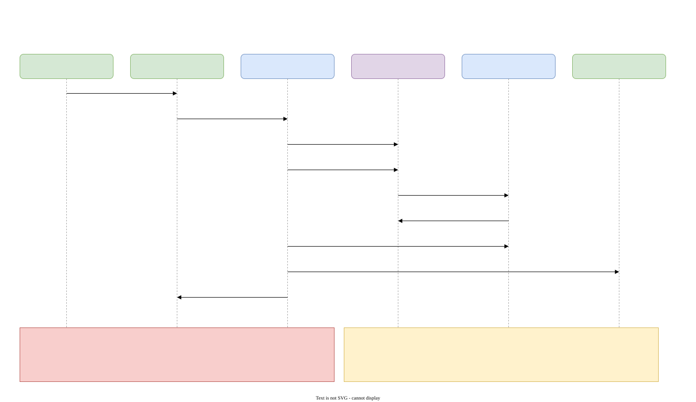
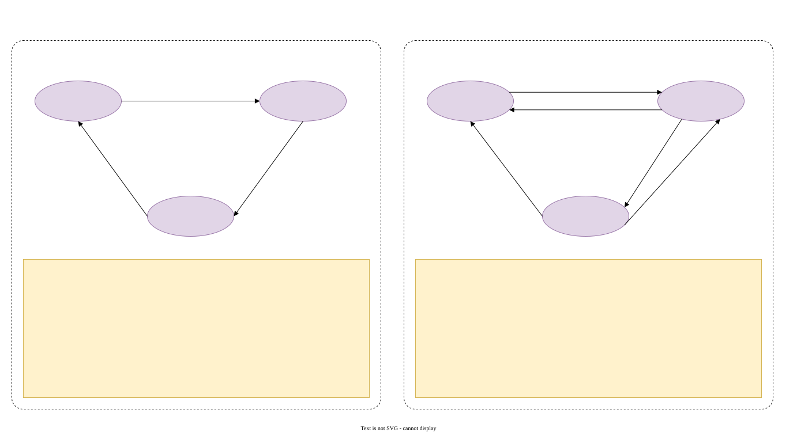
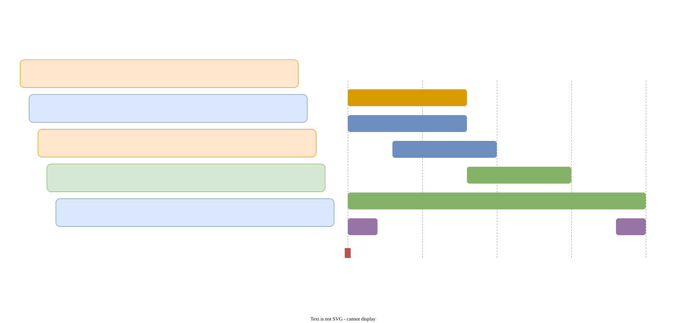
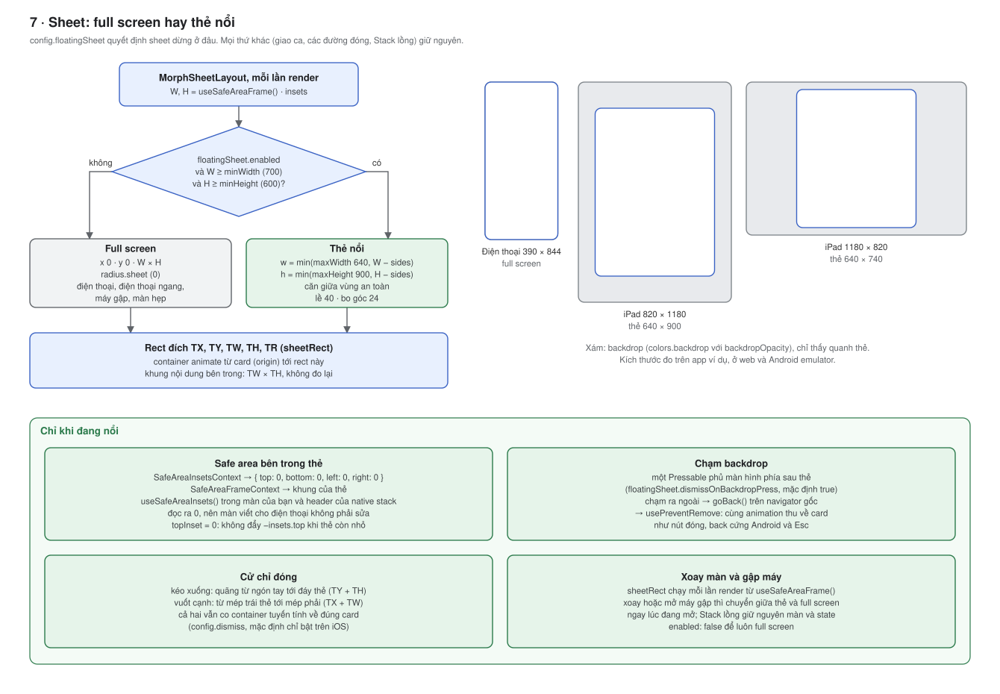

{/* Generated from docs/vi/ARCHITECTURE.md by website/scripts/sections.mjs: edit that file, then run npm run sections. */}

Liên quan: [Hướng dẫn tích hợp](/expo-morph-menu/vi/guides/integration/), [Tùy biến UI](/expo-morph-menu/vi/guides/custom-ui/), [Hiệu năng](/expo-morph-menu/vi/guides/performance/)

Nguồn sơ đồ: [`expo-morph-menu.vi.drawio`](https://github.com/anhtuank7c/expo-morph-menu/blob/main/docs/diagrams/expo-morph-menu.vi.drawio), 7 trang (0 tới 6). Số trang trong tài liệu này tương ứng với file đó. Trang 7 được [`floating-sheet.mjs`](https://github.com/anhtuank7c/expo-morph-menu/blob/main/docs/diagrams/floating-sheet.mjs) sinh thẳng ra SVG, có nhúng mô hình draw.io, nên draw.io vẫn mở được.

`expo-morph-menu` mở rộng một nút nổi thành card menu, và mở rộng một dòng menu thành một route expo-router dạng full screen. Khi route bị đóng, nó thu gọn trở lại thành card. Tài liệu này mô tả cấu trúc của package và lý do của các quyết định thiết kế chính.

## Mục lục

1. [Ranh giới route](#1-ranh-giới-route)
2. [Các module](#2-các-module)
3. [Trạng thái dùng chung](#3-trạng-thái-dùng-chung)
4. [Trình tự mở](#4-trình-tự-mở)
5. [Trình tự đóng](#5-trình-tự-đóng)
6. [Chuyển giao: hoán đổi trong một frame](#6-chuyển-giao-hoán-đổi-trong-một-frame)
7. [Container toàn màn hình](#7-container-toàn-màn-hình)
8. [Thao tác nhập và cử chỉ](#8-thao-tác-nhập-và-cử-chỉ)
9. [Đặc thù trên web](#9-đặc-thù-trên-web)
10. [Hình học](#10-hình-học)
11. [Nguyên tắc hiệu năng](#11-nguyên-tắc-hiệu-năng)
12. [Trace theo frame](#12-trace-theo-frame)
13. [Các phương án đã cân nhắc](#13-các-phương-án-đã-cân-nhắc)
14. [Hạn chế đã biết](#14-hạn-chế-đã-biết)

## 1. Ranh giới route

Một cách triển khai đơn giản là dùng một `Animated.View` duy nhất, animate từ nút sang card rồi sang full screen. View đó không phải là một đích điều hướng: nó không có màn hình con, không xử lý nút back trên Android, không có URL, không có deep link và không khôi phục trạng thái.

Package chia tương tác thành hai phần:

| Phần | Triển khai bằng | Lý do |
| --- | --- | --- |
| Từ nút đến card menu | Overlay (lớp phủ) (`MorphMenu`), không phải route | Một thành phần UI tồn tại ngắn, tương tự context menu. Nó không có URL. Nó vẫn xử lý nút back trên Android và phím Esc |
| Từ card đến full screen | Nhóm route (`MorphSheetLayout`) | Một đích điều hướng cần URL, màn hình con, điều hướng back và khôi phục trạng thái |

Overlay và nhóm route không import lẫn nhau. Chúng chỉ giao tiếp qua `MorphProvider` (trang 1).


## 2. Các module

| Module | Trách nhiệm |
| --- | --- |
| `MorphProvider` | Context: shared value, cấu hình đã resolve, màu sáng và tối, item, layout dòng, slot, callback |
| `MorphMenu` | Overlay: vùng chạm của nút với Pan gesture, card có animation, scrim, các dòng. Được render sau root navigator |
| `MorphSheetLayout` | Layout của nhóm route: container có animation, `Stack` bên trong có kích thước cố định, cử chỉ đóng, `usePreventRemove` |
| `morphSheetScreenOptions` | Option cho nhóm trong root stack: `transparentModal`, `animation: 'none'`, không có header của root stack, tắt cử chỉ native, nền trong suốt |
| `MenuFace` / `DefaultItem` | Các dòng menu, được render trong card và trong container trong lúc chuyển tiếp |
| `MorphCloseButton` | Nút đóng cho các màn hình sheet. Gọi `router.back()` |
| `useMorphSettled()` | Trả về `true` sau khi màn hình full screen đã mở rộng xong |
| `useMorphDismiss()` | Đóng toàn bộ sheet từ bất kỳ màn hình nào trong nhóm. `MorphSheetLayout` đăng ký hàm `goBack` của root navigator vào provider, và giá trị `closeMenu` (tùy chọn) ghi đè `closeMenuOnDismiss` cho riêng lần đóng đó |
| `useMorphProgress()` | Shared value chỉ đọc `{ menu, sheet }` |
| `MorphTrace` | Component debug ghi log mọi frame và đánh dấu các lỗi chuyển giao (hand-off) |

File nguồn trong `src/`:

| File | Nội dung |
| --- | --- |
| `config.ts` | Cấu hình mặc định và bảng màu |
| `geometry.ts` | Hình chữ nhật, offset của dòng, hit testing |
| `visibility.ts` | Độ mờ (opacity) của card và container, dùng chung cho style và `MorphTrace` |
| `constants.ts` | Các trạng thái chuyển giao và ngưỡng tiến trình (progress) |
| `shadow.ts` | Style bóng đổ theo từng platform |
| `Surface.tsx`, `optional.ts` | Liquid Glass, blur và haptics, chỉ được load khi đã cài |
| `web.ts` | Xử lý bàn phím trên web |

## 3. Trạng thái dùng chung

Bốn shared value của Reanimated kết nối overlay và nhóm route:

| Giá trị | Được ghi bởi | Ý nghĩa |
| --- | --- | --- |
| `menu` | Overlay | Từ 0 đến 1: nút mở rộng thành card |
| `sheet` | Nhóm route | Từ 0 đến 1: card mở rộng thành full screen |
| `origin` | Overlay (nhóm route đọc) | Khung bao của card tại thời điểm chọn |
| `handoff` | Cả hai | Bên nào đang render card: `MENU`, `ROUTE` hoặc `RETURNING` |

`origin` giữ cho hai phần độc lập với nhau. Một deep link vào route sheet không có origin, nên container mở rộng từ một hình chữ nhật dự phòng ở giữa màn hình.

`handoff` điều khiển việc hiển thị trong lúc chuyển tiếp. Route được mount bất đồng bộ. Nếu overlay bị ẩn chỉ dựa vào tiến trình, thỉnh thoảng sẽ có một frame không render cả card lẫn route. Overlay chỉ bị ẩn sau khi route đã render frame đầu tiên.

## 4. Trình tự mở

Trang 2.



1. Nhấn vào nút sẽ animate `menu` lên 1 và đặt chế độ thành `open`. Vùng chạm vẫn hoạt động cho đến khi kết thúc lần nhấn (xem [mục 8](#8-thao-tác-nhập-và-cử-chỉ)).
2. Di chuyển con trỏ qua các dòng (hover chuột trên web) sẽ highlight dòng đó và gọi `onHover(item)`.
3. Người dùng thả con trỏ trên một dòng, hoặc chạm vào một dòng. Nếu card chưa mở rộng xong (`menu < 0.995`), việc chọn được hoãn đến khi card mở rộng xong. Nếu không, container sẽ bắt đầu từ khung bao mà card chưa đạt tới.
4. Overlay đặt `origin` bằng khung bao của card và `handoff` thành `MENU`, gọi `onSelect(item)`, sau đó gọi `router.push(item.href)`.
5. Route được mount mà không có transition native. Frame đầu tiên của nó là container tại khung bao của card, render cùng các dòng menu (`MenuFace`).
6. Route đặt `handoff` thành `ROUTE` (native: trong `onLayout` của container; web: trong `useLayoutEffect`), và card của overlay bị ẩn. Các pixel trên màn hình không thay đổi.
7. `sheet` animate lên 1. Container mở rộng, nội dung màn hình hiện dần và các dòng menu mờ dần.
8. Khi spring kết thúc, `useMorphSettled()` trả về `true`.

Mọi cập nhật hiển thị đều chạy trên UI thread. JavaScript chỉ push route và gọi các callback.

## 5. Trình tự đóng

Trang 3.



Mọi cách đóng đều trở thành một action remove của điều hướng, và `usePreventRemove` chặn action đó: nút đóng hoặc `router.back()`, nút back phần cứng trên Android, nút back của trình duyệt, phím Esc trên web, và cử chỉ vuốt từ mép trái hoặc kéo xuống trên iOS. Vì vậy animation thu gọn chỉ được triển khai ở một chỗ:

1. `handoff` được đặt thành `RETURNING` và `sheet` animate về 0, bắt đầu từ giá trị hiện tại, nên một cử chỉ đã di chuyển container sẽ không gây ra bước nhảy.
2. Container thu gọn, nội dung màn hình mờ dần và các dòng menu hiện dần.
3. Ở frame đầu tiên mà `sheet <= 0.005` (`ARRIVED`), khung bao của container lệch so với card không quá 1 dp. Trong frame đó, opacity của container trở thành 0 và opacity của card trở thành 1.
4. Với `closeMenuOnDismiss: false` (mặc định), scrim hiện lại và menu vẫn mở. Với `true`, card thu gọn về nút.
5. Khi spring kết thúc, `sheetDismissed()` cập nhật React state của overlay, `onSheetDismissed(item)` được gọi, và action điều hướng ban đầu tiếp tục.

`handoff` giữ giá trị `RETURNING` sau khi route unmount. Android xóa view native bất đồng bộ, và nếu reset giá trị sớm hơn thì container sẽ hiện thêm một frame. Lần chọn tiếp theo sẽ reset giá trị này.

## 6. Chuyển giao: hoán đổi trong một frame

Trang 4.



Một phiên bản trước đây crossfade container và card trong 12% cuối của tiến trình. Một ảnh chụp màn hình giữa lúc đóng cho thấy hai bản sao trong suốt một phần của menu lệch nhau vài dp, với chữ bị nhân đôi. Phiên bản hiện tại hoán đổi hai lớp trong một frame, tại thời điểm khung bao của chúng trùng nhau. Cả hai lớp đọc cùng một giá trị `sheet` trong cùng một frame UI, nên một frame bị rớt (dropped frame) không thể làm chúng lệch nhau.

Thứ tự lớp phụ thuộc vào nền tảng:

- iOS: một `transparentModal` được hiển thị phía trên root view, nên route che overlay. Card không bị ẩn. Việc ẩn card cũng được tránh vì `UIVisualEffectView` (được Liquid Glass và blur sử dụng) không render đúng khi opacity nhỏ hơn 1.
- Android và web: các màn hình và overlay dùng chung một cây view, và overlay được khai báo sau navigator, nên nó nằm trên cùng. Overlay phải bị ẩn khi route đang hiển thị.

## 7. Container toàn màn hình

Trang 5.



```tsx
<Animated.View style={shell}>                       // x, y, width, height và radius thay đổi mỗi frame
  <Animated.View style={{ width: W, height: H }}>   // kích thước cố định, định vị tuyệt đối
    <Stack />                                        // không tính layout lại trong lúc animation
  </Animated.View>
</Animated.View>
```

Nếu `Stack` bên trong thay đổi kích thước cùng container, mỗi frame sẽ kích hoạt một lượt tính layout trên toàn bộ cây màn hình. Với một view bên trong có kích thước cố định và bị cắt bởi `overflow: hidden`, chỉ node container được tính layout lại. Vì navigator bên trong là một native stack thông thường, các màn hình con dùng animation push native, cử chỉ vuốt back native và nút back trên Android.

Các lớp bên trong container và khoảng animation của chúng (tiến trình 0 là card, 1 là full screen):

| Lớp | Khoảng tiến trình | Thay đổi |
| --- | --- | --- |
| Slot `Background` (variant `sheet`) | Từ 0 đến 0.4 | Opacity từ 1 về 0 |
| Màu nền của container | Từ 0 đến 0.4 | Từ màu card sang `colors.sheetBackground` |
| `MenuFace` (các dòng neo vào góc card) | Từ 0.15 đến 0.5 | Opacity từ 1 về 0 |
| Nội dung màn hình | Từ 0.4 đến 0.75 | Opacity từ 0 lên 1 |
| Nội dung màn hình | Từ 0 đến 1 | translateY từ `-insets.top` về 0 |
| Bóng đổ | Từ 0 đến 0.1 và từ 0.9 đến 1 | Hiện dần và mờ dần. Tắt ở khoảng giữa |

Nội dung được neo vào góc trên bên trái của container. Ở kích thước card, phần nhìn thấy được sẽ là vùng status bar trống, nên nội dung được dịch lên trên một khoảng `insets.top` khi container còn nhỏ.

Kích thước lấy từ `useSafeAreaFrame()`, không phải `useWindowDimensions()`. Với chế độ edge-to-edge trên Android, kích thước cửa sổ không bao gồm thanh điều hướng, và container sẽ không chạm tới mép dưới.

### Thẻ nổi trên màn hình rộng

Trang 7.



Container không phải lúc nào cũng dừng ở full screen. Mỗi lần render, `sheetRect()` trong `geometry.ts` tính rect đích từ khung màn hình, safe area insets và `config.floatingSheet`:

- Khi `floatingSheet.enabled` là true và màn hình rộng ít nhất `minWidth` (700), cao ít nhất `minHeight` (600), đích là một thẻ căn giữa vùng an toàn: tối đa `maxWidth` × `maxHeight` (640 × 900), cách mép ít nhất `margin` (40), bo góc `floatingSheet.radius` (24). Trên iPad dọc là 640 × 900, iPad ngang là 640 × 740.
- Còn lại là full screen với `radius.sheet`. Điện thoại, điện thoại xoay ngang và máy gập khi gập vẫn full screen.

Container animate từ card tới rect đích, và khung nội dung bên trong có đúng kích thước của đích. Mọi thứ khác giống nhau ở cả hai chế độ: giao ca, các đường đóng và `Stack` lồng kích thước cố định. Thẻ nổi khác ở bốn điểm:

| Phần | Hành vi |
| --- | --- |
| Safe area | Các màn bên trong nhận `SafeAreaInsetsContext` với mọi inset bằng 0 và `SafeAreaFrameContext` là khung của thẻ. Vì vậy `useSafeAreaInsets()` và header của native stack đọc ra 0, màn viết cho điện thoại dùng được mà không phải sửa. Độ đẩy nội dung `-insets.top` cũng bằng 0 |
| Backdrop | `colors.backdrop` với `backdropOpacity` vẫn hiện quanh thẻ. Với `dismissOnBackdropPress` (mặc định), một `Pressable` phía sau thẻ gọi `goBack()`, đi qua `usePreventRemove` như mọi đường đóng khác |
| Cử chỉ | Kéo xuống tính quãng từ ngón tay tới đáy thẻ (`TY + TH`), vuốt cạnh tính tới mép phải thẻ (`TX + TW`) |
| Đổi kích thước | Xoay màn hoặc mở máy gập lúc sheet đang mở sẽ chuyển giữa thẻ và full screen. Provider safe area luôn được render, mang giá trị của màn hình khi full screen, nên cây giữ nguyên cấu trúc và `Stack` lồng giữ nguyên màn con và state |

## 8. Thao tác nhập và cử chỉ

| Thao tác | iOS | Android | Web |
| --- | --- | --- | --- |
| Mở menu | Chạm hoặc nhấn | Chạm hoặc nhấn | Nhấp chuột hoặc nhấn |
| Chọn một dòng | Chạm vào dòng, hoặc nhấn giữ và kéo từ nút | Giống iOS | Nhấp chuột vào dòng, hoặc nhấn giữ và kéo |
| `onHover` | Trong lúc kéo | Trong lúc kéo | Trong lúc kéo hoặc hover chuột |
| Đóng menu | Chạm vào scrim | Chạm vào scrim, nút back phần cứng | Nhấp chuột vào scrim, phím Esc |
| Đóng full screen | Nút đóng, vuốt từ mép trái (1), kéo xuống (1) | Nút đóng, nút back phần cứng | Nút đóng, phím Esc (2), nút back của trình duyệt |

(1) Được điều khiển bởi `config.dismiss`. Mặc định bật trên iOS và tắt trên Android. Vuốt từ mép trái chỉ hoạt động ở màn hình gốc của nhóm. Ở các màn hình con, mép trái được dùng cho cử chỉ vuốt back native.
(2) Chỉ ở màn hình gốc của nhóm.

Một lần chạm được thả tại chỗ không bao giờ chọn dòng. Nút nằm bên trong vùng của dòng cuối cùng trong card, và nếu không có quy tắc này thì một lần chạm hơi lâu sẽ chọn dòng đó.

Xử lý chạm (trang 4, phía bên phải): ở chế độ `route`, overlay không nhận chạm và không xử lý sự kiện back. Trên các platform mà overlay nằm trên cùng, nếu không có quy tắc này thì scrim của overlay sẽ chặn các lần chạm vào nút đóng.

## 9. Đặc thù trên web

Các vấn đề sau được phát hiện trong quá trình kiểm thử trên Chrome. Package xử lý từng vấn đề:

- Pointer capture: Gesture Handler không gọi `setPointerCapture` khi view của gesture có `role="button"`. Không có pointer capture, một thao tác kéo ra khỏi nút sẽ không bao giờ gửi `pointerup` tới nút, và gesture không kết thúc. Trên web, role được đặt trên một phần tử bên trong.
- Vùng chạm trong lúc nhấn: một phần tử chuyển sang `pointer-events: none` trong lúc nhấn sẽ không nhận `pointerup`. Nút giữ vùng chạm cho đến khi kết thúc lần nhấn.
- Thời điểm chuyển giao: trên web, `onLayout` được triển khai bằng `ResizeObserver` và đến trễ vài frame. Vì vậy route đặt `handoff` trong `useLayoutEffect`.
- Hộp thoại "Leave site?": `usePreventRemove` chặn việc unload trang khi full screen đang mở. Package gọi `disablePrevention()`, do hook trả về, trong một listener `beforeunload` được đăng ký trước listener của React Navigation.
- Bóng đổ: React Native Web chỉ tạo `box-shadow` đúng khi tất cả thuộc tính `shadow*` nằm trong cùng một style object. Với `shadowOpacity` có animation thì điều này không đúng, nên trên web package đặt trực tiếp `boxShadow`.
- Phím Esc dùng để đóng, hover chuột kích hoạt `onHover`, và việc chọn văn bản bị tắt trong lúc kéo.

## 10. Hình học

Mọi hình chữ nhật đều được tính toán, không đo (`geometry.ts`). Việc đo là bất đồng bộ, nên frame đầu tiên sẽ dùng giá trị sai. Chiều cao dòng lấy từ `layout.rowHeight` hoặc `itemHeight(item, index)`. `listLayout()` chuyển chúng thành offset của dòng, được dùng bởi card, bởi các dòng menu bên trong container, bởi hit testing khi kéo (`rowAt`) và bởi highlight. Với `anchor: 'bottom-left'`, mọi vị trí được lật theo chiều ngang.

## 11. Nguyên tắc hiệu năng

- Cập nhật hiển thị không chờ JavaScript. Callback của spring và `useAnimatedReaction` chạy chuyển giao trên UI thread. Menu phản hồi ngay trong frame mà container chạm tới card, thay vì chờ spring dừng hẳn, việc này mất thêm khoảng 7 frame dao động quanh 0.
- Nội dung màn hình tốn chi phí được mount sau khi `useMorphSettled()` trả về `true`. Nội dung không bị unmount khi animation thu gọn bắt đầu.
- Bóng đổ bị tắt khi khung bao thay đổi mỗi frame.
- `MorphProvider` memoize cấu hình theo giá trị, nên một object inline `config={{...}}` không làm các consumer render lại.

Số liệu đo và lịch sử của từng bản sửa: [Hiệu năng](/expo-morph-menu/vi/guides/performance/).

## 12. Trace theo frame

`<MorphTrace enabled />` ghi một dòng log cho mỗi frame có giá trị thay đổi:

```
[morph] f=56 m=1.000 s=0.002 h=2 ov=1.00 sh=0.00 handoff
```

| Trường | Ý nghĩa |
| --- | --- |
| `f` | Số thứ tự frame |
| `m`, `s` | Tiến trình `menu` và `sheet` |
| `h` | Trạng thái `handoff` |
| `ov`, `sh` | Opacity được render của card và container, tính bằng cùng các hàm dùng cho style |

| Cờ | Điều kiện |
| --- | --- |
| `handoff` | Lần hoán đổi dự kiến giữa card và container |
| `FLICKER` | Bất kỳ thay đổi opacity nào khác lớn hơn 0.5 trong một frame |
| `HOLE` | Không lớp nào hiển thị trong khi route đang hiện |
| `GHOST` | Cả hai lớp đều hiển thị một phần trong khi khung bao của chúng khác nhau |
| `OVERLAP` | Card vẫn che một container đang di chuyển |
| `DROP(n)` | Frame mất `n` ms |

Bộ chạy kiểm thử end-to-end (E2E) của ứng dụng ví dụ báo lỗi khi gặp bất kỳ cờ lỗi nào. Xem [Hướng dẫn tích hợp: Kiểm thử](/expo-morph-menu/vi/guides/integration/#kiểm-thử).

## 13. Các phương án đã cân nhắc

- Thư viện shared element hoặc zoom transition, ví dụ `react-native-screen-transitions`: ít code hơn, nhưng thêm một dependency và thường dùng stack chạy bằng JavaScript. Phù hợp khi toàn bộ ứng dụng cần transition tùy biến.
- Shared element transition của Reanimated: ít code, và giữ được native stack. Tính năng này tương tác với các cử chỉ back bị chặn bởi `usePreventRemove`, mà package này phụ thuộc vào. Hãy kiểm tra trạng thái của tính năng trong phiên bản Reanimated bạn dùng trước khi sử dụng.
- Một overlay duy nhất cho toàn bộ tương tác: bị loại vì các lý do ở [mục 1](#1-ranh-giới-route).

Các platform native dùng cách tiếp cận tương tự: ẩn nguồn và đích, animate một view trung gian giữa hai khung bao, sau đó hiện đích. Trên iOS, SwiftUI cung cấp `matchedTransitionSource` cùng `.navigationTransition(.zoom)` cho transition giữa một view và một đích điều hướng. Trong Jetpack Compose, `SharedTransitionLayout` giữ cả hai đầu trong một cây, giống như package này.

## 14. Hạn chế đã biết

- iOS chưa được kiểm chứng trên thiết bị thật. Vuốt từ mép, Liquid Glass và blur chưa được kiểm thử. Android và web được bao phủ bởi kiểm thử end-to-end và trace theo frame.
- Xoay màn hình khi full screen đang mở: `origin` lưu tọa độ tuyệt đối và trở nên không hợp lệ sau khi xoay. Hãy khóa hướng màn hình cho nhóm, hoặc lưu kích thước màn hình cùng hình chữ nhật rồi quy đổi.
- Một menu cho mỗi ứng dụng: `origin` là một hình chữ nhật duy nhất. Nhiều menu sẽ cần một map với key là route.
- Khả năng truy cập: các dòng dùng role `menuitem` và mọi thao tác kéo đều có cách thay thế bằng chạm. Chưa triển khai thông báo cho trình đọc màn hình khi mở và đóng.
- Lồng sâu hơn: nếu stack bên trong chứa tab hoặc modal riêng, hãy kiểm tra thời điểm `usePreventRemove` được kích hoạt. Nó chỉ được kích hoạt khi stack bên trong đang ở màn hình gốc.
