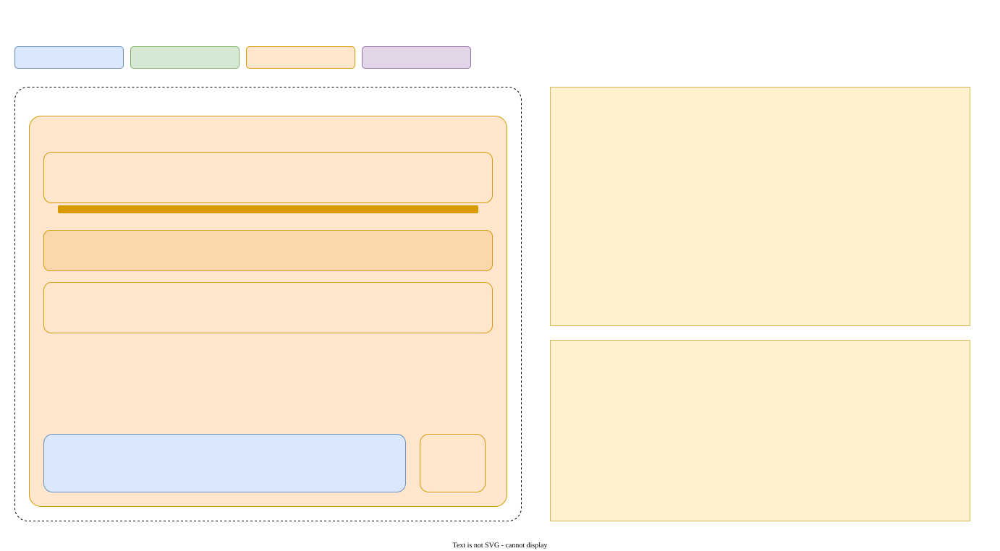

{/* Generated from README.vi.md by website/scripts/sections.mjs: edit that file, then run npm run sections. */}

import Demo from '~/components/Demo.astro';
import Source from '~/components/Source.astro';

<Demo route="?anchor=left">

Cùng app đó với `anchor: 'bottom-left'`. Mỗi tuỳ chọn trong bảng bên dưới là một dòng trong `config`.

</Demo>

Mọi tùy chọn đều không bắt buộc. Chỉ truyền những giá trị bạn muốn ghi đè.

```tsx
<MorphProvider
  items={items}
  config={{
    closeMenuOnDismiss: false,         // giữ menu mở sau khi đóng full screen
    anchor: 'bottom-right',            // hoặc 'bottom-left'
    layout: { fabSize: 56, cardWidth: 236, rowHeight: 46, padding: 10, margin: 20, iconSize: 15 },
    radius: Platform.select({ ios: { card: 28 }, android: { card: 16 } }),
    shadow: { elevation: 8 },          // Android: elevation. iOS và web: color, opacity, radius, offsetY
    dismiss: { edgeSwipe: true, dragDown: false },
    spring: { duration: 460, dampingRatio: 0.85 },
    haptics: true,
    surface: 'auto',                   // 'glass' | 'blur' | 'solid'
    colorScheme: 'auto',               // 'light' | 'dark'
    backdropOpacity: 0.25,
    floatingSheet: { minWidth: 700, maxWidth: 640 }, // màn rộng: thẻ nổi ở giữa
    colors: { dark: { surface: '#202022' } },
  }}
/>
```

| Tùy chọn | Mặc định (iOS / Android) | Mô tả |
| --- | --- | --- |
| `closeMenuOnDismiss` | `false` | `true` thu gọn card về nút sau khi full screen được đóng |
| `anchor` | `'bottom-right'` | Góc màn hình đặt nút |
| `layout.*` | `56 / 236 / 46 / 10 / 20 / 15 / 1` | Kích thước nút, chiều rộng card, chiều cao dòng, padding của danh sách, lề màn hình (cộng thêm vào inset safe area phía dưới), kích thước icon của dòng, chiều cao đường phân cách |
| `radius.card` / `radius.sheet` / `radius.fab` | `28` / `0` / `null` | Bán kính bo góc của card, của full screen và của nút (`null` render hình tròn) |
| `shadow` | opacity `0.18`, radius `18`, offsetY `8` / elevation `10` | Bóng đổ khi đứng yên. Bị tắt trong lúc khung đang chạy animation |
| `dismiss.edgeSwipe` | `true` / `false` | Vuốt từ mép trái. Chỉ hoạt động trên màn hình gốc của nhóm sheet, nên các màn hình lồng nhau giữ cử chỉ vuốt back native |
| `dismiss.dragDown` | `true` / `false` | Kéo xuống để đóng |
| `spring` | `460` ms, `0.85` | Thời lượng và hệ số damping của spring. Tôn trọng cài đặt Reduce Motion |
| `haptics` | `true` | Cần `expo-haptics` |
| `surface` | `'auto'` | Thứ tự chọn: Liquid Glass (iOS 26+), blur (iOS), solid |
| `colorScheme` | `'auto'` | Theo cài đặt hệ thống |
| `floatingSheet` | bật từ `700` × `600` pt, tối đa `640` × `900`, lề `40`, bo góc `24` | Trên màn rộng (iPad, điện thoại gập khi mở, web desktop), full screen thành một thẻ nổi ở giữa màn, như form sheet của iPadOS. Chạm ra ngoài thẻ để đóng (`dismissOnBackdropPress`). Bên trong thẻ, `useSafeAreaInsets()` trả về 0 và `useSafeAreaFrame()` trả về khung thẻ. `enabled: false` để luôn full screen |
| `colors.light` / `colors.dark` | `LIGHT_COLORS` / `DARK_COLORS` | `surface`, `sheetBackground`, `text`, `scrim`, `backdrop`, `highlight`, `fabIcon`, `closeBackground`, `closeIcon`, `iconForeground` |

### Icon

Icon của dòng (`item.icon`), icon của nút (`fabIcon`) và icon của nút đóng (`closeIcon` hoặc `<MorphCloseButton icon>`) nhận một `MorphIcon`:

```tsx
icon: <Ionicons name="camera" size={15} color="#fff" />,   // React element (icon font, SVG)
icon: <CameraSvg width={15} height={15} />,                 // component SVG (react-native-svg)
icon: require('./camera.png'),                              // ảnh đóng gói cùng ứng dụng
icon: { uri: 'https://example.com/camera.png' },            // ảnh từ xa
icon: ({ size, color }) => <Ionicons name="camera" size={size} color={color} />,
```

Dạng hàm nhận kích thước và màu theme tương ứng với vị trí của nó:

| Vị trí | `size` | `color` |
| --- | --- | --- |
| Icon của dòng | `layout.iconSize` | `colors.iconForeground` |
| Nút | `26` | `colors.fabIcon` |
| Nút đóng | `size * 0.56` | `colors.closeIcon` |

Ảnh một màu được tô bằng màu đó. Với ảnh nhiều màu, đặt `iconTint: false` trên item hoặc `tintImage={false}` trên nút đóng.

```tsx
<MorphProvider
  items={items}
  fabIcon={({ size, color }) => <Ionicons name="add" size={size} color={color} />}
  closeIcon={require('./close.png')}   // icon mặc định cho mọi MorphCloseButton
/>

<MorphCloseButton />
<MorphCloseButton icon={<CloseSvg />} size={40} backgroundColor="transparent" />
```

Props của `MorphCloseButton`: `icon`, `size` (mặc định `32`), `iconSize`, `color`, `backgroundColor`, `tintImage`, `style` và mọi prop của `Pressable`. Nó gọi `router.back()` trừ khi `onPress` gọi `e.preventDefault()`.

### Slot



Package quản lý các container có animation (kích thước, vị trí, bán kính bo góc, cắt nội dung) cùng với cử chỉ và logic chuyển giao (hand-off). Mỗi phần hiển thị có thể được thay thế qua `components`:

```tsx
import { MorphProvider, type MorphComponents } from 'expo-morph-menu';

const components: MorphComponents = {
  Background: () => <Card elevation={0} style={StyleSheet.absoluteFill} />,
  Item: ({ item }) => <ListItem title={item.label} subtitle={item.data?.subtitle} />,
  Trigger: () => <Icon name="plus" />,
  Separator: () => <Divider />,
  Scrim: () => <BlurView intensity={20} style={StyleSheet.absoluteFill} />,
  Backdrop: () => <View style={{ flex: 1, backgroundColor: '#000' }} />,
  Highlight: null,                     // Item tự render trạng thái hover
};

<MorphProvider
  items={items}
  components={components}
  itemHeight={(item) => (item.data?.subtitle ? 58 : 46)}
/>
```

| Slot | Props | Mặc định |
| --- | --- | --- |
| `Background` | `variant` (`'menu'` hoặc `'sheet'`), `progress`, `colors` | Liquid Glass, blur hoặc màu đặc `colors.surface` |
| `Item` | `item`, `index`, `variant`, `hovered`, `height`, `colors` | `DefaultItem`: icon trong vòng tròn màu `tint` và một nhãn |
| `Trigger` | `progress`, `size`, `colors` | `fabIcon` hoặc "+", xoay 45 độ và mờ dần khi mở |
| `Highlight` | `hovered`, `colors`. Truyền `null` để tắt | Hình chữ nhật bo góc màu `colors.highlight` |
| `Separator` | `index`, `colors` | Không có |
| `Scrim` / `Backdrop` | `progress`, `colors`. Độ mờ (opacity) do package animate | `colors.scrim` / `colors.backdrop` |

Component slot phải tuân theo bốn quy tắc:

1. `Item` và `Background` là thuần (pure). Chúng được render hai lần, trong card và trong container toàn màn hình trong lúc chuyển cảnh, và hai bản phải cho ra cùng kết quả.
2. Slot không tự animate kích thước hay vị trí của mình. Dùng `progress` và `hovered` (shared value của Reanimated) để animate opacity, màu hoặc góc xoay.
3. Chiều cao dòng được biết trước: `layout.rowHeight` hoặc một hàm thuần `itemHeight(item, index)`. Các dòng không được đo.
4. `Background` phải đục (không trong suốt), vì card và container toàn màn hình hoán đổi trong một frame.

Chi tiết và ví dụ cho NativeWind, Tamagui, React Native Paper và Unistyles: [Giao diện tùy chỉnh](/expo-morph-menu/vi/guides/custom-ui/).

### Callback

| Prop | Được gọi khi |
| --- | --- |
| `onHover(item)` | Con trỏ di chuyển vào một dòng. Dùng nó để prefetch dữ liệu |
| `onSelect(item)` | Một dòng được chọn, trước khi điều hướng |
| `onOpen()` / `onClose()` | Menu bắt đầu mở hoặc đóng |
| `onSheetDismissed(item)` | Full screen đã thu gọn xong |
