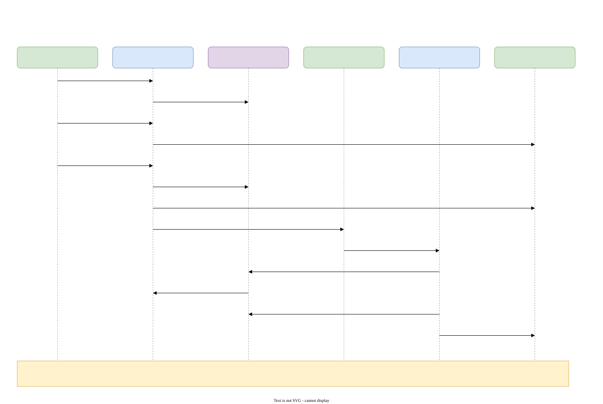
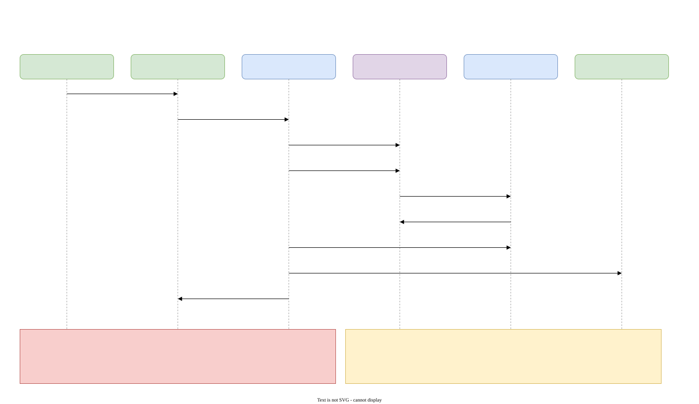

{/* Generated from README.vi.md by website/scripts/sections.mjs: edit that file, then run npm run sections. */}

Card menu là một overlay, không phải route. Khi một dòng được chọn, package lưu khung của card và push route của item. Layout của nhóm route render một `Stack` có kích thước cố định bên trong một container có animation. Container mở rộng từ khung đã lưu ra toàn màn hình, trong khi navigator bên trong giữ kích thước không đổi và không phải tính layout lại.

Mở: frame đầu tiên của container trùng với card và render cùng các dòng, nên overlay có thể được ẩn mà không có thay đổi nào nhìn thấy được. Sau đó container mở rộng.

Đóng: mọi đường đóng đều bị chặn bởi `usePreventRemove`. Container thu gọn, và tại frame mà khung của nó trùng với card, card được hiện ra và container bị ẩn.

Máy trạng thái, các lớp của container và dòng thời gian animation được mô tả trong [Kiến trúc](/expo-morph-menu/vi/guides/architecture/).
